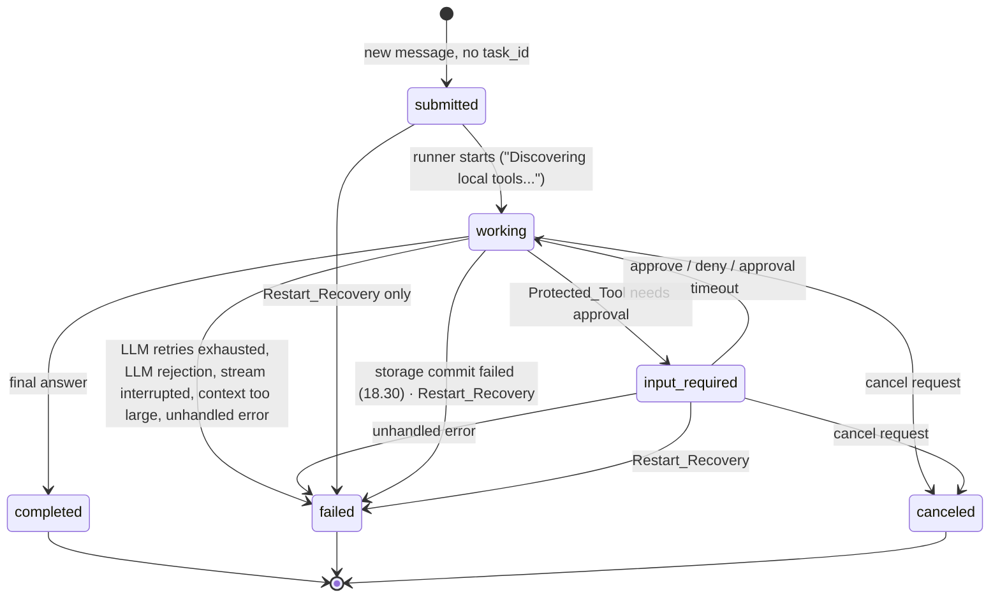

# Design Document: Local Agent Backend

## Overview

The Local Agent Backend is a single Python 3.14+ asyncio process (CPython standard GIL build) that runs on Windows, macOS, and Linux and bridges three protocols:

- **A2A (frontend)**: the Chat_App talks to the Backend through the official `a2a-sdk` server stack (JSON-RPC, REST, SSE).
- **LiteLLM (reasoning)**: the Orchestrator streams chat completions with function calling from a local model (Ollama, vLLM, any OpenAI-compatible base URL).
- **MCP (tools)**: the MCP_Client keeps long-lived sessions with configured stdio/SSE MCP_Servers, discovers their tools, and executes Tool_Calls.
- **Persistent storage**: Contexts, Message_Histories, Tasks, and artifacts live in one SQLite database (`local-agent.db`) in a per-user Storage_Directory, so conversations and Task results survive restarts (Requirement 18). One writer thread owns the only connection. The A2A Task_Store is a projection over the same rows, so every state change commits to both stores in one transaction. `storage.backend: memory` keeps everything in process memory and touches no files.

The design keeps protocol-heavy code thin and pushes decision logic into small pure modules (naming, schema translation, stream assembly, result formatting, history trimming, approval parsing, pattern matching, config substitution, redaction, restart-recovery planning, retention selection, schema-version classification, and the OS rules in `oscompat`: path resolution, default storage directory, executable lookup, command-line quoting, environment-name matching, bind planning, termination planning). Every OS-specific pure function takes the platform as a parameter, so the Windows rules are property-tested on Linux runners too, and vice versa. Those pure modules carry the correctness properties and are tested with Hypothesis; the I/O shells around them get example-based and integration tests.

### Research findings that shape the design

| Topic | Finding | Design consequence |
|---|---|---|
| `a2a-sdk` server API | Current releases (1.2.x on PyPI) build servers from route factories (`create_agent_card_routes`, `create_jsonrpc_routes`, `create_rest_routes`) mounted on a plain Starlette app, with `DefaultRequestHandler(agent_executor, task_store, agent_card, ...)` and `InMemoryTaskStore` ([A2A tutorial: Start Server](https://a2a-protocol.org/latest/tutorials/python/5-start-server/)). Older 0.3.x releases expose `A2AStarletteApplication`. | `app.py` builds a Starlette app from the route factories so we can add our own middleware (auth, loopback guard, CORS) and the `/health` route. A thin `a2a_compat.py` shim inside `a2a_server/` isolates naming differences if the pinned version changes. |
| `AgentExecutor` | `execute(context: RequestContext, event_queue: EventQueue)` and `cancel(context, event_queue)`; `TaskUpdater(event_queue, task_id, context_id)` emits status and artifact events; task state enum values are `TASK_STATE_*` in 1.x ([A2A tutorial: Agent Executor](https://a2a-protocol.org/latest/tutorials/python/4-agent-executor/)). | `HostAgentExecutor` adapts SDK calls to our `TaskRunner`. All SDK enum names are mapped in one place (`events.py`). |
| SDK-handled protocol errors | `DefaultRequestHandler` already returns task-not-found, task-not-cancelable, terminal-state, JSON-RPC parse/invalid-request/method-not-found/invalid-params errors. | Requirements 1.9, 2.8, 2.11, 2.12 are satisfied by the SDK and covered by integration tests; we add only the Context-busy and approval checks in a `HostRequestHandler` subclass. |
| SDK request handler internals (1.2.x line, read from `main`) | `DefaultRequestHandler` is an alias of `DefaultRequestHandlerV2` ([`request_handlers/__init__.py`](https://github.com/a2aproject/a2a-python/blob/main/src/a2a/server/request_handlers/__init__.py)). It runs each Task in an `ActiveTask` with a producer (calls `AgentExecutor.execute`) and a consumer that saves every event through the `TaskStore` and only then forwards it to subscribers ([`active_task.py`](https://github.com/a2aproject/a2a-python/blob/main/src/a2a/server/agent_execution/active_task.py)). The executor must enqueue a `Task` before any status event; a `Task` event for an existing task is logged at error level ("Task … already exists. Ignoring task replacement.") and the stored task is forwarded. Message streams subscribe with `include_initial_task=False`, so the first SSE event is whatever the executor enqueues first. A plain `TaskStore` is wrapped in `LegacyTaskStoreAdapter` (no versioning) ([`cluster/task_store.py`](https://github.com/a2aproject/a2a-python/blob/main/src/a2a/server/cluster/task_store.py)). `on_cancel_task` rejects tasks the store reports terminal and, for a non-terminal task with no local `ActiveTask`, writes `CANCELED` straight into the store. | The executor always enqueues a Task_Snapshot first (3.10). Task creation is the `TaskStore.save()` of that first snapshot, so the SDK's own save-before-forward ordering gives persist-before-emit for creation (11.2, 18.30). `HostRequestHandler.on_cancel_task` guards the direct-write path. The "already exists" log line is filtered to debug for continuation snapshots. These are SDK internals, so each is pinned by an integration test against the locked version. |
| SDK `DatabaseTaskStore` | Ships behind the `sqlite`/`sql` extras (`sqlalchemy[asyncio,aiosqlite]>=2.0`) ([PyPI metadata for 1.2.3](https://pypi.org/project/a2a-sdk/)). It takes an `AsyncEngine` and opens a **new session and transaction per call** (`async with self.async_session_maker.begin()` in `save` and `delete`), stores the whole Task (status, artifacts, history) as JSON in its own `tasks` table with an `owner` column, and creates that table itself unless `create_table=False` ([`database_task_store.py`](https://github.com/a2aproject/a2a-python/blob/main/src/a2a/server/tasks/database_task_store.py)). | Rejected. It cannot join our transaction, so 18.8 (one transaction for both stores) and 18.9 (store agreement after a kill) cannot hold. It also writes after our event is enqueued, duplicates the artifact text in a second JSON copy, and would bring its own table into our migration scheme. The Backend implements `ProjectedTaskStore(TaskStore)` over the Session_Store rows instead (key decision 8). |
| SQLAlchemy / greenlet / aiosqlite wheels | `greenlet` publishes `cp314` wheels from 3.2.3 for `win_amd64`, `macosx_11_0_universal2` (arm64 and x86_64), and `manylinux_2_17`/`2_28` x86_64 and aarch64 ([PyPI file list](https://pypi.org/simple/greenlet/)). Wheel availability is therefore not the blocker. | Not needed: no SQLAlchemy, greenlet, or aiosqlite in the dependency tree. Fewer compiled dependencies to lock across five platforms. |
| stdlib `sqlite3` on 3.14 | `sqlite3.connect(..., autocommit=True)` (3.12+) turns off implicit transactions, so explicit `BEGIN IMMEDIATE` / `COMMIT` / `ROLLBACK` control the transaction. Connections may only be used from the creating thread unless `check_same_thread=False`. The default datetime adapters are deprecated since 3.12 ([sqlite3 docs](https://docs.python.org/3.14/library/sqlite3.html)). aiosqlite uses the same model: one shared thread per connection ([aiosqlite](https://github.com/omnilib/aiosqlite)). | `storage/database.py` owns one connection on one dedicated thread (`ThreadPoolExecutor(max_workers=1)`), opened with `autocommit=True` and explicit `BEGIN IMMEDIATE`. Timestamps are stored as integers, so no datetime adapters are used. |
| SQLite locking and WAL | POSIX advisory (`fcntl`) locks are per process, and closing any descriptor of a database file drops the locks SQLite holds on it ([How To Corrupt An SQLite Database File §2.2](https://www.sqlite.org/howtocorrupt.html)). WAL needs shared memory on the same host and does not work on network file systems ([WAL](https://www.sqlite.org/wal.html)). In WAL mode with `synchronous=NORMAL`, a committed transaction survives an application crash; a power loss can roll back the most recent commits but leaves the database consistent ([PRAGMA synchronous](https://www.sqlite.org/pragma.html#pragma_synchronous)). | The Storage_Lock is a separate file, `local-agent.lock`, never the database file. Network file systems are documented as unsupported for the Storage_Directory. Store agreement (18.9) holds under power loss as well, because both stores share each transaction. |
| OS file locks | `fcntl.flock(fd, LOCK_EX \| LOCK_NB)` raises `BlockingIOError` when held elsewhere; flock locks belong to the open file description and the kernel drops them when the process dies. On Windows, `msvcrt.locking(fd, LK_NBLCK, 1)` raises `OSError` when the byte is locked; the OS releases locks of a terminated process, "but the time it takes … depends upon available system resources" ([LockFileEx](https://learn.microsoft.com/windows/win32/api/fileapi/nf-fileapi-lockfileex)). | `storage/lock.py` uses these two calls. The Windows release delay is why the crash test waits for the killed process handle to be signaled before restarting; the Backend itself never waits (18.26). |
| Windows ACLs | Since 3.13, `os.mkdir(path, 0o700)` on Windows applies an ACL, but it grants the `OWNER RIGHTS` principal rather than only the user SID ([cpython#128038](https://github.com/python/cpython/issues/128038)). It also does nothing for existing directories or files. | `oscompat/permissions.py` builds the protected DACL itself through ctypes (`advapi32`): one `ACCESS_ALLOWED_ACE` with `FILE_ALL_ACCESS` for the token user SID, `OBJECT_INHERIT_ACE \| CONTAINER_INHERIT_ACE` on the directory, applied with `SetNamedSecurityInfoW(..., DACL_SECURITY_INFORMATION \| PROTECTED_DACL_SECURITY_INFORMATION, ...)` (17.37). |
| SDK error mapping | JSON-RPC errors are built by `build_error_response`, which looks the exception's **exact type** up in `JSON_RPC_ERROR_CODE_MAP` (unknown types become `-32603`) and puts `data` = a list of `google.rpc.ErrorInfo` details whose `metadata` is `error.data` ([`response_helpers.py`](https://github.com/a2aproject/a2a-python/blob/main/src/a2a/server/request_handlers/response_helpers.py), [`error_handlers.py`](https://github.com/a2aproject/a2a-python/blob/main/src/a2a/utils/error_handlers.py), [`errors.py`](https://github.com/a2aproject/a2a-python/blob/main/src/a2a/utils/errors.py)). REST errors use `A2A_ERROR_MAPPING` (exact type → HTTP status, gRPC status, reason) with the same details. `JSONRPCError` is a pydantic model, not an exception, so a handler cannot raise a custom code. `create_jsonrpc_routes` builds a plain `JsonRpcDispatcher` and accepts no dispatcher class ([`jsonrpc_routes.py`](https://github.com/a2aproject/a2a-python/blob/main/src/a2a/server/routes/jsonrpc_routes.py)). | 1.14/1.15 need `data` to be the plain object, so the Backend builds its JSON-RPC route from `HostJsonRpcDispatcher(JsonRpcDispatcher)`, which renders `HostContractError`s itself (see "A2A interface contract"). For REST it registers its two error types in `A2A_ERROR_MAPPING` and `A2A_ERROR_REASONS` (409 and 400). |
| A2A-Version negotiation | The dispatcher wraps request processing in `validate_version("1.0")`: a missing or empty header is read as `0.3`, and any header whose **major** version is 1 is accepted (`1.1` passes) ([`version_validator.py`](https://github.com/a2aproject/a2a-python/blob/main/src/a2a/utils/version_validator.py)). With `enable_v0_3_compat=False` (the default), a missing header therefore yields `VersionNotSupportedError` (`-32009`). | Missing header: no override (1.13); the integration test records `-32009` as the observed behaviour of the pinned release. Present header: `HostRequestHandler` additionally rejects anything other than 1.0 (`1.1`, `1.0.1`, `2.0`, garbage) with the SDK's `VersionNotSupportedError` (1.12). |
| ProtoJSON enums | The dispatcher serializes responses and stream events with protobuf `MessageToDict(...)`, whose default is enum **names** (`use_integers_for_enums=False`) and camelCase field names ([`jsonrpc_dispatcher.py`](https://github.com/a2aproject/a2a-python/blob/main/src/a2a/server/routes/jsonrpc_dispatcher.py)). | `TASK_STATE_*` and `ROLE_*` come out by default (1.10). The Backend's own error `data` uses `TaskState.Name(...)`. A contract test asserts the raw bytes of every response and event type on both bindings. |
| `mcp` client API | `mcp` 2.3.x: `ClientSession(read, write, read_timeout_seconds: float \| None)`, `call_tool(name, arguments, read_timeout_seconds: float \| None)`, `list_tools(params=PaginatedRequestParams(cursor=...))`, result fields are snake_case (`is_error`, `next_cursor`, `structured_content`) ([ClientSession API](https://py.sdk.modelcontextprotocol.io/api/mcp/client/session/)). `ClientSession` accepts any pair of anyio memory streams of `SessionMessage`; `sse_client(url, ...)` remains for legacy SSE servers; the HTTP transports use `httpx2` ([Client transports](https://py.sdk.modelcontextprotocol.io/client/transports/)). | A `McpSessionAdapter` wraps the SDK so version drift (1.x camelCase vs 2.x snake_case, `timedelta` vs `float` timeouts, the 2.x `mcp_types` module split) touches one file. SSE servers keep using the SDK's `sse_client`. |
| `mcp` `stdio_client` process handling | Read from the SDK source on the 2.x line ([`client/stdio.py`](https://github.com/modelcontextprotocol/python-sdk/blob/main/src/mcp/client/stdio.py), [`os/win32/utilities.py`](https://github.com/modelcontextprotocol/python-sdk/blob/main/src/mcp/os/win32/utilities.py), [`os/posix/utilities.py`](https://github.com/modelcontextprotocol/python-sdk/blob/main/src/mcp/os/posix/utilities.py)). `stdio_client` owns process creation and takes only `command`, `args`, `env`, `cwd`, `encoding`; there is no hook for creation flags, process groups, or job objects. POSIX: `start_new_session=True`, shutdown is close stdin → 2 s → `SIGTERM` to the group → 2 s → `SIGKILL`. Windows: `CREATE_NO_WINDOW` (no `CREATE_NEW_PROCESS_GROUP`); a pywin32 job object with `KILL_ON_JOB_CLOSE` is assigned **after** the spawn (the SDK notes that children started before assignment escape the job); shutdown is close stdin → 2 s → `TerminateJobObject` (no `CTRL_BREAK_EVENT`, no `taskkill` fallback). Grace periods are module constants. The command is resolved with `shutil.which` against the **Backend's** `PATH`, then a fixed `.cmd/.bat/.exe/.ps1` list, and an unresolved name is passed through silently. Arguments go through `subprocess.list2cmdline`, which does not quote cmd.exe metacharacters for `.cmd`/`.bat` targets. The environment is an allow-list (`PATH`, `PATHEXT`, `SYSTEMROOT`, …) merged with `env` by a case-sensitive dict union. | The SDK transport cannot meet 17.4–17.12, 17.15, or 17.22 without patching private functions. The Backend therefore ships its own stdio transport (`mcp_client/stdio_transport.py`) that keeps the SDK's message framing and types and feeds a normal `ClientSession`, with process handling in `oscompat/process.py`. The SDK's Windows job object code is not used, so no process ends up in two Backend-managed jobs. See key decision 6. |
| anyio context managers | MCP transports and sessions are anyio context managers that must be entered and exited by the same task. | Each MCP_Server gets one long-lived **supervisor task** that owns `async with transport, session`; other tasks call `session.call_tool` concurrently (the session multiplexes JSON-RPC request IDs). |
| LiteLLM | `litellm.acompletion(model=..., messages=..., tools=..., stream=True, api_base=..., api_key=..., temperature=..., max_tokens=..., timeout=...)` yields OpenAI-style deltas; tool-call fragments arrive keyed by `index`. Exceptions map to OpenAI types (`APIConnectionError`, `Timeout`, `InternalServerError`, `BadRequestError`, `AuthenticationError`, `NotFoundError`). `litellm.add_function_to_prompt` enables prompt-based function calling for models without native support. | `LlmGateway` owns retries itself (`num_retries=0` passed to LiteLLM) so the retry-before-first-chunk rule (10.6) is exact. |
| Python 3.14 asyncio | The asyncio policy system is deprecated in 3.14 and scheduled for removal in 3.16: `AbstractEventLoopPolicy`, `DefaultEventLoopPolicy`, `WindowsSelectorEventLoopPolicy`, `WindowsProactorEventLoopPolicy`, `get_event_loop_policy()`, `set_event_loop_policy()`. The documented replacement is `asyncio.run()` / `asyncio.Runner` with `loop_factory` ([What's new in 3.14: asyncio deprecations](https://docs.python.org/3.14/whatsnew/3.14.html)). `asyncio.iscoroutinefunction()` is deprecated in favour of `inspect.iscoroutinefunction()`. `asyncio.get_event_loop()` no longer creates a loop implicitly. `asyncio.EventLoop` (3.13+) names the platform default loop class: Proactor on Windows, which supports subprocesses. | `__main__` creates the loop only via `asyncio.Runner(loop_factory=oscompat.event_loop.select_loop_factory())`. Code uses `asyncio.get_running_loop()` and `inspect.iscoroutinefunction()`. Tests run with `DeprecationWarning` as an error for `local_agent` and `asyncio` call sites (17.28). |
| uvicorn loop and signal handling | Since uvicorn 0.36.0, `Config.get_loop_factory()` replaces `setup_event_loop()`. `Server.run()` calls `asyncio_run(self.serve(...), loop_factory=...)`, with `loop` values `none`, `auto`, `asyncio`, `uvloop` ([uvicorn `config.py`](https://github.com/encode/uvicorn/blob/master/uvicorn/config.py)). `Server.serve()` wraps `_serve()` in `capture_signals()`, which installs `signal.signal` handlers for `SIGINT`, `SIGTERM` (and `SIGBREAK` on Windows) and **re-raises the captured signal** after shutdown ([uvicorn `server.py`](https://github.com/encode/uvicorn/blob/master/uvicorn/server.py)). Re-raising makes the process exit with a signal status instead of 0. Shutdown waits for open connections, up to `timeout_graceful_shutdown`, before lifespan shutdown. | Require `uvicorn>=0.36`. The Backend owns the loop (it never calls `Server.run()`), passes `loop="none"`, and runs `BackendServer.serve(sockets=...)`, a subclass whose `capture_signals()` is a no-op context manager. `oscompat/signals.py` installs the handlers and sets `server.should_exit`. The shutdown controller cancels Tasks itself so open SSE streams close and uvicorn's connection wait ends quickly (17.13, 17.14). `capture_signals` is not documented API, so the pinned version is covered by `test_shutdown_exit_code`. |
| PEP 649 / 749 deferred annotations | 3.14 evaluates annotations lazily (`annotationlib` added). Pydantic 2.12 adds initial 3.14 support for the new semantics, and forward references no longer need quotes ([Pydantic v2.12 release](https://pydantic.dev/articles/pydantic-v2-12-release), [PEP 749](https://peps.python.org/pep-0749/)). `dataclasses` resolves fields from `__annotations__` without evaluating types, so frozen dataclasses work unchanged. | `pydantic>=2.12`, no `pydantic.v1`. New modules do not add `from __future__ import annotations` (still legal, no longer needed). No code reads `__annotations__` directly; if introspection is needed, use `annotationlib.get_annotations()`. mypy runs with `python_version = "3.14"`. |
| Python build | The free-threaded build (`3.14t`) is a separate ABI (`cp314t`); `sysconfig.get_config_var("Py_GIL_DISABLED")` is `1` there. | Only the standard GIL build is supported. `oscompat` detects `Py_GIL_DISABLED == 1` and logs the 17.2 warning. No design relies on free-threading. |
| Windows | asyncio subprocesses need the Proactor loop, which is the default `asyncio.EventLoop` on Windows. `subprocess` on Windows passes a sequence through `list2cmdline` (MS C runtime rules), but a `str` command line goes to `CreateProcess` unchanged. Since 3.12 `shutil.which` may prepend the current directory (`NeedCurrentDirectoryForExePathW`) and reads `PATHEXT` from the Backend's own environment ([shutil.which](https://docs.python.org/3.14/library/shutil.html)). Since 3.12, `shell=True` uses `%SystemRoot%\System32\cmd.exe` rather than searching the current directory ([subprocess](https://docs.python.org/3.14/library/subprocess.html)). `loop.add_signal_handler` is unavailable on Windows. | The loop factory returns `asyncio.EventLoop` (Proactor) on Windows and never a selector loop. `oscompat/process.py` builds Windows command lines as strings: `list2cmdline` rules for `.exe`/`.com`, explicit `%SystemRoot%\System32\cmd.exe /d /e:ON /v:OFF /c "…"` with per-argument quoting for `.cmd`/`.bat` (17.8, 17.9). The executable resolver is a pure function over the **child's** `PATH`/`PATHEXT` with no current-directory search (17.4–17.6). Signals use `signal.signal` plus `SetConsoleCtrlHandler`. |
| uvloop | `uvloop>=0.22` ships CPython 3.14 wheels for macOS and Linux; `uvloop.new_event_loop` is a valid `loop_factory`; there is no Windows build. | Used when importable on macOS/Linux (17.29). |
| litellm on Windows | The `win_amd64` wheel issue in Appendix B ([BerriAI/litellm#41855](https://github.com/BerriAI/litellm/issues/41855)): CRLF-mangled tiktoken cache files fail checksum, so `import litellm` downloads replacements. litellm also fetches its model cost map at import unless `LITELLM_LOCAL_MODEL_COST_MAP=True`. | `__main__` sets `LITELLM_LOCAL_MODEL_COST_MAP=True` (`setdefault`) before importing litellm. The lock pins a litellm release whose Windows wheel passes the offline-import CI step. `estimate_tokens` already falls back to `ceil(chars / 4)` when tokenization fails, so a missing cache degrades token estimates but never blocks a Task. |

### Key design decisions

1. **Detached task runners.** Each Task's reasoning loop runs in its own `asyncio.Task` owned by a `TaskRunnerRegistry`, not inside the HTTP request. `execute()` only attaches the SDK `EventQueue` to the runner and waits until the runner reaches a stream-closing state. This lets a Task survive SSE disconnects (3.6), suspend in `input-required` without losing its in-memory state (5.7, no new LLM request on resume), and be canceled precisely (2.7, 14.4). Runner state (pending approvals, the suspended turn) is in memory only. A restart loses it, and Restart_Recovery finalizes such Tasks as `failed` (5.7, 18.15).
2. **One emitter per Task.** Every Status_Event and Token_Event goes through a `TaskEventEmitter` that enforces the transition table (2.9), commits each state change (with any history appends and artifact text it depends on) as one `StorageTxn` before emitting (11.2, 18.8, 18.10–18.12), and seals itself after a terminal state (3.9, 4.9, 14.6).
3. **Non-protected first, then approvals.** Within one LLM turn, all non-protected Tool_Calls run concurrently and finish before any Protected_Tool approval is requested. No tool events are emitted while the SSE stream is closed for `input-required`, and 8.3's "slowest + 500 ms" bound holds.
4. **Artifact close marker.** Token_Events are forwarded immediately (3.2 latency). The last-chunk flag cannot be known until the LLM stream ends, so the emitter closes each response artifact with one extra artifact update carrying an empty text part, `append=true`, `last_chunk=true`. It adds nothing to the reassembled text (3.4). This is an interpretation of 3.2/3.3: the marker is not a forwarded LLM chunk. If the Chat_App needs the flag on a non-empty chunk, the alternative is a one-chunk hold-back, which delays every chunk by one inter-token interval and can violate the 100 ms bound.
5. **Pure cores, thin shells.** Each component listed below has a pure function core with no I/O. Property tests run against those cores.
6. **Own stdio transport, SDK framing.** `mcp_client/stdio_transport.py` provides `managed_stdio_client(spec)`, an async context manager yielding the same `(read_stream, write_stream)` pair of `SessionMessage` streams that the SDK's `stdio_client` yields. Framing is the SDK's own: one JSON-RPC message per UTF-8 line, parsed with the SDK's JSON-RPC message adapter and serialized with `model_dump_json(by_alias=True, exclude_unset=True)`. `ClientSession`, initialization, pagination, and `call_tool` stay unchanged SDK code. Only spawning, pipes, and termination move to `oscompat/process.py`. Rejected alternatives: (a) monkeypatching `mcp.client.stdio._create_platform_compatible_process` and the module timeout constants, which are private and change between releases; (b) a wrapper launcher process that sets up the group or job and then execs the server, which adds a process per server, still cannot fix the late job assignment, and does not fix the cmd.exe quoting. Cost: about 150 lines that track the SDK framing contract, guarded by an integration test against the real SDK `ClientSession` and `mcp_echo_server.py` on every runner.
7. **The Backend owns the loop and signals.** `__main__` creates the loop through `asyncio.Runner(loop_factory=...)`, pre-binds the listening sockets, installs OS signal handlers that drive a `ShutdownController`, and runs uvicorn's `serve()` with uvicorn's own signal capture disabled. Shutdown order and exit status are therefore identical on every OS (17.13–17.15, 17.28).
8. **The Task_Store is a projection of the Session_Store.** `ProjectedTaskStore(TaskStore)` (`storage/task_store.py`) answers the SDK's `get`/`list` from the same `tasks` and `artifacts` rows the Session_Store writes, plus live in-memory artifact buffers for running Tasks (2.10). Its `save()` creates a Task when it sees the first snapshot of an unknown `task_id`; for known Tasks it only stores the SDK's A2A history and metadata in a private column and never changes state, status, or artifacts. The Backend's emitter is the single writer of Task_State. One commit therefore updates both stores (18.8), and the stores cannot disagree after a kill (18.9) because they share the row. The same class wraps `InMemorySessionStore` for `storage.backend: memory` (18.2). Rejected: the SDK `DatabaseTaskStore`, which opens its own transaction per call (research table).
9. **One connection, one writer thread.** All Storage_Database access goes through `Database`, which owns a single `sqlite3` connection on a dedicated thread. Transactions are serialized in submission order, nothing touches SQLite on the event loop thread (14.1, 18.14), and no third-party database package is needed.
10. **Separate lock file.** The Storage_Lock is an OS lock on `local-agent.lock` (`fcntl.flock` / `msvcrt.locking`), taken non-blocking before the database is opened. The OS releases it when the process dies (18.25–18.27). Locking the database file itself would interfere with SQLite's own locks.
11. **Exact A2A error contract.** The two Backend-defined errors (1.14, 1.15) are `HostContractError` subclasses. A `HostJsonRpcDispatcher` renders them with the exact `code`/`message`/`data`, because the SDK's generic mapping wraps `data` in `ErrorInfo` details. The REST binding uses the SDK's mapping table, extended with these two types.

## Architecture

```mermaid
flowchart LR
    subgraph Client
        UI[Chat_App<br/>A2A client]
    end

    subgraph Backend["Local Agent Backend (single asyncio loop)"]
        direction LR
        MW[Middleware<br/>LoopbackGuard · BearerAuth · CORS]
        subgraph A2A["a2a_server"]
            RH[HostRequestHandler<br/>DefaultRequestHandler subclass]
            EX[HostAgentExecutor]
            EM[TaskEventEmitter]
            HC[/health]
            AC[Agent_Card routes]
        end
        subgraph ORC["orchestrator"]
            TR[TaskRunnerRegistry]
            LOOP[ReasoningLoop]
            PB[PromptBuilder]
            CW[ContextWindowTrimmer]
            TD[ToolDispatcher]
            AG[ApprovalGate]
        end
        subgraph LLM["llm"]
            GW[LlmGateway]
            SA[StreamAssembler]
        end
        subgraph MCPC["mcp_client"]
            MGR[McpManager<br/>supervisors + backoff]
            REG[ToolRegistry]
            ST[SchemaTranslator]
            RF[ResultFormatter]
        end
        subgraph SESS["session"]
            SS[SessionStore ABC<br/>commit StorageTxn]
            MS[InMemorySessionStore]
            SQS[SQLiteSessionStore]
        end
        subgraph STOR["storage"]
            TS[ProjectedTaskStore<br/>a2a TaskStore]
            DB[Database<br/>1 connection · writer thread]
            MIG[migrations]
            REC[recovery]
            RET[retention]
            LCK[lock]
        end
        DBFILE[(local-agent.db<br/>WAL)]
        CFG[Config_Loader]
        LOG[structlog + Redactor<br/>UTF-8, LF]
        subgraph OSC["oscompat"]
            PLAT[platform check]
            EL[event_loop<br/>loop_factory]
            SIG[signals]
            NET[net<br/>bind plan]
            PATHS[paths + env<br/>default storage dir]
            PERM[permissions<br/>0700/0600 · protected DACL]
            PROC[process<br/>resolve · quote · spawn · tree kill]
        end
        SDC[ShutdownController]
        STDIO[stdio_transport<br/>SDK framing]
    end

    OSSIG{{OS signals<br/>SIGINT/SIGTERM · CTRL_C/BREAK/CLOSE}}
    LLMSRV[(Local LLM<br/>Ollama / vLLM)]
    MCPS1[(MCP_Server stdio<br/>Process_Tree)]
    MCPS2[(MCP_Server SSE)]

    UI -->|JSON-RPC / REST / SSE| MW --> RH --> EX
    MW --> HC
    MW --> AC
    RH --> TS
    EX --> TR --> LOOP
    LOOP --> PB
    LOOP --> CW
    LOOP --> TD --> AG
    LOOP --> GW --> SA
    GW --> LLMSRV
    TD --> MGR
    MGR --> REG
    REG --> ST
    TD --> RF
    LOOP --> SS
    SS -.implements.- MS
    SS -.implements.- SQS
    LOOP --> EM -->|commit before emit| SS
    EM -->|events| EX
    TS -->|projection| SS
    SQS --> DB --> DBFILE
    MIG --> DB
    REC --> DB
    RET --> SS
    LCK -.local-agent.lock.- DBFILE
    PERM -.restricts.- DBFILE
    MGR --> STDIO --> PROC --> MCPS1
    MGR -->|sse_client| MCPS2
    HC --> MGR
    CFG --> PATHS
    OSSIG --> SIG --> SDC
    SDC -->|should_exit| MW
    SDC -->|cancel all| TR
    SDC -->|stop| MGR
    NET -.pre-bound sockets.- MW
```

### Process lifecycle

```mermaid
sequenceDiagram
    autonumber
    participant OS as OS signals
    participant Main as __main__
    participant PL as oscompat
    participant CL as Config_Loader
    participant ST as storage (writer thread)
    participant Sock as oscompat.net
    participant UV as BackendServer (uvicorn)
    participant SDC as ShutdownController
    participant LS as app lifespan
    participant MGR as McpManager

    Main->>CL: load(AGENT_CONFIG or ./config.yaml) — UTF-8, BOM stripped, CRLF→LF, Path_Fields resolved
    alt invalid config / bad UTF-8 / missing file
        CL-->>Main: ConfigError(all issues, dotted paths)
        Main->>Main: print report, exit(2)
    end
    Main->>Main: configure structlog (level, redactor, UTF-8/LF byte sink)
    Main->>PL: classify_platform() → warn once if unsupported (17.2)
    opt storage.backend == sqlite (memory: skip, no file touched — 18.2)
        Main->>PL: storage_dir = storage.path or default_storage_dir(platform, env) (17.35)
        Main->>PL: makedirs(parents) + restrict_dir + restrict existing db/-wal/-shm/lock files (16.8, 17.36–17.38)
        alt not a directory / cannot create / cannot restrict
            PL-->>Main: StorageError("storage.path", path, OS reason) → exit(2) (16.9, 18.24)
        end
        Main->>ST: StorageLock.acquire(dir/local-agent.lock) — non-blocking (18.25)
        alt held by another process
            ST-->>Main: log error "storage is in use" + db path → exit(1) (18.26)
        end
        Main->>ST: Database.open(local-agent.db) — WAL, synchronous=NORMAL, foreign_keys=ON, busy_timeout; restrict new sidecars
        Main->>ST: migrations.apply() — classify schema_version, forward migrations, one txn each (18.19–18.22)
        Main->>ST: recovery.run() — one txn per non-terminal Task (18.15–18.18)
        Main->>ST: retention.sweep() once (11.11, Contexts that expired while stopped)
        alt open / invalid file / schema / migration / recovery failure
            ST-->>Main: rollback, file untouched → exit(2) (18.21, 18.22, 18.24)
        end
    end
    Main->>Main: setdefault LITELLM_LOCAL_MODEL_COST_MAP, import litellm
    Main->>Sock: bind_all(plan(host, port)) — exclusive bind, localhost → 127.0.0.1 [+ ::1]
    alt conflict / permission error
        Sock-->>Main: BindError(host, port, OS error)
        Main->>Main: log "cannot bind host:port", exit(1)
    else ::1 unavailable
        Sock-->>Main: warning, continue on 127.0.0.1 (17.31)
    end
    Main->>Main: asyncio.Runner(loop_factory=select_loop_factory())
    Main->>PL: signals.install(loop, SDC)
    Main->>UV: runner.run(serve(sockets)) — capture_signals disabled
    UV->>LS: startup
    LS->>MGR: start() (all enabled servers concurrently, 15 s handshake each)
    MGR-->>LS: done ≤ 17 s (failures logged, servers unavailable)
    LS->>LS: start retention task every 30 s (if session_idle_timeout_s is set)
    UV-->>Main: accepting requests
    Note over UV,MGR: ... serving ...
    OS->>SDC: SIGINT/SIGTERM · CTRL_C/CTRL_BREAK · CTRL_CLOSE (≤1 s to begin)
    SDC->>UV: should_exit = True (stop accepting within 0.1 s)
    SDC->>SDC: cancel all working / input-required Tasks → canceled
    UV->>LS: shutdown (after SSE streams close, timeout_graceful_shutdown = 2 s)
    LS->>MGR: stop(grace = 5 s, or 2 s for CTRL_CLOSE)
    MGR->>MGR: per stdio server: close stdin → SIGTERM / CTRL_BREAK to group → grace → SIGKILL group / TerminateJobObject / taskkill /T /F
    MGR-->>LS: all Process_Trees empty, SSE sessions closed
    LS->>ST: Database.close() (canceled states already committed); lock released at exit
    Main->>Main: exit(0)
```

`__main__` runs the storage steps and binds the sockets before uvicorn starts. Config errors (13.3) stop startup before everything else, storage failures (exit 2) and a held Storage_Lock (exit 1) stop it before the bind, and a port conflict (1.8, exit 1) fails before any MCP_Server is spawned. That ordering satisfies 18.28 and 16.9: every storage step finishes before the MCP_Client connects and before the A2A_Server accepts requests. The 10-second accept budget (1.6) excludes the MCP phase (capped at 15 s + 2 s, 6.6), migrations, and Restart_Recovery. Startup-phase file reads (config) and the storage steps run synchronously, the storage steps on the database writer thread via `Database.run_sync`, and all of it happens before the loop exists, so 14.1 is unaffected.

Exit statuses: 2 for configuration, storage directory, permission, database-open, schema-version, migration, and recovery failures (13.12, 16.9, 18.21, 18.22, 18.24); 1 for a held Storage_Lock (18.26) and bind failures (1.8); 0 after Graceful_Shutdown (17.14). The lock is acquired before the database file is opened, so a second Backend never opens, migrates, or recovers a database another process is using.

### Task execution flow



Stream-closing states for `execute()` are `completed`, `failed`, `canceled`, and `input-required` (3.5, 3.7). `submitted → failed` is reachable only through `is_allowed(..., recovery=True)`, which only `storage/recovery.py` passes (2.9, 18.15).

## Components and Interfaces

Module paths follow Appendix A. Signatures are illustrative Python; `...` marks bodies.

### 1. Config (`config/models.py`, `config/loader.py`)

```python
class ConfigIssue(NamedTuple):
    path: str          # dotted path, e.g. "mcp_servers.1.command"
    message: str       # never contains substituted env values

class ConfigError(Exception):
    issues: list[ConfigIssue]

def resolve_config_path(env: Mapping[str, str], cwd: Path) -> Path: ...
def substitute_env(raw: Any, env: Mapping[str, str], path: str = "") -> Any: ...   # pure
def load_config(path: Path, env: Mapping[str, str]) -> BackendConfig: ...
def load_config_from_text(text: str, env: Mapping[str, str], source: str) -> BackendConfig: ...
def dump_config(cfg: BackendConfig) -> str: ...   # YAML, secrets revealed, "${" escaped
```

- `resolve_config_path`: `AGENT_CONFIG` when set and non-empty, otherwise `cwd / "config.yaml"`. There is no fallback (13.6). Read through `pydantic-settings` (`LauncherSettings.agent_config: str | None`). The `AGENT_CONFIG` value is a Path_Field resolved against the process working directory by `oscompat.paths.resolve_path_field` (13.1, 17.16–17.18).
- File reading (17.23–17.25): the loader reads **bytes** (`Path.read_bytes()`, before the loop exists) and calls `decode_config_bytes(data) -> str`. It strips one leading UTF-8 BOM (`EF BB BF`) and decodes the rest with `"utf-8"` / `errors="strict"`, independent of locale or code page. A `UnicodeDecodeError` becomes `ConfigIssue("<file>", "invalid UTF-8 at byte offset N")`, where N = `exc.start + bom_len` is the offset in the original file. The text is then normalized with `text.replace("\r\n", "\n")` before `yaml.safe_load`, so `problem_mark.line + 1` counts each CRLF or LF as one break and scalar values cannot carry a stray `\r`. A lone `\r` is left to PyYAML, which treats it as a line break per YAML 1.1.
- `substitute_env` walks the parsed YAML tree. In every **string value** it replaces `${NAME}` (regex `\$\{([A-Za-z_][A-Za-z0-9_]*)\}`) with the value from `oscompat.env.lookup_env(env, NAME, platform)`, and turns the escape `$${` into a literal `${`. Name matching is case-insensitive on Windows (ordinal `str.upper()`, the same rule CPython's `os.environ` uses there) and case-sensitive on macOS and Linux (17.21). A missing variable raises `ConfigIssue(path, "environment variable NAME is not set")` (13.8). Mapping keys are not substituted.
- Path_Fields (17.16–17.19) are resolved after substitution and before pydantic validation, by `resolve_path_field(value, base_dir=<config file dir>, home=..., platform=...)`. They are `mcp_servers[*].cwd`, `mcp_servers[*].command` when it contains a separator, and `storage.path` (13.10) when `storage.backend` is `sqlite`. With `storage.backend: memory`, `storage.path` is accepted and not resolved, so it cannot produce an error or touch the file system (13.11). An omitted `storage.path` stays `None` in the config object, and the Storage_Directory is computed at startup by `oscompat.paths.default_storage_dir` (17.35), so `dump_config` round-trips it unchanged. A resolution error (for example `~` with no home variable, or a Windows drive-relative path such as `C:tools\x.exe`) is reported as a `ConfigIssue` at the field's dotted path in the same single report. `args` are never path-processed (17.20). An omitted `cwd` is stored as `None` and becomes the config directory in the spawn spec (17.19). Bare command names are left for the runtime PATH search (17.4).
- Validation runs in two passes so that **all** issues are reported together (13.3):
  1. Pydantic field validation (`extra="forbid"`): types, ranges, required fields, transport discriminator. `ValidationError.errors()` maps to dotted paths, and the input value is included for non-secret fields (port example, 1.7).
  2. Cross-field checks on the raw tree, run even when pass 1 fails: duplicate MCP_Server names (6.4), Permission_Policy server references and pattern lengths (5.3), non-loopback bind without a ≥32-character bearer token (16.5).
  - An invalid `storage.backend` value is a pass-1 `Literal` error reported at `storage.backend` (13.9). Validation failures exit with status 2 (13.12).
- YAML is parsed with `yaml.safe_load`. A `yaml.MarkedYAMLError` produces `line`/`column` from `problem_mark` (+1 for 1-based). A non-mapping top level is an error (13.7).
- `dump_config` serializes with `model_dump(mode="json")`, reveals `SecretStr` values, and escapes literal `${` as `$${`, so `load(dump(cfg)) == cfg` (13.5). Path_Fields are stored already resolved, as absolute normalized paths. `resolve_path_field` is the identity on such values, so the round trip still holds.

### 2. Logging (`logging_setup.py`)

```python
class Redactor:
    def __init__(self, secrets: Iterable[str], placeholder: str = "[REDACTED]"): ...
    def redact(self, text: str) -> str: ...          # pure

def configure_logging(cfg: LoggingConfig, redactor: Redactor) -> None: ...
def get_logger(component: str) -> structlog.BoundLogger: ...
```

- The secret set is collected from the config: `llm.api_key`, `server.bearer_token`, every `mcp_servers[*].headers` value, and every `mcp_servers[*].env` value (15.5).
- `Redactor.redact` builds the set of all length-4 substrings of every secret. It masks every character position covered by a matching 4-character window, then collapses each masked run into one placeholder. Secrets shorter than 4 characters are matched whole. As a result, no output contains any ≥4-character substring of a secret. The trade-off is occasional over-redaction of common 4-grams (for example `Bear` from a `Bearer ...` header value), which is acceptable for local debugging logs.
- structlog processor chain: `merge_contextvars` → `add_log_level` → `timestamper` (UTC ISO-8601 with `timespec="milliseconds"`) → `redact_processor` (recursively redacts all string values) → `render_line` (`json.dumps(event, ensure_ascii=False, separators=(",", ":")).encode("utf-8", "backslashreplace") + b"\n"`). One line per record (15.1). The minimum level is applied through `make_filtering_bound_logger(level)` (15.7).
- Output is bytes through `structlog.BytesLoggerFactory(sys.stderr.buffer)`, so neither the console code page nor Windows text-mode newline translation applies. Each record is UTF-8 and ends with exactly one LF (17.26). JSON escaping turns any CR/LF inside values into `\r`/`\n` escapes, so a record never spans lines. Lone surrogates, which UTF-8 cannot encode, become `\udXXX` escapes through `backslashreplace`.
- `context_id`/`task_id` are bound with `structlog.contextvars.bind_contextvars` inside each runner. Records outside a Task carry `null` for both.
- The same `Redactor` is applied to every human-readable error string sent to the Chat_App or the LLM (2.6, 9.7).

### 3. A2A server (`a2a_server/`)

#### `agent_card.py`

```python
def build_agent_card(cfg: BackendConfig) -> AgentCard: ...
def endpoint_url(host: str, port: int) -> str: ...  # "http://127.0.0.1:10000/", IPv6 bracketed
```

The card has `capabilities.streaming=True`, `default_input_modes=["text/plain"]`, `default_output_modes=["text/plain"]`, one skill (`id="local-tools-chat"`), and name/description/version from `cfg.agent` (all non-empty by validation). `supported_interfaces` lists JSON-RPC at `endpoint_url(...)` (1.3–1.5). For wildcard binds (`0.0.0.0`, `::`) the URL uses the literal bind host, as 1.5 requires. Remote clients then need a reachable hostname, which is documented in `config.example.yaml`.

#### `app.py`

```python
def build_app(cfg: BackendConfig, deps: Deps) -> Starlette:
    install_error_mappings()                             # REST: ContextBusyError → 409, TaskNotAwaitingInputError → 400
    handler = HostRequestHandler(HostAgentExecutor(deps), task_store=deps.task_store, agent_card=card)
    jsonrpc = HostJsonRpcDispatcher(handler)             # renders HostContractError exactly (1.14, 1.15)
    routes = [
        *create_agent_card_routes(card),                 # /.well-known/agent-card.json
        Route("/", jsonrpc.handle_requests, methods=["POST"]),   # JSON-RPC + SSE; replaces create_jsonrpc_routes
        *create_rest_routes(handler),                    # REST binding
        Route("/health", health_endpoint, methods=["GET"]),
    ]
    middleware = [
        Middleware(LoopbackGuardMiddleware, enabled=is_loopback(cfg.server.host)),
        Middleware(CORSMiddleware, allow_origins=cfg.server.cors_allowed_origins,
                   allow_methods=["GET", "POST", "OPTIONS"], allow_headers=["*"]),
        Middleware(BearerAuthMiddleware, token=cfg.server.bearer_token,
                   enabled=not is_loopback(cfg.server.host),
                   exempt_paths={AGENT_CARD_WELL_KNOWN_PATH}),
    ]
    return Starlette(routes=routes, middleware=middleware, lifespan=lifespan(deps))
```

`Deps` is a dataclass of wired singletons (config, session store, task store, database or `None` for the memory backend, clock, MCP manager, registry, LLM gateway, runner registry, logger). It is built in one function so tests can substitute fakes. `create_jsonrpc_routes` is not used because it constructs a plain `JsonRpcDispatcher` internally; the route above is the same single `Route` it would build (research table).

#### `auth.py`

- `is_loopback(host) -> bool` (pure): true for `localhost`, any `127.0.0.0/8` address, and `::1`; false otherwise, including `0.0.0.0` and `::` (16.2).
- `LoopbackGuardMiddleware`: when enabled, it closes any connection whose `scope["client"][0]` is not loopback with HTTP 403 (16.1, defense in depth beyond the bind address).
- `BearerAuthMiddleware`: when enabled, every path except the agent card path requires `Authorization: Bearer <token>`. The comparison uses `hmac.compare_digest` on UTF-8 bytes (exact, case-sensitive). Failure returns 401 before routing, so no Task or history is touched (16.2, 16.3). CORS preflight `OPTIONS` requests pass through to `CORSMiddleware`, which is outermost relative to auth so that 401 responses still carry CORS headers for allowed origins.
- CORS uses Starlette's `CORSMiddleware` with an exact origin list. An empty list (the default) produces no `Access-Control-Allow-*` headers (16.4, 16.6).

#### `health.py`

```python
def health_payload(servers: Sequence[ServerStatus]) -> dict: ...  # pure
# {"status": "ok"|"degraded", "mcp_servers": [{"name": "fs", "status": "available"}]}
```

The payload reads only in-memory `McpManager` state and never contacts the LLM or MCP_Servers (15.8). Disabled servers are reported as `unavailable` but do not affect `status`, which is `ok` iff every **enabled** server is available (15.9).

#### `executor.py`

```python
class HostRequestHandler(DefaultRequestHandler):            # DefaultRequestHandlerV2 in 1.2.x
    """Adds version and admission checks before delegating to the SDK."""
    async def on_message_send(self, params, context):
        self._check_version(context); reservation = await self._admit(params, context)
        with reservation: return await super().on_message_send(params, context)
    async def on_message_send_stream(self, params, context):
        self._check_version(context); reservation = await self._admit(params, context)
        with reservation:
            async for e in super().on_message_send_stream(params, context): yield e
    async def on_cancel_task(self, params, context): ...     # guards the SDK's direct-write path (below)
    # on_get_task / on_list_tasks / on_subscribe_to_task: _check_version, then super()

class HostAgentExecutor(AgentExecutor):
    async def execute(self, context: RequestContext, event_queue: EventQueue) -> None: ...
    async def cancel(self, context: RequestContext, event_queue: EventQueue) -> None: ...
```

`_check_version(context)` reads `context.state["headers"]`. A present `A2A-Version` header that `accepts_version` (pure, see "A2A interface contract") rejects raises the SDK's `VersionNotSupportedError` (1.12). An absent header is left to the SDK (1.13).

`_admit(params, context)` runs under a per-Context `asyncio.Lock`. It reads committed state from the Session_Store and the in-memory `TaskRunnerRegistry`:

| Incoming message | Check | Outcome |
|---|---|---|
| no `task_id`, `context_id` of a Context with a Task in `submitted`/`working`/`input-required`, or with an unclaimed admission reservation | `SessionStore.active_task(context_id)`, `runners.reservation(context_id)` | `ContextBusyError(context_id, active_task_id)` (1.14, 11.7); nothing created |
| no `task_id`, unknown or absent `context_id` (including a Context deleted by retention, 11.14) | — | admitted with a reservation; Context created by the first snapshot's save (2.2, 2.13) |
| no `task_id`, `context_id` persisted by an earlier process | — | admitted; the persisted history is resumed (2.13, 18.6) |
| `task_id` of a `submitted` or `working` Task | `SessionStore.get_task` | `TaskNotAwaitingInputError(task_id, state)` (1.15, 2.14) |
| `task_id` unknown, or of a terminal Task (including Tasks finalized by Restart_Recovery) | SDK (`TaskNotFoundError`; `UnsupportedOperationError` "terminal state") | 2.8, 2.11, 18.17 |
| `task_id` of an `input-required` Task | — | admitted to `execute` |

A `submitted` Task counts as busy. A Task is `submitted` only between its creation commit and the runner's first transition, so this closes the window in which two concurrent messages could both be admitted. The reservation covers the earlier window before the `task_id` is known. A second message that finds a reservation waits up to 1 s for the reserved `task_id` and reports it as `active_task_id`. The reservation is released when the creation commit succeeds or fails, or when the request ends.

`execute()`:

```python
async def execute(self, context, event_queue):
    rec = await self.sessions.get_task(context.task_id)        # own lookup; the v2 builder passes task=None
    if rec is None:                                             # new Task
        ctx_id = context.context_id                             # SDK-generated (UUID4) if the client sent none
        runner = self.runners.create(context.task_id, ctx_id, context.message)   # claims the reservation
        runner.attach(event_queue)
        created = self.task_store.expect_creation(context.task_id)
        await event_queue.enqueue_event(snapshot(context.task_id, ctx_id, SUBMITTED))  # first event (3.10, 3.11)
        await asyncio.wait_for(created, 5)                      # resolved by ProjectedTaskStore.save() after the create txn
        runner.start()                                          # never started if creation failed (18.30)
    else:                                                       # continuation of an input-required Task
        runner = self.runners.get(rec.task_id)
        decision = parse_approval_decision(context.message, self.cfg.orchestration.approval_keywords)
        runner.attach(event_queue)
        if decision is None:                                    # 5.11, 3.13
            await event_queue.enqueue_event(await self.task_store.snapshot(rec.task_id))   # INPUT_REQUIRED
            await runner.emitter.reprompt_approval()            # commit status message, then final input-required status
            return
        await runner.emitter.transition(WORKING, emit=False)    # commit input-required → working first (5.8)
        await event_queue.enqueue_event(await self.task_store.snapshot(rec.task_id))       # WORKING (3.12)
        await runner.emitter.emit_current_status()              # the working Status_Event of 5.8
        runner.approval_gate.resolve(decision)
    await runner.wait_stream_closing()                          # completed/failed/canceled/input-required
```

- **First event (3.10–3.13).** The executor's first enqueue on every streaming request is a `Task` snapshot. Because message streams subscribe with `include_initial_task=False`, that snapshot is the first SSE event. For a new Task the SDK consumer saves it (the creation commit) before forwarding it. For a continuation the SDK forwards the stored Task, which `ProjectedTaskStore.get` builds from the committed row. Committing `working` before enqueuing guarantees the snapshot reads `TASK_STATE_WORKING` and never `TASK_STATE_INPUT_REQUIRED` (3.12). `transition(..., emit=False)` commits without enqueuing, and `emit_current_status()` then enqueues the committed state's Status_Event. Persist-before-emit is unchanged.
- **Creation failure (18.30).** If the creation commit fails, `save()` raises, so the SDK consumer delivers the error to the request (`StorageWriteError`, an `InternalError` subclass with the message "Storage could not be written") and `created` raises. The runner is never started, and no Task or Context row exists. `save()` ignores the SDK's follow-up "failed task for a failed request" write for an unknown `task_id` (`storage/task_store.py`).
- **Cancel.** `cancel()` attaches the cancel request's `event_queue` and calls `runner.cancel()`, which returns after the runner commits and emits `canceled` (≤2 s, 2.7, 14.4). `HostRequestHandler.on_cancel_task` checks the Session_Store first. Unknown → `TaskNotFoundError` (2.11). Terminal, including recovered Tasks → `TaskNotCancelableError` (2.12, 18.17). Non-terminal with a runner → `super()`, which reaches `executor.cancel`. Non-terminal without a runner cannot happen within one process (Restart_Recovery leaves no non-terminal Task); it is logged at error level and answered with `TaskNotCancelableError`, so the SDK's direct `CANCELED` store write is never taken.

Task and Context IDs come from the SDK `RequestContext` (UUID4). The creation transaction inserts the `task_id` as a primary key, so a collision with any persisted `task_id`, including those of earlier processes, fails the commit instead of overwriting (2.1).

#### `events.py`: TaskEventEmitter

```python
ALLOWED: frozenset[tuple[TaskState, TaskState]] = frozenset({
    (SUBMITTED, WORKING), (WORKING, INPUT_REQUIRED), (INPUT_REQUIRED, WORKING),
    (WORKING, COMPLETED), (WORKING, FAILED), (INPUT_REQUIRED, FAILED),
    (WORKING, CANCELED), (INPUT_REQUIRED, CANCELED),
})

RECOVERY_ONLY = frozenset({(SUBMITTED, FAILED)})

def is_allowed(current: TaskState, new: TaskState, *, recovery: bool = False) -> bool: ...    # pure (2.9)

class TaskEventEmitter:
    async def transition(self, new: TaskState, message: str | None = None,
                         metadata: dict | None = None, *,
                         with_txn: StorageTxn | None = None,          # appends/artifacts committed together
                         emit: bool = True) -> bool: ...
    async def status(self, message: str, metadata: dict | None = None) -> None: ...  # same-state update
    async def emit_current_status(self) -> None: ...                  # enqueue the committed state, no commit
    async def token(self, artifact_id: str, text: str, first: bool) -> None: ...      # buffer + enqueue, no commit
    async def close_artifact(self, artifact_id: str) -> None: ...     # commit full text, then last-chunk event
    def live_artifacts(self) -> list[ArtifactRecord]: ...             # read by ProjectedTaskStore.get (2.10)
    async def tool_started(self, call: ResolvedCall) -> None: ...
    async def tool_completed(self, call: ResolvedCall | UnresolvedCall, ok: bool) -> None: ...
    async def approval_required(self, call: ResolvedCall) -> None: ...
    sealed: bool                                                     # True after terminal
```

Rules enforced inside the emitter:

- `transition`: if `not is_allowed(cur, new)`, it logs `transition_rejected` (task_id, current, requested) and returns `False` without changing state (2.9). Otherwise it builds one `StorageTxn` with the state change (`expected_from=cur`, redacted status message, metadata, `updated_at_ms`, Context Last_Activity) merged with `with_txn`. It awaits `SessionStore.commit(txn)` **before** enqueuing the status event (11.2, 18.8), then logs the transition record (15.2). On a terminal transition the emitter adds the text of every artifact without a last-chunk event to the same transaction (18.12), and the runner adds the synthetic Tool_Results of 11.5 (18.11).
- `status` (same-state message, for example a tool event or the re-prompt) commits the new latest status message before enqueuing (18.4, 18.8).
- `token` appends the chunk to an in-memory `ArtifactBuffer` and enqueues the Token_Event without a commit. Token latency stays within 3.2's 100 ms, and the Storage_Database sees one write per artifact rather than one per chunk. `close_artifact` commits the concatenated text with `closed=1` and only then enqueues the last-chunk event (18.12; see "Transaction model" in the storage section).
- Commit failure (18.30): when `commit` raises `StorageError`, the transaction has been rolled back and the dependent event is **not** enqueued. The emitter logs `storage_write_failed` (database path, `task_id`, redacted reason, 16.11) and raises `StorageWriteFailed` into the runner, whose `_finalize` attempts `failed` with "The conversation could not be saved". A failed `submitted → working` commit is treated as `working` for the transition check: the emitter's logical state becomes `working` and the follow-up commit uses `expected_from ∈ {submitted, working}`. If that commit also fails (18.31), the emitter enqueues the final `failed` Status_Event without persistence (the one documented exception to persist-before-emit), seals, and leaves the row at its last committed state for Restart_Recovery. Other Contexts are unaffected because each runner commits its own transactions.
- Terminal and `input-required` status events are marked final (`final=True` where the pinned SDK exposes the flag; on SDK versions without it, the SDK closes the stream on these states).
- After a terminal state the emitter is `sealed`, and every later call is a no-op (3.9, 4.9, 14.6).
- Tool metadata lives on the status `Message.metadata`: `{"kind": ..., "tool_name": original, "server": name, "tool_call_id": id, "outcome"?: "succeeded"|"failed"}` (4.4).
- `tool_completed` asserts that it is called exactly once per call ID. `tool_started` is only reachable from the dispatch path that actually sends to an MCP_Server (4.5, 4.6).
- Event sink: while an `execute()`/`cancel()` call is attached, events go to its `EventQueue` via `TaskUpdater`. When no call is attached (for example, the approval timeout fires while the Chat_App is away), the `DetachedSink` drops the events. The state they describe was already committed, and `ProjectedTaskStore` serves get-task and later subscriptions from the committed rows, so get-task stays accurate (2.10, 3.6, 18.7).
- The executor does not stop the runner when a Chat_App SSE connection drops. The SDK's request handler keeps consuming the producer in the background, and the integration test `test_disconnect_continues` verifies this against the pinned SDK version.

#### A2A interface contract (`a2a_server/errors.py`, `a2a_server/dispatch.py`)

This contract is between the Backend and the Chat_App; both sides test against it.

| Situation | JSON-RPC binding | REST binding | Req |
|---|---|---|---|
| New message for a busy Context | `{"code": -32050, "message": "Context is busy", "data": {"context_id": "<id>", "active_task_id": "<id>"}}` | HTTP 409, `error.status = "ABORTED"`, `error.message = "Context is busy"`, `error.details[0]` = `ErrorInfo{reason: "CONTEXT_BUSY", domain: "a2a-protocol.org", metadata: {context_id, active_task_id}}` | 1.14, 11.7 |
| Continuation for a `submitted`/`working` Task | `{"code": -32602, "message": "Task is not awaiting input", "data": {"task_id": "<id>", "state": "TASK_STATE_WORKING"}}` | HTTP 400, `INVALID_ARGUMENT`, same message, `ErrorInfo{reason: "INVALID_PARAMS", metadata: {task_id, state}}` | 1.15, 2.14 |
| `A2A-Version` present and not 1.0 | SDK `VersionNotSupportedError`, `-32009` | SDK mapping (400, `VERSION_NOT_SUPPORTED`) | 1.12 |
| `A2A-Version` absent | whatever the pinned SDK does; observed on the 1.2.x line: read as `0.3` → `-32009` | same, observed | 1.13 |
| Storage write failed at Task creation | SDK `InternalError` subclass, `-32603`, message "Storage could not be written" | 500 | 18.30 |

The REST rows follow the SDK's REST error format (google.rpc `Status` with typed `details`), which is the A2A HTTP+JSON convention. "The same data fields" are the `ErrorInfo.metadata` entries; all values are strings, as `ErrorInfo.metadata` requires.

```python
class HostContractError(A2AError):
    jsonrpc_code: ClassVar[int]
    def jsonrpc_error(self) -> dict: return {"code": self.jsonrpc_code, "message": self.message, "data": self.data}

class ContextBusyError(HostContractError):
    jsonrpc_code = -32050                         # implementation-defined server error range, outside -32001…-32009
    def __init__(self, context_id: str, active_task_id: str):
        super().__init__("Context is busy", {"context_id": context_id, "active_task_id": active_task_id})

class TaskNotAwaitingInputError(HostContractError):
    jsonrpc_code = -32602
    def __init__(self, task_id: str, state: TaskState):
        super().__init__("Task is not awaiting input", {"task_id": task_id, "state": TaskState.Name(state)})

def install_error_mappings() -> None:            # idempotent; REST only
    A2A_ERROR_MAPPING[ContextBusyError] = ErrorMapping(409, "ABORTED", "CONTEXT_BUSY")
    A2A_ERROR_MAPPING[TaskNotAwaitingInputError] = ErrorMapping(400, "INVALID_ARGUMENT", "INVALID_PARAMS")
    A2A_ERROR_REASONS.update({ContextBusyError: "CONTEXT_BUSY", TaskNotAwaitingInputError: "INVALID_PARAMS"})

def accepts_version(header: str) -> bool: ...    # pure (1.11, 1.12)

class HostJsonRpcDispatcher(JsonRpcDispatcher):
    def _generate_error_response(self, request_id, error): ...   # HostContractError → exact body (streaming path)
    def _create_response(self, call_context, handler_result): ... # non-streaming path, see below
```

- **Why a dispatcher subclass.** The SDK maps errors by exact type and wraps `data` in `ErrorInfo` details, so no handler-side exception can produce `data: {"context_id": …}` (research table). `_admit` stores the error in `context.state["host_contract_error"]` and raises it. It is an `A2AError`, so the SDK aborts the request through its normal error path with no Task created. The dispatcher then renders it:
  - Streaming (`SendStreamingMessage`): the SDK fetches the first event eagerly, so the error surfaces before any SSE response starts. It reaches the outer `except A2AError` and goes to `_generate_error_response`, which the subclass overrides to return `{"jsonrpc": "2.0", "id": <id>, "error": err.jsonrpc_error()}` as a plain JSON response.
  - Non-streaming (`SendMessage`): the SDK builds its generic error dict and passes it to `_create_response(call_context, …)`. The override replaces the dict when `call_context.state` holds a `HostContractError`.
  - Both methods are private SDK API. The pinned version is guarded by `test_error_contract_jsonrpc` (both methods, both errors, request ID echoed) and `test_error_contract_rest`.
- **Fallback if the SDK changes.** If a later SDK release removes either hook, the same rendering moves into a small ASGI wrapper around the JSON-RPC route that replays the request body and rewrites error bodies whose `ErrorInfo.reason` is `CONTEXT_BUSY` or `INVALID_PARAMS` with a Backend-owned marker. The contract tests stay the same.
- **`accepts_version(h)`** is true iff `h.strip()` parses as a `packaging.version.Version` whose release is `(1, 0)` or `(1, 0, 0…)`. So `1.0` and `1.0.0` are accepted, and `1.1`, `1.0.1`, `2.0`, `0.3`, and `abc` are rejected. A2A versions are `major.minor`, so a trailing `.0` is read as the same version. A missing header never reaches this function (1.13).
- **ProtoJSON (1.10).** Every response and stream event is serialized by the SDK through `MessageToDict`, whose default renders enums by name. The Backend never builds A2A JSON by hand except the contract error bodies, whose `state` is `TaskState.Name(...)`. `test_protojson_contract` asserts on raw response and SSE bytes for: Task (all six states), Status_Event, Token_Event, get-task, cancel, and both contract errors on both bindings. It checks for `TASK_STATE_*` and `ROLE_AGENT`/`ROLE_USER`, and for no lower-case or integer enum forms.
- **First event of a stream (3.1, 3.10–3.13).** See `execute()`. In summary: a new Task gets `Task{state: TASK_STATE_SUBMITTED}` first; an admitted continuation with a recognized decision gets `Task{state: TASK_STATE_WORKING}` (the transition was committed before the enqueue), then the `working` Status_Event; an unrecognized reply gets `Task{state: TASK_STATE_INPUT_REQUIRED}`, then exactly one `input-required` Status_Event with the re-prompt, marked final.

### 4. Orchestrator (`orchestrator/`)

#### `loop.py`: TaskRunner and ReasoningLoop

```python
class TaskRunner:
    task_id: str; context_id: str
    emitter: TaskEventEmitter
    approval_gate: ApprovalGate
    def start(self) -> None: ...                 # asyncio.create_task(self._run())
    async def cancel(self) -> None: ...
    async def wait_stream_closing(self) -> None: ...

async def _run(self):
    try:
        await self.emitter.transition(WORKING, "Discovering local tools...")   # 2.4 + 4.1 (single event)
        if cfg.per_session_discovery and self.is_new_context:
            await mcp.refresh_available()                                        # 6.12 / 6.13
        await sessions.append(ctx, [user_message])                               # 11.3
        await self._reasoning_loop()
    except asyncio.CancelledError:
        await self._finalize(CANCELED, "Task canceled")
        raise
    except LlmUnreachable:   await self._finalize(FAILED, "The local LLM is unreachable ...")   # 10.7
    except LlmRejected as e: await self._finalize(FAILED, f"The LLM endpoint rejected the request: {e.reason}")  # 10.9
    except LlmInterrupted:   await self._finalize(FAILED, "The LLM response was interrupted ...")   # 3.8 / 10.10
    except TurnTooLarge:     await self._finalize(FAILED, "This conversation turn exceeds the context window budget ...")  # 11.9
    except StorageWriteFailed: await self._finalize(FAILED, "The conversation could not be saved")       # 18.30 / 18.31
    except Exception as e:   await self._finalize(FAILED, safe_message(e))      # 2.6, redacted, no traceback

async def _reasoning_loop(self):
    round_trips = 0
    while True:
        tools_enabled = round_trips < cfg.max_tool_iterations
        request = await self._build_request(tools_enabled)           # PromptBuilder + Trimmer
        response = await self._stream_response(request)              # Token_Events
        if not tools_enabled:                                         # 8.8 / 8.12
            await self._append_assistant(response.text, tool_calls=[])
            return await self._complete()
        if not response.tool_calls:                                   # 2.5
            await self._append_assistant(response.text, tool_calls=[])
            return await self._complete()
        await self._append_assistant(response.text, response.tool_calls)   # 8.10
        results = await dispatcher.run_turn(response.tool_calls)           # ordered
        await sessions.append(ctx, [r.as_message() for r in results])      # 8.4 / 8.5
        round_trips += 1
```

- `_finalize(state, msg)` computes `missing_results()`, one synthetic Tool_Result for every Tool_Call of this Task in the history that lacks one ("Tool call was not completed because the Task was canceled/failed", 11.5, 14.5). It then calls `emitter.transition(state, redactor.redact(msg), with_txn=StorageTxn(appends=missing))`. The synthetic results, the text of any unclosed artifact, and the terminal state therefore commit in one transaction (18.11, 18.12). Cleanup is wrapped in `asyncio.timeout(1.5)` so cancellation completes within 2 s. `StorageWriteFailed` from any commit is handled like an unhandled error, with the message "The conversation could not be saved" (18.30).
- Every `sessions.append(...)` in the loop is one commit that also updates the Context's Last_Activity. The loop awaits it before the next chat-completion request and before the next Status_Event (18.10). The assistant message of a tool turn and the turn's ordered Tool_Results are two separate commits: the assistant message before dispatch (8.10), the results after the turn. Each message row carries the producing `task_id`, which Restart_Recovery uses to find the Task's Tool_Calls.
- **Cancellation**: `TaskRunner.cancel()` discards the pending approval (`approval_gate.discard()`), cancels the runner `asyncio.Task` (which cancels the in-flight `litellm` stream and all tool sub-tasks via structured cancellation), and awaits completion with a 2 s cap. Output arriving afterwards is dropped because its awaiting coroutine no longer exists (14.5).
- `_stream_response` assigns a fresh `artifact_id = f"response-{n}"` per assistant response (3.3). It emits a Token_Event for each non-empty text delta (`append = not first`), then `close_artifact` when the stream ends, if any text was emitted. Tool-call fragments emit nothing (3.2). On `LlmInterrupted`, already emitted text stays in the artifact (3.8). The partial assistant text is not appended to history (10.7).
- When the final response has no text, one artifact with empty text and `last_chunk=true` is emitted so the completed Task always has a result artifact (2.5).

#### `prompt_builder.py`

```python
DEFAULT_BASE_INSTRUCTIONS: str
def build_system_prompt(base: str | None, tools: Sequence[RegisteredTool]) -> str: ...   # pure
```

Layout: base instructions (or the default when `None`/empty, 12.8), then exactly one `## Tool usage` section. The section holds the three fixed instructions (12.3) and then either `### <server_name>` groups with `- <llm_name>: <description or "(no description provided)">` lines (12.2, 12.9), or the sentence "No tools are currently available." (12.4). The prompt is rebuilt on every chat-completion request from the live registry snapshot (12.5). The Session_Store keeps one `system` slot per Context that is overwritten, never appended (12.6, 12.7).

#### `context_window.py`

```python
def split_turns(history: Sequence[ChatMessage]) -> list[list[ChatMessage]]: ...         # pure
def trim_to_budget(system: ChatMessage, turns: list[list[ChatMessage]], budget: int,
                   estimate: Callable[[Sequence[ChatMessage]], int]) -> list[ChatMessage]: ...  # pure; raises TurnTooLarge
async def estimate_tokens(model: str, messages, tools) -> int: ...   # litellm.token_counter in asyncio.to_thread
```

`trim_to_budget` drops whole turns from the oldest side until `estimate(system + kept) <= budget`, always keeping the system prompt and the last turn. If those two alone exceed the budget it raises `TurnTooLarge` (11.8, 11.9). It returns a new list and never mutates stored history. Tool definitions count toward the estimate. When `litellm.token_counter` cannot tokenize the model, the estimator falls back to `ceil(chars / 4)`.

#### `tool_dispatch.py`

```python
@dataclass(frozen=True)
class Prepared:            # ready to send
    call: ToolCall; server: str; tool: str; args: dict; protected: bool
@dataclass(frozen=True)
class Rejected:            # resolved without sending (4.6)
    call: ToolCall; result_text: str; server: str | None; tool: str | None; outcome: Literal["error", "denied"]

def prepare_call(call: ToolCall, registry: RegistrySnapshot, availability: Mapping[str, bool]) -> Prepared | Rejected: ...  # pure
def start_status_message(tool: str, args: Mapping[str, Any]) -> str: ...    # pure (4.2)

class ToolDispatcher:
    async def run_turn(self, calls: Sequence[ToolCall]) -> list[ToolResult]: ...
```

`prepare_call` order of checks, each producing the Tool_Result text defined in Requirement 9:

1. Name not in registry → unknown-tool text listing all LLM-facing names, or "no tools are available" (9.3).
2. `json.loads` fails → parse error text. A non-object value → "arguments must be a JSON object" (9.4).
3. `jsonschema` validation (`Draft202012Validator`, or the schema's `$schema` dialect) → every error as `"<json path>: <validator keyword> – <message>"`, sorted by path (9.5).
4. Owning server unavailable → "MCP server '<name>' is unavailable" (9.6).
5. Otherwise `Prepared(protected = registry.is_protected(llm_name))`.

Protected calls with invalid arguments are rejected in steps 2–3 before approval (5.5).

`run_turn` algorithm:

```python
async def run_turn(self, calls):
    results: dict[str, ToolResult] = {}
    prepared = [prepare_call(c, registry.snapshot(), mgr.availability()) for c in calls]
    for p in prepared:
        if isinstance(p, Rejected):
            results[p.call.id] = p.as_result(); await emitter.tool_completed(p, ok=False)   # 4.6
    plain = [p for p in prepared if isinstance(p, Prepared) and not p.protected]
    outcomes = await asyncio.gather(*(self._execute(p) for p in plain))            # 8.3, no return_exceptions needed: _execute never raises except CancelledError
    results.update({p.call.id: r for p, r in zip(plain, outcomes)})
    for p in (p for p in prepared if isinstance(p, Prepared) and p.protected):     # 5.13, call order
        decision = await approval_gate.request(p)                                  # input-required … working
        if decision is Decision.APPROVE:
            results[p.call.id] = await self._execute(p)                            # 5.9, 4.7, 4.8
        else:
            results[p.call.id] = denied_result(p, reason=decision.reason)          # 5.10 / 5.14
            await emitter.tool_completed(p, ok=False)
    return [results[c.id] for c in calls]                                          # 8.5, 9.10
```

`_execute(p)` emits `tool_started` (with `start_status_message`), calls `mgr.call_tool(server, tool, args, timeout)`, converts the outcome with `ResultFormatter`, emits `tool_completed`, logs the Tool_Call record, and returns the `ToolResult`. Every non-cancellation exception becomes an error Tool_Result (9.7). The Task stays `working` (9.8).

`start_status_message("read_file", {"path": "config.json"})` → `"Calling read_file (config.json)..."`. It picks the first top-level key, in JSON object order, whose name contains `path`, `file`, `uri`, or `url` (case-insensitive) and whose value is a string, and truncates the value to 120 characters (4.2). With no such key the message is `"Calling read_file..."`.

#### `approval_gate.py`

```python
class Decision(Enum): APPROVE; DENY; TIMEOUT
def parse_approval_decision(message: Message, kw: ApprovalKeywords) -> Decision | None: ...   # pure (5.12)

class ApprovalGate:
    async def request(self, p: Prepared) -> Decision: ...
    def resolve(self, d: Decision) -> None: ...
    def discard(self) -> None: ...
    pending: PendingApproval | None      # at most one per Task (5.13)
```

- `parse_approval_decision`: if any `DataPart` has `data["decision"]` exactly `"approve"` or `"deny"`, the first such part wins (structured data takes precedence). Otherwise, for each `TextPart`, `text.strip().casefold()` is compared with the casefolded keyword lists. Otherwise the result is `None`.
- `request(p)`: stores `PendingApproval(call_id, llm_name, args, future)`. It calls `emitter.transition(INPUT_REQUIRED, prompt, metadata={"kind": "tool_approval_required", ...})` with LLM-facing name, original name, server, call ID, and parsed arguments in the message (5.6). It then awaits the future, wrapped in `asyncio.timeout(approval_timeout)` when configured (5.14, 5.15). When a continuation message resolves the future, `execute()` has already committed and emitted `working` before the Task_Snapshot (5.8, 3.12). On timeout, `request` calls `emitter.transition(WORKING)` itself. It then returns. The remaining Tool_Calls of the turn stay in the suspended `run_turn` frame and the history stays in the Session_Store (5.7). No LLM request is issued on resume.
- Approved calls go through `_execute`, which emits `tool_started` after the `working` transition and before the send (4.8). If the Task is canceled in between, the `CancelledError` prevents the send (4.7).

### 5. LLM (`llm/`)

```python
@dataclass(frozen=True)
class ToolCall: id: str; name: str; arguments: str           # raw JSON text, unchanged (10.11)

@dataclass(frozen=True)
class AssembledResponse: text: str; tool_calls: tuple[ToolCall, ...]

class StreamAssembler:                                        # pure, stateful accumulator
    def feed(self, delta: Delta) -> str | None: ...           # returns non-empty text or None
    def finish(self, existing_ids: AbstractSet[str]) -> AssembledResponse: ...

class LlmGateway:
    async def stream(self, messages: list[dict], tools: list[dict] | None) -> LlmStream: ...

class LlmStream(AsyncIterator[str]):                          # yields text chunks
    def result(self) -> AssembledResponse: ...                # after exhaustion
```

- `StreamAssembler.feed`: text deltas are appended to a buffer and returned if non-empty. Tool-call fragments are grouped by `index`: the first non-empty `id` wins, the first non-empty `function.name` wins, and `function.arguments` strings are concatenated in arrival order. `finish` sorts by index (10.3) and assigns `call_<uuid4 hex>` to calls without an ID, avoiding `existing_ids` (10.11).
- `LlmGateway.stream`:
  - Request kwargs: `model`, `api_base`, `api_key` (only if set, 10.1), `temperature`, `max_tokens`, `timeout`, `stream=True`, `num_retries=0`, plus `tools` and `tool_choice="auto"` only when `tools` is non-empty (10.4, 10.5).
  - Retry policy (10.6): attempt = `await litellm.acompletion(...)` plus fetching the first chunk. On `APIConnectionError`, `Timeout`, `InternalServerError`, `ServiceUnavailableError`, or another 5xx before the first chunk, it sleeps `[1, 2][attempt]` and retries, for 3 attempts total. Exhaustion raises `LlmUnreachable` (10.7). `BadRequestError`, `AuthenticationError`, `NotFoundError`, `PermissionDeniedError`, and other 4xx errors raise `LlmRejected(reason)` without retry (10.9).
  - After the first chunk, any exception raises `LlmInterrupted` (10.10, 3.8).
  - When `llm.native_function_calling` is false, `litellm.add_function_to_prompt = True` is set once at startup. This is process-global, which is acceptable because the Backend has one model. The assembler accepts the fallback's tool calls in the same shape (10.8).
  - Each request writes one log record with duration in ms, outcome, and error type/message (15.1, 15.4, 15.6).

### 6. MCP client (`mcp_client/`)

#### `manager.py`

```python
class ServerState(Enum): AVAILABLE; UNAVAILABLE; DISABLED

class McpSessionAdapter:                       # isolates SDK version differences
    async def list_all_tools(self, timeout: float) -> list[McpToolInfo]: ...   # follows next_cursor (7.1)
    async def call_tool(self, name: str, args: dict, timeout: float) -> CallOutcome: ...

class ServerSupervisor:                        # one asyncio.Task per enabled server
    async def run(self) -> None: ...

class McpManager:
    async def start(self) -> None: ...          # concurrent first connect, returns after all settle (≤17 s)
    async def stop(self) -> None: ...
    async def refresh_available(self) -> None: ...
    def availability(self) -> Mapping[str, bool]: ...
    async def call_tool(self, server: str, tool: str, args: dict, timeout: float) -> CallOutcome: ...
    def statuses(self) -> list[ServerStatus]: ...
```

Supervisor loop per enabled server (6.5–6.10):

```python
async def run(self):
    attempt = 0                                 # 0 = initial connect
    while not self.stopping:
        try:
            async with self._open_transport() as (read, write), \
                       ClientSession(read, write) as session:
                with anyio.fail_after(15):
                    await session.initialize()                                     # 6.7
                tools = await adapter.list_all_tools(timeout=15)                   # 7.1 / 7.10
                registry.replace_server(self.name, tools)                          # 7.11, 6.9
                self.state = AVAILABLE; attempt = 0; self.first_settled.set()
                await self._wait_closed_or_stop()                                  # transport EOF / stop event
        except Exception as e:
            log.error("mcp_server_failed", server=self.name, reason=redact(str(e)))
        self.state = UNAVAILABLE; registry.remove_server(self.name); self.first_settled.set()   # 6.8
        if self.stopping or attempt >= 5: break                                    # 6.10
        await asyncio.sleep(backoff_delay(attempt)); attempt += 1                  # 1, 2, 4, 8, 16 (cap 30)
```

- `backoff_delay(n) = min(1 * 2**n, 30)` (pure).
- The initial connection failure uses the same loop. That gives the initial attempt plus 5 reconnections, matching 6.8's "dropped connection" wording for runtime drops. A failed *initial* connect is logged and marked unavailable (6.7) and then retried in the background by the same schedule. This is a deliberate choice; if retries should apply only to servers that were once connected, set `attempt = 5` on initial failure.
- `_open_transport`: for stdio, `managed_stdio_client(await build_spawn_spec(server_cfg, config_dir, platform))` (see `mcp_client/stdio_transport.py` below and `oscompat/process.py`). For SSE, `sse_client(url, headers=...)` (6.2, 6.3). `build_spawn_spec` raises `SpawnRejected` when executable resolution fails (17.6) or a batch argument is disallowed (17.9). The supervisor treats that as a failed connection attempt (6.7) with the resolver's message as the reason. The supervisor also terminates the Process_Tree after a failed handshake and before every reconnection attempt (17.11), because leaving the transport context manager always runs the termination sequence.
- If a tool list request fails (error or >15 s), the server registers no tools and remains connected (7.10).
- `start()` launches all supervisors with `asyncio.create_task` and awaits every `first_settled` event under `asyncio.timeout(17)` (6.6). Disabled servers get no supervisor (6.5).
- `stop(grace: float = 5.0)` sets `stopping` and the supervisor stop events. All supervisors leave their transport contexts concurrently, so every stdio Process_Tree runs the `oscompat.process.terminate_tree` sequence in parallel with the given grace (5 s, or 2 s for `CTRL_CLOSE_EVENT`, 6.11, 17.15). `stop` awaits the supervisors under `asyncio.timeout(1 + grace + 1.5)` (stdin wait + grace + forced-kill reap). Termination runs inside a cancellation shield with every wait bounded, as in the SDK, so a cancelled caller cannot leak a live tree. Process-tree cleanup is checked by the `mcp_spawning_server.py` integration test on every runner (6.11, 17.12).
- `call_tool` checks availability, then `adapter.call_tool` with `read_timeout_seconds=timeout` inside `asyncio.timeout(timeout)`. On timeout the awaiting coroutine is cancelled, so the SDK cancels the request (and sends `notifications/cancelled` where supported), and any late response is never observed (9.2, 9.9). Calls from different Tasks run concurrently on one session (14.3).
- `refresh_available()` runs `list_all_tools` concurrently for available servers. A failure keeps the previous tools and logs a warning, and the caller does not wait for retries (6.12, 6.13).

#### `registry.py`

```python
def sanitize(s: str) -> str: ...                                               # pure: [^A-Za-z0-9_-] → "_"
def assign_names(entries: Sequence[tuple[str, str]]) -> list[str]: ...         # pure, (server, tool) in order
def compile_pattern(p: str) -> re.Pattern: ...                                  # pure: * → .*, ? → ., rest escaped
def is_protected(policy: Mapping[str, Sequence[str]], server: str, tool: str) -> bool: ...   # pure

class ToolRegistry:
    def replace_server(self, server: str, tools: list[McpToolInfo]) -> None: ...
    def remove_server(self, server: str) -> None: ...
    def snapshot(self) -> RegistrySnapshot: ...      # immutable view used by one request
```

- `assign_names`: for each `(server, tool)` in config order, then tool-list order, `base = sanitize(f"{server}__{tool}")[:64]`. If `base` is unused it is assigned. Otherwise, for k = 2, 3, …, the candidate is `base[:64 - len(f"_{k}")] + f"_{k}"`, and the first unused one is assigned (7.3, 7.7). The function is deterministic for the same input (7.12).
- On every `replace_server`/`remove_server` the registry rebuilds all names from the config-ordered list of currently registered servers and swaps in a new immutable `RegistrySnapshot` atomically. A Tool_Call is resolved against the snapshot that was sent to the LLM for that turn, so a rename caused by a mid-turn reconnect cannot misroute a call.
- `RegistrySnapshot.resolve(llm_name) -> (server, original_tool) | None` (7.4, 8.1). `RegistrySnapshot.openai_tools()` returns translated definitions for available servers only (7.9).
- Pattern matching uses a custom translation (not `fnmatch`, whose `[...]` classes are not part of the policy grammar), `fullmatch`, case-sensitive, against the original tool name (5.1, 5.2).

#### `schema_translator.py`

```python
def translate(server: str, tool: McpToolInfo, llm_name: str) -> dict | SchemaRejected: ...   # pure
```

- `jsonschema.validators.validator_for(schema).check_schema(schema)` failure → rejected with a warning (7.8). `type` present and not `"object"` → rejected (7.8).
- `parameters = deepcopy(schema)`. When `type` is missing, it is set to `"object"` and `properties` defaults to `{}` (7.6). All other keywords (`required`, `$defs`, `additionalProperties`, …) are preserved, so `type`/`properties`/`required` are equal to the input for object schemas (7.5).
- Output: `{"type": "function", "function": {"name": llm_name, "description": tool.description or "", "parameters": parameters}}` (7.2).

#### `result_formatter.py`

```python
def content_to_text(items: Sequence[ContentItem]) -> str: ...      # pure (8.6, 8.11)
def truncate(text: str, max_chars: int) -> str: ...                # pure (8.9)
def timeout_text(llm_name: str, seconds: float) -> str: ...
def exception_text(exc: BaseException, redactor: Redactor) -> str: ...   # "<TypeName>: <message>" redacted (9.7)
```

- `content_to_text`: text items keep their text. Image, audio, and resource items become `"[<type> content" + (", mime type X" if mime) + (", uri Y" if uri) + "]"`. All items are joined with `"\n"` in received order. An empty list becomes `"The tool returned no content."`.
- `truncate`: if `len(text) > max_chars`, the result is `text[:max_chars] + f"\n[Output truncated: original length {len(text)} characters, limit {max_chars} characters]"`.
- Error-flagged results (`is_error=True`) use the same conversion and truncation (9.1).

### 7. Session and storage (`session/`, `storage/`)

#### `session/store.py`: the storage interface (11.10)

```python
@dataclass(frozen=True)
class StateChange:
    task_id: str; expected_from: frozenset[TaskState]; new: TaskState
    status_message: str | None; metadata: Mapping[str, Any] | None

@dataclass(frozen=True)
class ArtifactWrite:
    task_id: str; artifact_id: str; ordinal: int; text: str; closed: bool

@dataclass(frozen=True)
class StorageTxn:                                           # pure description of ONE atomic commit
    context_id: str
    now_ms: int                                             # Last_Activity / updated_at (epoch ms, wall clock)
    appends: tuple[tuple[str | None, ChatMessage], ...] = ()   # (producing task_id, message), in order
    system_prompt: SystemMessage | None | Unset = UNSET     # replace the single slot (12.7)
    state: StateChange | None = None
    artifacts: tuple[ArtifactWrite, ...] = ()
    def merge(self, other: "StorageTxn") -> "StorageTxn": ...

class SessionStore(ABC):
    async def commit(self, txn: StorageTxn) -> None: ...                    # all or nothing; raises StorageError / StaleState
    async def create_task(self, task_id: str, context_id: str, now_ms: int,
                          a2a_snapshot: str | None) -> bool: ...           # one txn: ensure Context + insert Task (submitted); True if Context new
    async def get_history(self, context_id: str) -> tuple[SystemMessage | None, list[ChatMessage]]: ...
    async def get_task(self, task_id: str) -> TaskRecord | None: ...        # includes artifacts in emission order
    async def list_tasks(self, query: TaskQuery) -> TaskPage: ...
    async def active_task(self, context_id: str) -> str | None: ...         # submitted / working / input-required
    async def set_a2a_snapshot(self, task_id: str, snapshot: str) -> None: ...   # Task_Store private column
    async def delete_expired(self, cutoff_ms: int) -> list[str]: ...        # retention, one txn (11.11)
    # convenience wrappers built on commit(): append, set_system_prompt, set_state

class InMemorySessionStore(SessionStore): ...       # session/memory_store.py (storage.backend: memory; tests)
class SQLiteSessionStore(SessionStore): ...         # session/sqlite_store.py (default)
```

- **One transaction model for both backends.** Every write the Orchestrator, emitter, or recovery makes is a `StorageTxn`. The SQLite store runs it as one `BEGIN IMMEDIATE … COMMIT` on the writer thread. The memory store validates the whole transaction first and then applies it with no `await` in between, which is atomic on the event loop. Code above the interface cannot tell the two apart (11.10).
- `StateChange.expected_from` is a compare-and-set guard (`UPDATE tasks SET state=? … WHERE task_id=? AND state IN (…)`; rowcount ≠ 1 → `StaleState`, rollback). Two writers can therefore never interleave a transition, even across code paths.
- Isolation (11.6): every write names its `context_id`, and history rows are keyed by `(context_id, seq)`.
- Last_Activity (Glossary): `commit` sets `contexts.last_activity_ms = now_ms` whenever the transaction creates the Context, creates a Task, changes a Task_State, or appends messages. Same-state status messages do not count as activity.
- Timestamps are **integer epoch milliseconds from the wall clock** (`Clock.now_ms() = time.time_ns() // 1_000_000`, injected). The previous `time.monotonic()` value cannot survive a restart and cannot express "expired while the Backend was stopped" (11.11). Wall-clock jumps are accepted: a backward jump delays deletion, and a forward jump can delete early, never a Context with an Active_Task (11.12).

#### `session/sqlite_store.py`: SQLiteSessionStore

```python
class SQLiteSessionStore(SessionStore):
    def __init__(self, db: Database, redactor: Redactor, clock: Clock): ...
```

- Each method is one `db.transaction(fn)` or `db.read(fn)` call. `fn` is a plain synchronous function over the connection, so all SQL lives in one module and is unit-testable without a loop.
- Appends: `seq = COALESCE(MAX(seq), -1) + 1` per Context inside the transaction (the `IMMEDIATE` write lock makes this race-free). One row per message.
- Encoding (18.3, 18.5): `content`, `status_message`, artifact `text`, and the System_Prompt are bound as `TEXT` parameters exactly as the Python `str`, never formatted into SQL, stripped, or normalized. `None` and `""` are distinct (`NULL` vs `''`). CRLF, whitespace, and non-ASCII survive because SQLite stores the UTF-8 encoding of the bound string and returns it unchanged. `tool_calls` is `json.dumps([{"id", "name", "arguments"}], ensure_ascii=False, separators=(",", ":"))`. `arguments` is a JSON **string**, so argument text that is not valid JSON (10.11) round-trips unchanged through `json.loads`. Metadata is a JSON object, encoded the same way.
- Lone surrogates: a Python `str` with an unpaired surrogate cannot be encoded as UTF-8, so SQLite cannot store it. Such strings can only arise from JSON `\udXXX` escapes in LLM or MCP output. Ingress into the Message_History (`StreamAssembler`, `ResultFormatter`, user message parts) replaces each lone surrogate with U+FFFD. Stored text is therefore always valid Unicode, and 18.5's character-for-character equality holds for everything that is stored. This decision is not in the requirements.
- Redaction (16.10, 16.11): `status_message`, failure messages, and exception-derived Tool_Results (9.7) are passed through `Redactor.redact` before they enter a `StorageTxn`. Backend_Config secrets are never written anywhere else: the database has no config table, and the A2A snapshot column holds only SDK Task history and metadata.
- Reads return `TaskRecord`/`ChatMessage` objects. Artifacts are ordered by `ordinal` (18.7).

#### `storage/database.py`

```python
class Database:
    path: Path
    @classmethod
    def open(cls, path: Path, *, create: bool) -> "Database": ...   # startup, before the loop; runs on the writer thread
    def run_sync(self, fn: Callable[[sqlite3.Connection], T]) -> T: ...      # startup only (blocks the caller)
    async def read(self, fn: Callable[[sqlite3.Connection], T]) -> T: ...
    async def transaction(self, fn: Callable[[sqlite3.Connection], T]) -> T: ...
    def close(self) -> None: ...

class StorageError(Exception): path: str; reason: str          # reason already redacted
```

- **Executor.** `ThreadPoolExecutor(max_workers=1, thread_name_prefix="local-agent-db")`. The connection is created inside that thread and never leaves it, so `check_same_thread` stays at its default. `read`/`transaction` use `loop.run_in_executor(self._executor, …)`, so the loop thread never blocks on SQLite (14.1, 18.14). One thread also serializes all transactions in submission order. The default `asyncio.to_thread` pool is not used, because a connection must not hop between threads.
- **Connection.** `sqlite3.connect(f"file:{quote(path)}?mode=rw", uri=True, autocommit=True, timeout=5)`, or `mode=rwc` when the file is absent. After a create, the POSIX file is pre-created with `os.open(path, O_CREAT | O_EXCL | O_RDWR, 0o600)` so SQLite never creates it with a broader mode. Pragmas, each checked by reading it back: `journal_mode=WAL` (must return `wal`, 18.13), `synchronous=NORMAL` (18.13), `foreign_keys=ON`, `busy_timeout=5000`. `PRAGMA quick_check` runs at open, and a `sqlite3.DatabaseError` such as "file is not a database" becomes a `StorageError` (18.24). The minimum SQLite library version is 3.24 (UPSERT; partial indexes need 3.8). An older `sqlite3.sqlite_version_info` is a `StorageError` naming both versions. All five CI runners report their version in the test log.
- **`transaction(fn)`.** `BEGIN IMMEDIATE`, then `fn(conn)`, then `COMMIT`. Any exception runs `ROLLBACK` and is re-raised as `StorageError` with a redacted reason, or as `StaleState` (18.30). `BaseException` (simulated crash in tests) skips both, which is what a real kill does.
- **Shutdown.** `close()` runs `PRAGMA optimize`, closes the connection on its thread, and shuts the executor down. A WAL checkpoint is not required: the next open replays the WAL.
- **Fault injection.** `Database` takes an optional `connection_factory`. Tests pass `FaultInjectingConnection`, which wraps the real connection and raises a chosen exception (`sqlite3.OperationalError("disk I/O error")`, `sqlite3.OperationalError("database or disk is full")`, or `SimulatedCrash(BaseException)`) at the k-th `execute`/`commit`.

#### `storage/lock.py`: Storage_Lock (18.25–18.27)

```python
class StorageInUse(Exception): path: str
class StorageLock:
    @classmethod
    def acquire(cls, storage_dir: Path, platform: str) -> "StorageLock": ...   # never blocks
    def release(self) -> None: ...                                             # also implicit at process exit
```

- File: `<storage_dir>/local-agent.lock`, opened with `os.open(O_RDWR | O_CREAT [| O_BINARY], 0o600)`. On POSIX it is `fchmod`ed to `0600` (17.36). On Windows it inherits the directory's protected DACL, which is re-applied explicitly when the file already existed (17.37).
- POSIX: `fcntl.flock(fd, LOCK_EX | LOCK_NB)`; `BlockingIOError` → `StorageInUse`. Windows: `msvcrt.locking(fd, LK_NBLCK, 1)` on byte 0; `OSError` (`EACCES`/`EDEADLOCK`) → `StorageInUse`. Neither call waits (18.26).
- The descriptor stays open for the process lifetime. The kernel drops the lock when the process dies, including on `SIGKILL` and `TerminateProcess`, so no stale-lock cleanup exists or is needed (18.27). The file's contents (the PID, written after locking) are diagnostic only and never read for decisions.
- `__main__` maps `StorageInUse` to one error log record, `storage_in_use`, with the text `storage is in use` and the database path, then exits 1. The lock is acquired before the database is opened, so the running process's database, Tasks, and Contexts are untouched.
- Rejected alternatives: SQLite `locking_mode=EXCLUSIVE`, which takes its lock only at the first write and reports conflicts as `SQLITE_BUSY` after `busy_timeout`; and locking the database file itself (research table).

#### `storage/migrations.py`: Schema_Version handling (18.19–18.22)

```python
CURRENT_SCHEMA_VERSION: Final = 1

@dataclass(frozen=True)
class Migration: version: int; description: str; statements: tuple[str, ...]
MIGRATIONS: Final[tuple[Migration, ...]] = (Migration(1, "initial schema", SCHEMA_V1),)

SchemaState = Empty | AtVersion(v: int) | NoVersionTable | BadVersionValue(rows: tuple)
def classify_schema(tables: frozenset[str], version_rows: Sequence[tuple[Any, ...]] | None) -> SchemaState: ...  # pure
def plan(state: SchemaState, supported: int, migrations: Sequence[Migration]) -> list[Migration] | Refusal: ...    # pure
def apply(db: Database, path: str) -> int: ...                                                                     # returns final version
```

- `classify_schema` takes the user table names from `sqlite_schema`, excluding `sqlite_%`, and the rows of `schema_version` (or `None` when that table is absent). The results are `Empty` (no tables, including a zero-length new file; 18.19), `NoVersionTable` (tables but no `schema_version`), `BadVersionValue` (not exactly one row, or a non-integer value; `typeof(version)` is checked so `'1'` and `1.0` are rejected), or `AtVersion(v)`.
- `plan`: `Empty` → all migrations from 1. `AtVersion(v)` with v < supported → the migrations with version > v, ascending. v == supported → nothing. v > supported, `NoVersionTable`, or `BadVersionValue` → `Refusal`. The refusal message states the path, the stored version or "no readable schema version", and the highest supported version (18.22).
- `apply` runs `plan` on a read-only inspection. On `Refusal` it raises `SchemaError` before any write, so the file is not modified (18.22; the test compares file hashes before and after). Otherwise each migration runs in its own `transaction`: its statements, then `UPDATE schema_version SET version = ?` (or `INSERT` for migration 1). A failure rolls back only that migration and raises `MigrationError(path, from_version, target_version)`. The database stays at the last committed version with its data unchanged (18.21). Both errors exit 2.
- Migrations are forward-only, never edited after release, and each comes with a fixture database at its pre-migration version under `tests/fixtures/db/` (Testing Strategy). DDL is transactional in SQLite, so a migration that adds a column or rebuilds a table (`CREATE new … INSERT SELECT … DROP … ALTER TABLE RENAME`) is atomic.

#### `storage/recovery.py`: Restart_Recovery (18.15–18.18)

```python
RECOVERY_STATUS: Final = "The backend restarted while this task was running"
RECOVERY_TOOL_RESULT: Final = "Tool call not completed: the backend restarted while this task was running"

@dataclass(frozen=True)
class TaskRow: task_id: str; context_id: str; state: TaskState; created_at_ms: int
@dataclass(frozen=True)
class StoredMessage: seq: int; task_id: str | None; role: str; tool_calls: tuple[ToolCall, ...]; tool_call_id: str | None
@dataclass(frozen=True)
class RecoveryAction:
    task_id: str; context_id: str; from_state: TaskState
    synthetic_results: tuple[str, ...]           # tool_call_ids, in history order then Tool_Call order

def plan_recovery(tasks: Sequence[TaskRow], histories: Mapping[str, Sequence[StoredMessage]]) -> list[RecoveryAction]: ...  # pure
def run(db: Database, clock: Clock) -> RecoveryReport: ...
```

- `plan_recovery` selects exactly the Tasks in `submitted`, `working`, or `input-required`, ordered by `created_at_ms`, then `task_id`. For each one, it walks that Context's history in `seq` order and collects every Tool_Call of an assistant message whose `task_id` is this Task and that has no later tool message with the same ID. Terminal Tasks produce no action (18.15). A database with no non-terminal Task produces an empty plan, so a second run changes nothing (18.18).
- `run` executes each action as **one transaction**. It appends one `ToolMessage(tool_call_id, RECOVERY_TOOL_RESULT)` per synthetic result in order, runs `StateChange(expected_from={from_state}, new=FAILED, status_message=RECOVERY_STATUS)` with `is_allowed(from_state, FAILED, recovery=True)` (the only caller allowed to pass `recovery=True`, 2.9), and sets `last_activity_ms` to now (18.16). The Task_Store entry is the same row, so it shows the same `failed` state and status message.
- Pending approvals are runner memory and do not survive the restart, so there is nothing to discard on disk (18.16). The recovered Task gets no runner, so `_admit` and `on_cancel_task` see a terminal Task (18.17).
- Recovery runs before the bind and before MCP startup. It sends nothing to an MCP_Server, the LLM, or any client (18.17).
- A failing transaction rolls back that Task's changes, stops recovery, and exits 2 through the 18.24 error path. Tasks recovered before it stay recovered; the remainder is recovered on the next start.

#### `storage/retention.py`: Session_Idle_Timeout (11.11–11.14)

```python
@dataclass(frozen=True)
class ContextActivity: context_id: str; last_activity_ms: int; has_live_task: bool   # submitted/working/input-required
def select_expired(contexts: Sequence[ContextActivity], now_ms: int, idle_timeout_s: int) -> list[str]: ...  # pure
async def sweep(store: SessionStore, runners: TaskRunnerRegistry, clock: Clock, idle_timeout_s: int) -> list[str]: ...
```

- `select_expired` returns the IDs with `now_ms - last_activity_ms > idle_timeout_s * 1000` and `not has_live_task`, in input order. Contexts with an Active_Task are never selected (11.12). `submitted` also counts as live, so a Task about to start is never deleted under it.
- `SQLiteSessionStore.delete_expired(cutoff_ms)` runs **one transaction**: the `SELECT` of the same predicate (`last_activity_ms < cutoff` and `NOT EXISTS` a live Task), then `DELETE FROM contexts WHERE context_id IN (…)`. `ON DELETE CASCADE` removes messages, Tasks, and artifacts. Those rows are the Task_Store's data too, so both stores lose the Context in that one transaction (11.11). The memory store applies the pure selector to its records. The SQL and the pure selector are checked against each other (Property 21).
- Scheduling: once at startup right after Restart_Recovery, which removes Contexts that expired while the Backend was stopped, then every 30 s from the lifespan task. A Context is therefore deleted within 30 s of expiring, inside 11.11's 60 s bound. When `session_idle_timeout_s` is unset, nothing runs (11.13).
- `sweep` then calls `runners.forget(context_ids)`, so no in-memory state survives. Afterwards get-task and cancel answer `TaskNotFoundError` (11.14), and a message with that `context_id` creates a fresh Context (2.13).
- A retention transaction and a creation transaction for the same Context are serialized by the writer thread. If retention runs first, the creation re-creates an empty Context. If creation runs first, the new `submitted` Task and the refreshed Last_Activity keep the Context alive.

#### `storage/task_store.py`: ProjectedTaskStore (Task_Store, 18.1, 18.2)

```python
class ProjectedTaskStore(TaskStore):
    def __init__(self, sessions: SessionStore, runners: TaskRunnerRegistry): ...
    def expect_creation(self, task_id: str) -> asyncio.Future[None]: ...
    async def save(self, task: Task, context: ServerCallContext) -> None: ...
    async def get(self, task_id: str, context: ServerCallContext) -> Task | None: ...
    async def list(self, params: ListTasksRequest, context: ServerCallContext) -> ListTasksResponse: ...
    async def delete(self, task_id: str, context: ServerCallContext) -> None: ...
    async def snapshot(self, task_id: str) -> Task: ...      # used by the executor for first events
```

- `save(task)`:
  1. Unknown `task_id` and `task.status.state == SUBMITTED`: `sessions.create_task(task_id, context_id, now, snapshot_json(task))`, one transaction that inserts the Context if absent and the Task as `submitted`. It resolves the `expect_creation` future with success or with the `StorageError`, and re-raises on failure, so the SDK forwards no event (18.30).
  2. Unknown `task_id` with any other state: this is the SDK's own failure bookkeeping for a request whose creation failed. Logged at debug and not stored, so a failed creation leaves no Task (18.30).
  3. Known `task_id`: `snapshot_json(task)` keeps only the SDK-supplied `history` and `metadata` (status and artifacts removed). It is written to `tasks.a2a_snapshot` only if it changed, which skips the per-Token_Event saves. Task_State, status message, and artifacts are **never** taken from `task`. If `task.status.state` differs from the committed state, that is normal consumer lag and is logged at debug; a terminal state that the Backend did not commit is logged at warning as `task_store_divergent_save`, which tests treat as a failure.
- `get(task_id)`: builds the `Task` proto from the committed row: `id`, `context_id`, `status{state, message: agent text part with status_message, timestamp: updated_at_ms}`, `metadata`, `history` from `a2a_snapshot`, and `artifacts` in `ordinal` order. For a Task with a live runner, artifacts whose buffer has text not yet committed come from `emitter.live_artifacts()`, so a mid-stream get-task returns everything accumulated so far (2.10). `None` when absent, including after retention (11.14).
- `list` maps `ListTasksRequest` filters (`context_id`, `status`, `status_timestamp_after`, `page_size`, `page_token`) to `SessionStore.list_tasks`, ordered by `updated_at_ms DESC, task_id DESC`, with an opaque cursor. `include_artifacts` is honoured by the SDK.
- `delete` deletes one Task and its artifacts in one transaction. The Context and its history stay. The SDK does not call it in the flows used here; retention is the deletion path.
- `owner`/tenant scoping is ignored: the Backend is single-user, and the bearer token (16.2) is the only access boundary.
- The class depends only on the `SessionStore` ABC, so with `storage.backend: memory` the same class wraps `InMemorySessionStore`, which gives the in-memory Task_Store of 18.2.
- Store agreement (18.8, 18.9) follows from the layout: the Task_Store has no copy of Task_State, status, or artifacts to fall out of sync. Property 50 still kills the process at every statement and checks both views after reopening.

#### Transaction model and artifact persistence (18.8, 18.10–18.12)

| Event | Transaction contents | Then emitted |
|---|---|---|
| New Task (first snapshot save) | insert Context if absent, insert Task `submitted`, A2A snapshot, Last_Activity | Task_Snapshot `SUBMITTED` (SDK forwards after save) |
| Runner start | `submitted → working`, "Discovering local tools..." | `working` Status_Event |
| User message appended | message row, Last_Activity | — (before the first LLM request, 11.3) |
| Assistant turn with Tool_Calls | assistant row (text + `tool_calls` JSON) | — (before dispatch, 8.10) |
| Tool turn results | tool rows in Tool_Call order | — (before the next LLM request) |
| Tool status (`tool_call_started/completed`) | latest status message | the tool Status_Event |
| Approval needed | `working → input-required`, prompt, metadata | `input-required` (final) |
| Continuation admitted | `input-required → working` | Task_Snapshot `WORKING`, then `working` Status_Event |
| Artifact closed (normal end of a response) | artifact row: full concatenated text, `closed=1` | last-chunk Token_Event |
| Final answer | assistant row + `working → completed` | `completed` (final) |
| Cancel / fail | synthetic Tool_Results (11.5) + unclosed artifacts' text + terminal state | terminal Status_Event (final) |

- **Artifact prefix (18.12).** Text chunks are emitted immediately and accumulated in memory. The text of an artifact is committed at most once: at `close_artifact`, before the last-chunk event, or in the terminal transaction if the response never closed (3.8). In both cases the committed text is the concatenation of every chunk emitted so far, and no chunk of that artifact is emitted afterwards (the close marker carries empty text, key decision 4, and the emitter seals after a terminal state). After any abnormal termination the persisted text is therefore either absent (the empty prefix) or exactly the emitted concatenation, which is a prefix of it.
- **Store agreement (18.9).** Every Task_State change is one `UPDATE tasks` inside the transaction that also carries its history and artifact effects, and the Task_Store reads that row. A kill before `COMMIT` leaves the previous state in both views; a kill after leaves the new state in both. The emitter enqueues only after `commit` returns, so a client never sees a state that a restart could undo, except the unpersisted final `failed` event of 18.31.
- **Persist before emit for SDK-generated events.** The SDK consumer saves before forwarding (research table), and our `save()` is the creation commit, so the creation snapshot is covered too.
- **Failure (18.30, 18.31).** See the emitter rules. A failed commit leaves exactly the earlier committed contents (rollback), nothing dependent is emitted, and other runners are unaffected.

- The Orchestrator, A2A_Server, and Approval_Gate depend only on the `SessionStore` ABC and `TaskStore`. `storage.backend` selects `SQLiteSessionStore` + `ProjectedTaskStore` or `InMemorySessionStore` + `ProjectedTaskStore` in `build_deps` (11.10, 18.1, 18.2). Behaviour visible through A2A, including the busy check, the transition table, disconnect survival, subscription, and 2 s cancellation, is the same for both (18.29). The scenario properties run against both stores.

### 8. Cross-platform layer (`oscompat/`, `mcp_client/stdio_transport.py`)

All OS-specific code lives in `oscompat/`. Every decision function is pure and takes `platform: Literal["win32", "darwin", "linux"]` (plus injected facts such as an `is_file` oracle) instead of reading `sys.platform`. The thin I/O wrappers pass `sys.platform` and the real OS calls. Two small modules join the Appendix A layout: `oscompat/env.py` (environment-name rules) and `oscompat/net.py` (bind planning). Two private helpers do too: `oscompat/_win32.py` (ctypes declarations) and `oscompat/ctrl_break.py` (the console helper described below).

| Criterion | Where | Mechanism |
|---|---|---|
| 17.1, 17.2 | `oscompat/__init__.py` | `classify_platform(facts)` |
| 17.3 | everywhere | platform-parameterized pure cores, cross-runner transcript digest (P46) |
| 17.4–17.6 | `process.py` | `resolve_command` |
| 17.7–17.9 | `process.py` | `build_command_line`, `quote_batch_args` |
| 17.10–17.12, 17.15 | `process.py`, `_win32.py`, `ctrl_break.py` | `spawn`, `terminate_tree` |
| 17.13–17.15 | `signals.py` | `install`, `ShutdownController` |
| 17.16–17.20 | `paths.py`, `process.py` | `resolve_path_field`, `build_spawn_spec` |
| 17.21, 17.22 | `env.py` | `lookup_env`, `merge_env` |
| 17.23–17.25 | `config/loader.py` | `decode_config_bytes`, CRLF normalization |
| 17.26 | `logging_setup.py` | byte sink, `render_line` |
| 17.27 | `stdio_transport.py` | UTF-8 line framing |
| 17.28, 17.29 | `event_loop.py` | `select_loop_factory` |
| 17.30–17.32 | `net.py` | `plan_binds`, `bind_all` |
| 17.33, 17.34 | `pyproject.toml`, `uv.lock`, `ci.yml` | binary-only lock, OS matrix |
| 17.35, 17.38 | `paths.py` | `default_storage_dir`, `ensure_storage_dir` |
| 16.8, 16.9, 17.36, 17.37 | `permissions.py` | `restrict_dir`, `restrict_file`, `describe_access` |
| 18.25–18.27 | `storage/lock.py` | `flock` / `msvcrt.locking` |

#### `oscompat/__init__.py`: platform detection

```python
@dataclass(frozen=True)
class PlatformFacts:
    system: str            # platform.system(): "Windows" | "Darwin" | "Linux" | other
    release: str           # Windows build number, macOS product version, or "" on Linux
    native_machine: str    # normalized: "x86_64" | "arm64" | other
    libc: tuple[str, str]  # platform.libc_ver(), ("glibc", "2.39") or ("", "")
    implementation: str    # sys.implementation.name
    version: tuple[int, int]
    gil_disabled: bool     # sysconfig.get_config_var("Py_GIL_DISABLED") == 1

@dataclass(frozen=True)
class PlatformVerdict:
    supported: bool
    os_label: str; arch: str; build: str   # e.g. "Windows 10 build 19045", "x86_64", "CPython 3.14 (GIL)"

def classify_platform(f: PlatformFacts) -> PlatformVerdict: ...   # pure (17.1, 17.2)
def gather_facts() -> PlatformFacts: ...                           # I/O wrapper
```

Supported iff CPython `(3, 14)` with the GIL enabled and one of the following:
- Windows build ≥ 19045 (10 22H2; 11 is ≥ 22000) on native x86_64;
- macOS ≥ 14.0 on arm64 or x86_64;
- Linux glibc ≥ 2.28 on x86_64 or aarch64.

`native_machine` on Windows comes from `IsWow64Process2`, so x64 Python emulated on Windows arm64 is reported as arm64 and warned about (17.2). Linux `aarch64` is normalized to `arm64`. musl returns `("", "")` from `libc_ver()` and is unsupported. `__main__` logs exactly one `platform_unsupported` warning with `os_label`, `arch`, and `build`, then continues.

#### `oscompat/event_loop.py`

```python
def select_loop_factory(platform: str, uvloop_new_event_loop: Callable[[], AbstractEventLoop] | None
                        ) -> Callable[[], AbstractEventLoop]:
    if platform != "win32" and uvloop_new_event_loop is not None:
        return uvloop_new_event_loop          # 17.29
    return asyncio.EventLoop                  # Proactor on Windows, selector + pidfd/thread child watching on POSIX
```

The wrapper tries `import uvloop` only when `sys.platform != "win32"`. No module calls a policy API (17.28). A unit test also scans `src/` for the deprecated names listed in the research table.

#### `oscompat/paths.py`: Path_Field resolution

```python
class PathFieldError(ValueError): ...
def resolve_path_field(value: str, *, base_dir: str, home: str | None, platform: str) -> str: ...  # pure
def has_separator(value: str, platform: str) -> bool: ...                                           # pure
```

- Separators: `/` everywhere; also `\` on Windows. On POSIX `\` is an ordinary filename character and is kept literally (17.16). The function uses `PureWindowsPath`/`ntpath` or `PurePosixPath`/`posixpath` according to `platform`, never the host module, so it is testable on any OS.
- `~` expansion: `~`, `~/…`, and on Windows `~\…` replace the `~` with `home` (`HOME` on POSIX, `USERPROFILE` on Windows, read through `lookup_env`). `~user` forms are not expanded and are treated as relative names. A missing home variable raises `PathFieldError` (17.17).
- Relative values are joined to `base_dir`: the process cwd for `AGENT_CONFIG`, the config file's directory for every other Path_Field (17.18). The result is normalized lexically (`normpath`, no symlink resolution, no file system access), so the function is pure and idempotent on its own output.
- Windows edge cases: UNC (`\\server\share\…`) and `C:\…` are absolute. A root-relative `\tools\x` takes the drive of `base_dir`. Drive-relative `C:tools\x` raises `PathFieldError("drive-relative paths are not supported")`, because its meaning depends on per-drive current directories. This decision is not in the requirements, and the alternative is resolving against the drive root.

```python
APP_DIR: Final = "local-agent"
def default_storage_dir(platform: str, env: Mapping[str, str]) -> str: ...   # pure (17.35)
def ensure_storage_dir(path: str) -> None: ...                               # I/O (17.38, 18.23)
```

- `default_storage_dir` reads variables through `lookup_env`, so lookups are case-insensitive on Windows:
  - `win32`: `LOCALAPPDATA` if set and non-empty → `<LOCALAPPDATA>\local-agent`; else `<USERPROFILE>\AppData\Local\local-agent`.
  - `darwin`: `<HOME>/Library/Application Support/local-agent`.
  - `linux`: `XDG_DATA_HOME` if set and absolute (`posixpath.isabs`) → `<XDG_DATA_HOME>/local-agent`; a relative or empty value is ignored, as the XDG Base Directory spec says; else `<HOME>/.local/share/local-agent`.
  - A missing home variable raises `PathFieldError`, reported at `storage.path` (13.10, 18.24).
  - The result is lexically normalized with the platform's path module, like `resolve_path_field`, so the function is testable for every platform on every runner.
- `ensure_storage_dir`: if the path exists and is not a directory, `StorageError("not a directory")`. Otherwise `os.makedirs(path, exist_ok=True)`, which creates every missing parent with default permissions; only the Storage_Directory itself is restricted (17.38, 18.23). OS errors become `StorageError` with the OS reason (18.24).

#### `oscompat/permissions.py`: user-only access (16.8, 16.9, 17.36, 17.37)

```python
STORAGE_FILES: Final = ("local-agent.db", "local-agent.db-wal", "local-agent.db-shm", "local-agent.lock")
def restrict_dir(path: str, platform: str) -> None: ...            # raises PermissionSetupError(path, os_reason)
def restrict_file(path: str, platform: str) -> None: ...
def restrict_storage(dir: str, platform: str) -> None: ...         # dir + every existing STORAGE_FILES entry
def describe_access(path: str, platform: str) -> AccessReport: ... # for tests: mode bits, or the DACL's ACEs + protected flag
```

- POSIX (17.36): `os.chmod(dir, 0o700)` and `os.chmod(file, 0o600)`, applied even when the files already exist with broader modes. Files the Backend creates are opened with mode `0o600` (`os.open`; the umask can only narrow it) and then `chmod`ed, so the result does not depend on the umask. On Unix, SQLite creates `-wal` and `-shm` with the same permission bits as the database file. They are `chmod`ed again right after `Database.open`, which covers files left by an older process.
- Windows (17.37), all through `ctypes` (`advapi32`, `kernel32`), declared in `oscompat/_win32.py`:
  1. SID of the running user: `OpenProcessToken(GetCurrentProcess(), TOKEN_QUERY)` → `GetTokenInformation(TokenUser)`.
  2. A DACL with exactly one ACE: `InitializeAcl` + `AddAccessAllowedAceEx(acl, ACL_REVISION, flags, FILE_ALL_ACCESS, sid)`. `flags` is `OBJECT_INHERIT_ACE | CONTAINER_INHERIT_ACE` for the directory, so `-wal`/`-shm` files SQLite creates later inherit it, and `0` for files.
  3. `SetNamedSecurityInfoW(path, SE_FILE_OBJECT, DACL_SECURITY_INFORMATION | PROTECTED_DACL_SECURITY_INFORMATION, None, None, acl, None)`. `PROTECTED` removes inherited entries. Owner and group are not changed.
  - A non-zero return becomes `PermissionSetupError(path, FormatMessageW(code))`.
  - `os.mkdir(path, 0o700)` is deliberately not relied on: it grants `OWNER RIGHTS` instead of only the user SID, and it does nothing for existing paths (research table).
- `restrict_storage` runs before the lock and before the database is opened (18.28). `restrict_file` runs again on the database and its sidecars after open. Any failure is reported at `storage.path` with the affected path and the OS reason, and exits 2 before MCP startup and the bind (16.9).
- Known limits, documented: local administrators and `SYSTEM` can still take ownership on Windows, and `root` can still read on POSIX. ACLs on network or FAT file systems may be unsupported; that surfaces as a 16.9 startup error, not a silent downgrade.

#### `oscompat/env.py`: environment-variable names

```python
def env_key(name: str, platform: str) -> str:          # "win32": name.upper(); else: name
def lookup_env(env: Mapping[str, str], name: str, platform: str) -> str | None: ...   # pure (17.21)
def merge_env(inherited: Mapping[str, str], configured: Mapping[str, str], platform: str) -> dict[str, str]: ...  # pure (17.22)
def inherited_env(environ: Mapping[str, str], platform: str) -> dict[str, str]: ...
```

- `merge_env` starts from `inherited`. For each configured name it removes every inherited entry with the same `env_key`, then inserts the configured name with its original spelling. On Windows the result has exactly one entry per upper-cased name. On POSIX it is an exact-key union where configured values win.
- `inherited_env` keeps the existing allow-list policy, which children do not escape. It reuses the SDK's `DEFAULT_INHERITED_ENV_VARS` and on Windows adds `COMSPEC`, `WINDIR`, `PROGRAMDATA`, `PROGRAMFILES`, and `PROGRAMFILES(X86)`, which `npx.cmd` and Node need. The list is a module constant. The `npx` integration test on Windows guards it.
- The Windows `PATH`/`PATHEXT` used for command resolution come from the merged environment, so a configured `Path` override is honoured (17.4).

#### `oscompat/process.py`: resolution, quoting, spawning, termination

```python
@dataclass(frozen=True)
class Resolved:  path: str; kind: Literal["native", "batch"]
@dataclass(frozen=True)
class NotFound:  command: str; searched: tuple[str, ...]      # message: "no executable found for command 'npx'"

def resolve_command(command: str, *, platform: str, path_value: str, pathext_value: str | None,
                    base_dir: str, home: str | None, is_file: Callable[[str], bool]) -> Resolved | NotFound: ...  # pure

class BatchArgRejected(ValueError):  position: int; char: str   # position is 1-based argument index
def quote_batch_args(batch_path: str, args: Sequence[str]) -> str: ...        # pure (17.8, 17.9)
def build_command_line(resolved: Resolved, args: Sequence[str], system_root: str) -> str: ...   # pure, Windows

@dataclass(frozen=True)
class SpawnSpec:
    platform: str
    argv: tuple[str, ...] | None          # POSIX: [exe, *args]
    command_line: str | None              # Windows: full CreateProcess command line
    application: str | None               # Windows: lpApplicationName (exe, or cmd.exe for batch)
    env: Mapping[str, str]; cwd: str
    start_new_session: bool               # POSIX
    creationflags: int                    # Windows: CREATE_NEW_PROCESS_GROUP | CREATE_SUSPENDED | CREATE_NO_WINDOW
    grace_s: float                        # set at termination time from ShutdownReason

async def build_spawn_spec(cfg: StdioServerConfig, config_dir: str, platform: str) -> SpawnSpec: ...  # resolution I/O via to_thread
async def spawn(spec: SpawnSpec) -> TreeHandle: ...
async def terminate_tree(h: TreeHandle, grace_s: float, stdin_wait_s: float) -> TerminationReport: ...
def termination_plan(platform: str, job_assigned: bool) -> tuple[Step, ...]: ...                         # pure
```

**Executable resolution (17.4–17.6).** `resolve_command` is a pure re-implementation instead of a `shutil.which` call. `shutil.which` reads `PATHEXT` from the Backend's environment rather than the child's, may prepend the current directory on Windows, and since 3.12 also matches extensionless files. The rules:
- With a separator (`has_separator`), the command is a Path_Field resolved against the config directory, and `PATH` is not searched (17.5). Without one, each `PATH` entry is tried in order (17.4). Empty entries are skipped, surrounding quotes are stripped on Windows, and relative entries are joined to the spawn `cwd`. The current directory is never searched implicitly.
- On Windows, if the name's suffix is not in `PATHEXT` (case-insensitive), the resolver tries `name + ext` for each `PATHEXT` entry in order within each directory: directory order outer, extension order inner, the same as cmd.exe. If the suffix is already in `PATHEXT`, only the exact name is tried. A missing `PATHEXT` defaults to `.COM;.EXE;.BAT;.CMD`. For separator commands, the exact path is tried first, then the extensions (17.5).
- On POSIX, `is_file` means a regular file with `os.access(X_OK)`. On Windows it means a regular file. `.cmd`/`.bat` resolve to `kind="batch"`, and `.exe`/`.com` to `"native"`. Any other suffix (for example `.ps1`) returns `NotFound` with "not a launchable executable".
- `NotFound` becomes a failed connection attempt (6.7) whose reason names the command and lists the searched directories (17.6). The file probes run in `asyncio.to_thread` (14.1).

**Command line construction (17.7–17.9).**
- POSIX: `argv = (exe, *args)` goes to `exec` directly with no shell, so fidelity is exact by construction.
- Windows native: `application = exe`, `command_line = subprocess.list2cmdline([exe, *args])`. The MS C runtime and `CommandLineToArgvW` parse that back to the same list for any argument without NUL.
- Windows batch: `CreateProcess` always runs batch files through cmd.exe, so a batch target cannot avoid cmd.exe, but the Backend never uses `shell=True` or `COMSPEC`. It follows the approach Rust's standard library adopted after the BatBadBut advisories:
  - `application = %SystemRoot%\System32\cmd.exe`.
  - `command_line = 'cmd.exe /d /e:ON /v:OFF /c "' + quote_batch_args(bat, args) + '"'`.
  - `/d` skips AutoRun. `/v:OFF` makes `!` literal. The outer quotes are stripped by `/c` in the documented "old behaviour" path, leaving the inner line intact.
  - `quote_batch_args` first rejects any argument, or a batch path, containing `"`, `%`, CR, or LF. It raises `BatchArgRejected(position, char)` for the first offender (17.9), because cmd.exe expands `%` and ends quoting at `"` even inside double quotes. It then encloses the path and every argument in double quotes, so `& | < > ^` and spaces are inside a quoted region and literal to cmd.exe (17.8). Trailing backslashes in an argument are doubled before the closing quote, so a CRT program reached through `%*` (for example `node` behind `npx.cmd`) parses the original value.
  - Empty arguments become `""`.

**Spawning (17.10, 17.19, 17.20, 17.27).** `cwd` = the resolved configured directory or the config directory. `env` = `merge_env(inherited_env(os.environ), cfg.env)`. `args` are passed untouched.
- POSIX: `anyio.open_process(argv, stdin=PIPE, stdout=PIPE, stderr=<log pipe>, env, cwd, start_new_session=True)`. The child leads a new session and process group, so terminal `SIGINT` from Ctrl+C does not reach it. Works with uvloop.
- Windows (all blocking calls in `to_thread`):
  1. `job = CreateJobObjectW()` with `JOBOBJECT_EXTENDED_LIMIT_INFORMATION.LimitFlags = JOB_OBJECT_LIMIT_KILL_ON_JOB_CLOSE`.
  2. `subprocess.Popen(command_line, executable=application, stdin=PIPE, stdout=PIPE, stderr=…, env, cwd, creationflags=CREATE_NEW_PROCESS_GROUP | CREATE_SUSPENDED | CREATE_NO_WINDOW)`. A `str` command line reaches `CreateProcess` unchanged.
  3. `AssignProcessToJobObject(job, popen._handle)` while the child is still suspended, so no descendant can start outside the job. This fixes the race the SDK documents.
  4. Resume the single primary thread: `CreateToolhelp32Snapshot(TH32CS_SNAPTHREAD)` → `OpenThread(THREAD_SUSPEND_RESUME)` → `ResumeThread`. `Popen` does not expose the thread handle.
  5. If job creation or assignment fails, log a warning, mark `job_assigned=False`, and resume anyway. Termination then uses the `taskkill` fallback (17.11).
  - `CREATE_NO_WINDOW` gives the child its own hidden console. Console control events from the Backend's console (Ctrl+C, Ctrl+Break, close) therefore never reach the Process_Tree directly (17.10). `CREATE_NEW_PROCESS_GROUP` also disables Ctrl+C handling in the child group.
  - The pipes are synchronous handles, so reads and writes run in worker threads via anyio `FileReadStream`/`FileWriteStream`, the same pattern as the SDK's Windows `FallbackProcess`. That costs two threads per stdio server, and no blocking call runs on the loop thread (14.1).
- Both OSes: the child's stderr is read line by line (UTF-8, `errors="replace"`) and logged at `debug` with the server name, so a chatty server cannot fill the pipe.

**Process-tree termination (6.11, 17.11, 17.12, 17.15).** `terminate_tree(h, grace_s, stdin_wait_s=1.0)` (0.5 s in the console-close case) runs under `anyio.CancelScope(shield=True)` with every wait bounded:

| Step | POSIX (macOS, Linux) | Windows |
|---|---|---|
| 1. close stdin | `stdin.aclose()`, wait up to `stdin_wait_s` for the group to empty (MCP spec shutdown order) | same; "group empty" = job `ActiveProcesses == 0` (`QueryInformationJobObject`, `JobObjectBasicAccountingInformation`) |
| 2. graceful | `os.killpg(pgid, SIGTERM)` with pgid = child pid (never `getpgid`, which fails once the leader is reaped) | `CTRL_BREAK_EVENT` to the child's console group via `ctrl_break.py` (below); skipped if the helper fails |
| 3. wait | poll until the group is empty (`killpg(pgid, 0)` → `ProcessLookupError`) or `grace_s` elapses (5 s, or 2 s on console close) | poll `ActiveProcesses` until 0 or `grace_s` elapses |
| 4. force | `os.killpg(pgid, SIGKILL)` | `TerminateJobObject(job, 1)`; if `job_assigned` is false, `%SystemRoot%\System32\taskkill.exe /PID <pid> /T /F` |
| 5. reap | wait ≤ 1.5 s, close pipes and transport, log `mcp_process_tree_stopped` (pids, duration, forced) | same, then `CloseHandle(job)` (`KILL_ON_JOB_CLOSE` also covers a Backend crash) |

- Why a helper for Windows step 2: `GenerateConsoleCtrlEvent` only reaches processes attached to the caller's console. The child has its own hidden console. Detaching the Backend from its console would break its stderr logging, so `oscompat/ctrl_break.py` is run as `sys.executable -m local_agent.oscompat.ctrl_break <pid>`, with a 1 s timeout. It calls `FreeConsole()`, then `AttachConsole(pid)`, then `SetConsoleCtrlHandler(NULL, TRUE)` to ignore the event itself, then `GenerateConsoleCtrlEvent(CTRL_BREAK_EVENT, 0)`, which reaches every process on that console, the whole tree. Helper failure is logged and does not delay forced termination.
- Known limitations, documented: a POSIX descendant that calls `setsid()` leaves the group by design, and the requirements scope Process_Tree to the group. `taskkill /T` follows parent pids and can miss orphaned grandchildren when the intermediate parent has already exited, which is why the job object is primary. The `CREATE_NO_WINDOW` hidden-console behaviour that `AttachConsole` relies on is confirmed by the Windows integration test `test_ctrl_break_reaches_tree`. If that test shows it does not hold on a runner image, step 2 is skipped and termination becomes stdin close → grace → job kill, which still meets 17.12.

#### `mcp_client/stdio_transport.py`

```python
@asynccontextmanager
async def managed_stdio_client(spec: SpawnSpec, *, grace: Callable[[], float]
                               ) -> AsyncIterator[tuple[MemoryObjectReceiveStream[SessionMessage | Exception],
                                                        MemoryObjectSendStream[SessionMessage]]]: ...
def encode_line(msg: SessionMessage) -> bytes: ...          # pure: model_dump_json(by_alias=True, exclude_unset=True) + "\n", UTF-8
def decode_line(line: bytes) -> SessionMessage | Exception: ...   # pure: UTF-8 strict, SDK JSON-RPC adapter
```

- The reader splits stdout on `b"\n"` (bytes level, so a multi-byte UTF-8 sequence split across reads is never decoded early), strips one trailing `b"\r"` for servers that write CRLF, and decodes UTF-8 strictly regardless of locale (17.27). Invalid UTF-8 or JSON yields an `Exception` item, which `ClientSession` surfaces the same way as with the SDK transport.
- `grace` is read at exit time from the `ShutdownController`, so a console-close shutdown applies 2 s to servers already running.
- Exiting the context, whether normally, by error, or by cancellation, always runs `terminate_tree`.
- The SDK import of the JSON-RPC message adapter goes through `McpSessionAdapter`'s compat module, because its location differs between 1.x (`mcp.types`) and 2.x (`mcp_types`).

#### `oscompat/signals.py`: Shutdown_Signal handling

```python
class ShutdownReason(Enum): SIGNAL; CONSOLE_CLOSE
class ShutdownController:
    def request(self, reason: ShutdownReason) -> None: ...   # idempotent; second request → force
    @property
    def grace_s(self) -> float: ...                          # 5.0, 2.0 for CONSOLE_CLOSE, 0.0 when forced
    async def run(self) -> int: ...                          # executes Graceful_Shutdown, returns exit status 0
def install(loop: AbstractEventLoop, ctl: ShutdownController, platform: str) -> Callable[[], None]: ...  # returns uninstall
```

- POSIX: `loop.add_signal_handler(SIGINT | SIGTERM, ctl.request, SIGNAL)`, which works with both asyncio and uvloop.
- Windows:
  - `signal.signal(SIGINT, h)` and `signal.signal(SIGBREAK, h)`, where `h` calls `loop.call_soon_threadsafe(ctl.request, SIGNAL)`. CPython maps `CTRL_C_EVENT` to `SIGINT` and `CTRL_BREAK_EVENT` to `SIGBREAK`. The Proactor loop's wakeup fd makes the handler run promptly.
  - `CTRL_CLOSE_EVENT` is not mapped by CPython, so `SetConsoleCtrlHandler(cb, TRUE)` registers a ctypes `HANDLER_ROUTINE`, kept referenced for the process lifetime. `cb` runs on a system thread. For `CTRL_CLOSE_EVENT` it schedules `ctl.request(CONSOLE_CLOSE)` and then **blocks** on a `threading.Event` set when shutdown finishes, for at most 4.5 s, because Windows ends the process as soon as the handler returns (and in any case about 5 s after the event). For other events it returns `FALSE` so CPython's own handler still runs.
- Installation happens through `runner.get_loop()` before `runner.run(...)`. `asyncio.Runner` then sees a non-default `SIGINT` handler and does not install its own main-task-cancelling handler.
- `ctl.request` runs on the loop within one loop iteration, well inside 17.13's 1 s. `ctl.run()` performs Graceful_Shutdown in this fixed order on every OS (17.14):
  1. `server.should_exit = True`. uvicorn's main loop checks it every 0.1 s, closes the listening sockets, and shuts down idle keep-alive connections.
  2. `TaskRunnerRegistry.cancel_all()` cancels every `working`/`input-required` Task as in 2.7. Their final `canceled` events end the open SSE streams, so uvicorn's connection wait (`timeout_graceful_shutdown=2`) ends quickly.
  3. uvicorn runs lifespan shutdown → `McpManager.stop(grace=ctl.grace_s)` terminates stdio trees and closes SSE sessions.
  4. `__main__` returns exit status 0 from `runner.run(...)`, then `sys.exit(0)`.
- A second Shutdown_Signal sets `grace_s = 0`: forced termination right after stdin close. Ordering and exit status 0 stay the same.
- uvicorn's `capture_signals` is disabled (key decision 7), so no captured signal is re-raised after shutdown and the exit status stays 0.

#### `oscompat/net.py`: bind planning

```python
@dataclass(frozen=True)
class BindTarget: family: int; address: str; required: bool      # required=False only for the localhost ::1 socket
@dataclass(frozen=True)
class SockOpts: exclusive_addr_use: bool; reuse_addr: bool; reuse_port: bool; v6only: bool

def plan_binds(host: str, port: int) -> list[BindTarget]: ...            # pure (17.30)
def socket_options(platform: str, family: int) -> SockOpts: ...          # pure (17.32)
def classify_bind_error(exc: OSError) -> Literal["conflict", "unavailable", "other"]: ...   # pure (1.8, 17.31)
def bind_all(host: str, port: int, platform: str) -> list[socket.socket]: ...               # I/O, before the loop
```

- `plan_binds`: `localhost` → `[127.0.0.1 (required), ::1 (optional)]` without name resolution (17.30). An IPv4 or IPv6 literal → one required target. Any other hostname → `getaddrinfo(host, port, type=SOCK_STREAM)`, first result, one required target.
- `socket_options`:
  - Windows: `SO_EXCLUSIVEADDRUSE = 1` and nothing else.
  - Linux: `SO_REUSEADDR = 1`, which on Linux never lets two sockets listen on the same address and port, and lets a restarted Backend rebind past `TIME_WAIT`.
  - macOS: no `SO_REUSEADDR`, because BSD semantics let a specific-address bind coexist with another process's wildcard listener.
  - `SO_REUSEPORT` is never set. IPv6 sockets set `IPV6_V6ONLY = 1`.
  - Trade-off on macOS: a restart within about 30 s of a crash can hit `EADDRINUSE` from `TIME_WAIT`. That is reported under 1.8 like any conflict.
- `classify_bind_error` recognizes:
  - `EADDRINUSE`/`WSAEADDRINUSE` (10048) and `EACCES`/`WSAEACCES` (10013, also what an exclusive-use conflict and Hyper-V excluded port ranges return) as conflict / fatal;
  - `EADDRNOTAVAIL`/`WSAEADDRNOTAVAIL` (10049), `EAFNOSUPPORT`/`WSAEAFNOSUPPORT` (10047), and `socket.has_ipv6 is False` as unavailable.
  - An optional target that is unavailable logs one warning and is skipped (17.31). Every other failure on any target closes the sockets already bound, logs host, port, and OS error, and exits 1 (1.8).
- `endpoint_url` keeps the configured `localhost` host name in the Agent_Card (1.5). `is_loopback` already treats `localhost`, `127.0.0.0/8`, and `::1` as loopback, so both sockets pass `LoopbackGuardMiddleware`.

#### Dependencies and repository files (17.33, 17.34)

- `pyproject.toml`: `requires-python = ">=3.14"`, `uvicorn[standard]>=0.36`, `pydantic>=2.12`, `pyyaml>=6.0.3`, `uvloop>=0.22; sys_platform != 'win32'`, and `litellm` pinned to a release whose Windows wheel passes the offline-import step. `[tool.uv] required-environments` lists the five platform markers so `uv lock` fails if any package lacks a wheel for one of them. `[tool.mypy] python_version = "3.14"`.
- Storage dependencies (Task_Store decision, key decision 8): `a2a-sdk[http-server]` only. The `sqlite`/`sql` extras are not used, so SQLAlchemy, greenlet, and aiosqlite are not in the lock. Storage uses the standard-library `sqlite3`, which needs no wheel. CPython 3.14 builds from python.org and uv (python-build-standalone) bundle a current SQLite. Distribution builds link the system `libsqlite3`, so `Database.open` enforces SQLite ≥ 3.24 at runtime. Appendix B's `a2a-sdk` row becomes `a2a-sdk[http-server]`, and its `sqlite3` row now names the dedicated writer thread rather than `asyncio.to_thread`. At lock time, confirm that importing `a2a.server.request_handlers` and `a2a.server.tasks` does not require SQLAlchemy ([a2a-python#883](https://github.com/google-a2a/a2a-python/issues/883) reported such an import). The SDK source read for this design guards the import with `try/except ImportError`, and the CI smoke step `python -c "import a2a.server.request_handlers, a2a.server.tasks"` checks it.
- `.gitattributes`: `* text=auto eol=lf`, plus `tests/fixtures/** -text` so any byte-exact fixtures (CRLF, BOM, invalid UTF-8) are never rewritten on a Windows checkout, and `*.db binary` for the migration fixture databases under `tests/fixtures/db/`. The line-ending properties generate their CRLF variants in memory and do not depend on checkout settings.
- `pywin32` arrives as an `mcp` dependency on Windows. The Backend does not import it (ctypes only), and the SDK's job-object code is not on the stdio path, so the Appendix B double-job concern does not arise. The lock still needs a `cp314-win_amd64` pywin32 wheel.

## Data Models

### Backend_Config (pydantic v2)

```python
class ServerConfig(BaseModel):
    host: str = "127.0.0.1"                                       # 13.4, 16.1; "localhost" → 127.0.0.1 + optional ::1 (17.30)
    port: int = Field(10000, ge=1, le=65535)                      # 1.7
    bearer_token: SecretStr | None = None                         # required (≥32) for non-loopback, 16.5
    cors_allowed_origins: list[AnyHttpOrigin] = []                # exact scheme://host[:port], 16.4/16.6

class LLMConfig(BaseModel):
    model: str = Field(min_length=1)                              # e.g. "ollama_chat/llama3.1"
    api_base: AnyHttpUrl | None = None
    api_key: SecretStr | None = None
    temperature: float = Field(0.7, ge=0, le=2)
    max_output_tokens: int = Field(2048, ge=1)
    request_timeout_s: float = Field(120, gt=0)
    native_function_calling: bool = True

class AgentConfig(BaseModel):
    name: str = Field("Local Agent", min_length=1)
    description: str = Field("Local AI assistant with MCP tools", min_length=1)
    version: str = Field("0.1.0", min_length=1)
    base_instructions: str | None = None

class ApprovalKeywords(BaseModel):
    approve: list[str] = ["approve", "yes"]
    deny: list[str] = ["deny", "no"]                              # validator: non-empty, disjoint after casefold

class OrchestrationConfig(BaseModel):
    max_tool_iterations: int = Field(10, ge=1, le=100)
    tool_timeout_s: float = Field(60, gt=0, le=3600)
    max_tool_output_chars: int = Field(32_000, ge=1_000, le=1_000_000)
    context_window_budget: int = Field(8_192, ge=1_024, le=1_000_000)
    approval_timeout_s: int | None = Field(None, ge=1, le=86_400)
    approval_keywords: ApprovalKeywords = ApprovalKeywords()
    session_idle_timeout_s: int | None = Field(None, ge=60, le=604_800)
    per_session_discovery: bool = False

ServerName = Annotated[str, StringConstraints(pattern=r"^[A-Za-z0-9_-]{1,32}$")]

class StdioServerConfig(BaseModel):
    name: ServerName
    transport: Literal["stdio"]
    enabled: bool = True
    command: str = Field(min_length=1)                             # Path_Field iff it contains a separator (17.5)
    args: list[str] = []                                           # never path-processed (17.20)
    cwd: str | None = None                                         # Path_Field; None → config file directory (17.19)
    env: dict[str, SecretStr] = {}                                 # merged per 17.22

class SseServerConfig(BaseModel):
    name: ServerName
    transport: Literal["sse"]
    enabled: bool = True
    url: HttpUrl                                                   # http/https only
    headers: dict[str, SecretStr] = {}

MCPServerConfig = Annotated[StdioServerConfig | SseServerConfig, Field(discriminator="transport")]

PermissionPattern = Annotated[str, StringConstraints(min_length=1, max_length=128)]

class LoggingConfig(BaseModel):
    level: Literal["debug", "info", "warning", "error"] = "info"

class StorageConfig(BaseModel):
    backend: Literal["sqlite", "memory"] = "sqlite"                # 13.9; other values → issue at "storage.backend"
    path: str | None = None                                        # Path_Field (13.10); None → default_storage_dir (17.35);
                                                                   # accepted and ignored for "memory" (13.11)

class BackendConfig(BaseModel):
    model_config = ConfigDict(extra="forbid", frozen=True)
    server: ServerConfig = ServerConfig()
    llm: LLMConfig
    agent: AgentConfig = AgentConfig()
    orchestration: OrchestrationConfig = OrchestrationConfig()
    mcp_servers: list[MCPServerConfig] = Field([], max_length=50)
    permissions: dict[str, list[PermissionPattern]] = {}           # each list ≤100 entries
    logging: LoggingConfig = LoggingConfig()
    storage: StorageConfig = StorageConfig()

def storage_directory(cfg: BackendConfig, env: Mapping[str, str], platform: str) -> str | None:
    """None for the memory backend; otherwise cfg.storage.path (already resolved) or default_storage_dir()."""
```

Example `config.yaml`:

```yaml
server:
  host: 127.0.0.1
  port: 10000
  cors_allowed_origins: ["http://localhost:5173"]
llm:
  model: ollama_chat/llama3.1
  api_base: http://localhost:11434
orchestration:
  approval_timeout_s: 600
mcp_servers:
  - name: fs
    transport: stdio
    command: npx
    args: ["-y", "@modelcontextprotocol/server-filesystem", "C:/Users/me/notes"]   # npx → npx.cmd on Windows via PATHEXT
    cwd: ~/mcp                                                                       # Path_Field, ~ → USERPROFILE / HOME
    env: { NODE_OPTIONS: "--max-old-space-size=512" }                                # replaces any inherited NODE_OPTIONS (case-insensitive on Windows)
  - name: pg
    transport: sse
    url: http://localhost:8931/sse
    headers: { Authorization: "Bearer ${PG_MCP_TOKEN}" }
permissions:
  fs: ["write_*", "delete_*", "move_file"]
storage:
  backend: sqlite            # default; "memory" keeps nothing on disk
  # path: ~/agent-data       # Path_Field; default per OS (17.35)
```

### Runtime models

```python
# Chat messages kept in Message_History (OpenAI wire shape via to_openai())
@dataclass(frozen=True)
class SystemMessage:    content: str
@dataclass(frozen=True)
class UserMessage:      content: str
@dataclass(frozen=True)
class AssistantMessage: content: str | None; tool_calls: tuple[ToolCall, ...] = ()
@dataclass(frozen=True)
class ToolMessage:      tool_call_id: str; content: str
ChatMessage = SystemMessage | UserMessage | AssistantMessage | ToolMessage

@dataclass
class ContextRecord:
    context_id: str
    system_prompt: SystemMessage | None           # single slot (12.7)
    history: list[ChatMessage]                    # user/assistant/tool only
    created_at_ms: int                            # epoch ms, wall clock (18.3)
    last_activity_ms: int                         # epoch ms, wall clock; was time.monotonic() before persistence (11.11)

@dataclass(frozen=True)
class ArtifactRecord:
    artifact_id: str                              # "response-<n>", unique within the Task (3.3)
    ordinal: int                                  # emission order within the Task (18.4, 18.7)
    text: str                                     # full reassembled text (3.4); prefix of emitted text after a crash (18.12)
    closed: bool                                  # last-chunk event emitted

@dataclass(frozen=True)
class TaskRecord:
    task_id: str; context_id: str; state: TaskState
    status_message: str | None                    # latest, redacted (16.11)
    metadata: Mapping[str, Any]
    created_at_ms: int; updated_at_ms: int
    artifacts: tuple[ArtifactRecord, ...]         # ordered by ordinal

@dataclass(frozen=True)
class McpToolInfo:
    name: str; description: str | None; input_schema: dict

@dataclass(frozen=True)
class RegisteredTool:
    llm_name: str; server: str; tool: str; description: str | None
    openai_def: dict; protected: bool

@dataclass(frozen=True)
class ToolResult:
    call_id: str; llm_name: str; server: str | None; tool: str | None
    text: str; outcome: Literal["success", "error", "timeout", "denied"]
    def as_message(self) -> ToolMessage: ...

@dataclass
class PendingApproval:
    call_id: str; llm_name: str; server: str; tool: str; args: dict
    future: asyncio.Future[Decision]; since: float
```

The Message_History invariant ("history integrity", 11.5) is stated over these types. Every `ToolMessage.tool_call_id` appears in an earlier `AssistantMessage.tool_calls`. In a Task that reached a terminal state, every such ID has exactly one `ToolMessage`. With the SQLite backend the invariant also holds for every committed database state: the assistant message and its Tool_Results are committed in separate transactions, but a Task's terminal transaction includes any missing results (18.11), and Restart_Recovery adds them for Tasks that never reached a terminal transaction (18.16).

### Storage_Database schema (Schema_Version 1)

```sql
-- Exactly one row; checked by migrations.classify_schema (18.22)
CREATE TABLE schema_version (
    version INTEGER NOT NULL CHECK (typeof(version) = 'integer')
);

CREATE TABLE contexts (
    context_id        TEXT    PRIMARY KEY,
    system_prompt     TEXT,                              -- NULL = no stored System_Prompt (12.7, 18.3)
    created_at_ms     INTEGER NOT NULL,                  -- epoch ms, wall clock
    last_activity_ms  INTEGER NOT NULL                   -- Last_Activity (11.11)
);
CREATE INDEX contexts_by_activity ON contexts (last_activity_ms);

CREATE TABLE messages (
    context_id    TEXT    NOT NULL REFERENCES contexts (context_id) ON DELETE CASCADE,
    seq           INTEGER NOT NULL,                      -- 0, 1, 2, … per Context = Message_History order
    task_id       TEXT,                                  -- producing Task (used by Restart_Recovery); no FK, see below
    role          TEXT    NOT NULL CHECK (role IN ('user', 'assistant', 'tool')),
    content       TEXT,                                  -- exact text; NULL only for an assistant message without text
    tool_calls    TEXT,                                  -- assistant only: JSON [{"id","name","arguments"}], arguments verbatim
    tool_call_id  TEXT,                                  -- tool only
    PRIMARY KEY (context_id, seq),
    CHECK ((role = 'tool') = (tool_call_id IS NOT NULL)),
    CHECK (role = 'assistant' OR tool_calls IS NULL),
    CHECK (role = 'assistant' OR content IS NOT NULL)
);
CREATE INDEX messages_by_task ON messages (task_id) WHERE task_id IS NOT NULL;

CREATE TABLE tasks (
    task_id         TEXT    PRIMARY KEY,                 -- collision with any earlier task_id fails the commit (2.1)
    context_id      TEXT    NOT NULL REFERENCES contexts (context_id) ON DELETE CASCADE,
    state           TEXT    NOT NULL CHECK (state IN ('submitted', 'working', 'input-required',
                                                      'completed', 'failed', 'canceled')),
    status_message  TEXT,                                -- latest, redacted (16.11)
    metadata        TEXT    NOT NULL DEFAULT '{}',       -- JSON object
    created_at_ms   INTEGER NOT NULL,
    updated_at_ms   INTEGER NOT NULL,
    a2a_snapshot    TEXT                                 -- Task_Store private: SDK history + metadata (ProtoJSON)
);
CREATE INDEX tasks_by_context ON tasks (context_id, state);
CREATE INDEX tasks_live ON tasks (state) WHERE state IN ('submitted', 'working', 'input-required');
CREATE INDEX tasks_by_update ON tasks (updated_at_ms DESC, task_id DESC);

CREATE TABLE artifacts (
    task_id      TEXT    NOT NULL REFERENCES tasks (task_id) ON DELETE CASCADE,
    artifact_id  TEXT    NOT NULL,
    ordinal      INTEGER NOT NULL,                       -- emission order within the Task (18.4)
    text         TEXT    NOT NULL,                       -- concatenated Token_Event text (3.4, 18.12)
    closed       INTEGER NOT NULL CHECK (closed IN (0, 1)),
    PRIMARY KEY (task_id, artifact_id),
    UNIQUE (task_id, ordinal)
);
```

- Task_State is stored as the lower-case Requirement names. Conversion to and from `TaskState` (`TASK_STATE_*`) happens in one mapping in `session/sqlite_store.py`. ProtoJSON appears only on the wire and inside `a2a_snapshot`.
- `messages.task_id` has no foreign key. Retention deletes whole Contexts, and a message's Task always lives in the same Context, so the cascade from `contexts` removes both.
- The partial index `tasks_live` serves the busy check (11.7), Restart_Recovery (18.15), and the retention `NOT EXISTS` (11.12). `contexts_by_activity` serves the retention range scan.
- Tables are not `STRICT` (that needs SQLite 3.37). Type discipline comes from `CHECK` constraints and the store's parameter binding.

### Cross-platform runtime models

```python
@dataclass
class TreeHandle:                       # one per running stdio MCP_Server
    pid: int                            # also the POSIX pgid
    platform: str
    process: anyio.abc.Process | WinPopenProcess
    job: int | None                     # Windows job handle; None if assignment failed
    job_assigned: bool

class Step(Enum): CLOSE_STDIN; GRACEFUL; WAIT_GRACE; FORCE_GROUP; FORCE_JOB; FORCE_TASKKILL; REAP

@dataclass(frozen=True)
class TerminationReport:
    pid: int; steps: tuple[Step, ...]; forced: bool; duration_ms: int; survivors: tuple[int, ...]
```

`termination_plan(platform, job_assigned)` returns the step template: POSIX `CLOSE_STDIN, GRACEFUL, WAIT_GRACE, FORCE_GROUP, REAP`; Windows `… FORCE_JOB …`, or `… FORCE_TASKKILL …` when no job. `terminate_tree` executes the template and skips the remaining steps once the tree is empty. `survivors` must be empty (17.12); a non-empty value is logged at error level.

### Event metadata schema (Status_Event `message.metadata`)

| Field | Type | Present on |
|---|---|---|
| `kind` | `"tool_call_started" \| "tool_call_completed" \| "tool_approval_required"` | all tool events |
| `tool_name` | original MCP_Tool name | all tool events |
| `server` | MCP_Server name | all tool events |
| `tool_call_id` | Tool_Call identifier | all tool events |
| `outcome` | `"succeeded" \| "failed"` | `tool_call_completed` only |
| `llm_tool_name`, `arguments` | string, object | `tool_approval_required` only |

For Tool_Calls rejected because the name is unknown, `tool_name` carries the LLM-facing name as emitted and `server` is `null`.

### Log record schema

```json
{"ts":"2025-01-01T12:00:00.123Z","level":"info","component":"orchestrator","event":"tool_call_finished",
 "context_id":"…","task_id":"…","tool":"fs__read_file","server":"fs","tool_call_id":"call_1",
 "outcome":"success","duration_ms":42}
```

Event kinds: `task_state_changed` (+ `from_state`, `to_state`), `transition_rejected`, `llm_request_finished` (+ `duration_ms`, `outcome`, `error_type`, `error`), `tool_call_finished` (+ fields above), `mcp_server_failed`, `mcp_server_connected`, `schema_rejected`, `config_loaded`, `platform_unsupported` (+ `os`, `arch`, `python_build`), `bind_ipv6_unavailable`, `shutdown_started` (+ `reason`), `shutdown_finished` (+ `duration_ms`), `mcp_process_tree_stopped` (+ `server`, `forced`, `survivors`), `job_object_unavailable`, `ctrl_break_failed`, `storage_opened` (+ `path`, `schema_version`, `sqlite_version`), `storage_in_use` (+ `path`; message contains `storage is in use`), `storage_error` (+ `field: "storage.path"`, `path`, `reason`), `schema_migrated` (+ `from_version`, `to_version`, `duration_ms`), `restart_recovery_finished` (+ `recovered_tasks`, `synthetic_results`), `retention_sweep` (+ `deleted_contexts`), `storage_write_failed` (+ `path`, `task_id`, redacted `reason`), `task_store_divergent_save` (+ `task_id`, `committed_state`, `sdk_state`).

## Correctness Properties

*A property is a characteristic or behavior that should hold true across all valid executions of a system-essentially, a formal statement about what the system should do. Properties serve as the bridge between human-readable specifications and machine-verifiable correctness guarantees.*

The reflection step removed redundancy from the prework. Criteria with the same harness and assertion target were merged: 3.2/3.3/3.4 into one framing property, 4.x into one event-ordering property, 8.4/8.5/8.10/9.10/11.4/11.5/14.5 into one history-integrity property, and the config validation criteria into one complete-report property. 8.1 and 8.2 are folded into the name round-trip, and 3.9/4.9/14.6 into the emitter seal. The scenario properties (P3, P4, P12, P13, P14, P23, P50, P51, P52, P59) run the real `ReasoningLoop`, `ToolDispatcher`, `ApprovalGate`, and `TaskEventEmitter` against fakes (`FakeLlmGateway`, `FakeMcpManager`, `RecordingEventSink`). They run against **both** Session_Store implementations: `InMemorySessionStore`, and `SQLiteSessionStore` on a fresh temporary database per example. Running both keeps behaviour identical across backends (11.10, 18.29). Each run is driven by a Hypothesis-generated **scenario script**: per LLM turn the text chunks, tool calls (valid, unknown name, bad JSON, schema-invalid, unavailable server, protected), per-call latency and outcome (success, error flag, timeout, exception), approval decisions, and optional cancel/failure injection points.

### Property 1: Stream reassembly and token framing

*For any* sequence of LLM stream deltas (non-empty text, empty text, and tool-call fragments in any interleaving), the Token_Events emitted for that assistant response SHALL be exactly the non-empty text deltas in received order, all carrying one artifact identifier unique within the Task. The first event SHALL have `append=false` and every later event `append=true`, only the final artifact event SHALL have `last_chunk=true`, and the concatenation of all emitted texts SHALL equal the assistant text stored in the Message_History for that response.

**Validates: Requirements 3.2, 3.3, 3.4**

### Property 2: Interrupted streams keep the emitted prefix

*For any* text chunk sequence and any failure position k ≥ 1 after which the LLM stream raises, the Task SHALL have emitted exactly the first k non-empty chunks as Token_Events, then no further Token_Event, then one final Status_Event with Task_State `failed` stating that the response was interrupted. The gateway SHALL have made exactly one attempt, and the Message_History SHALL contain no assistant message from that request.

**Validates: Requirements 3.8, 10.10, 10.7**

### Property 3: Event ordering

*For any* scenario script, the recorded event stream of the Task SHALL satisfy all of the following:
- The first Status_Event after `submitted` is the single `working` event with message "Discovering local tools...", emitted before the first chat-completion request and before any Token_Event.
- For every Tool_Call sent to an MCP_Server there is exactly one `tool_call_started` and exactly one `tool_call_completed` event with that Tool_Call identifier, the started event comes first, and the completed event comes before the matching Tool_Result is appended.
- For every Tool_Call resolved without sending (unknown name, invalid JSON, schema failure, unavailable server, denial) there is no `tool_call_started` event and exactly one `tool_call_completed` event with outcome `failed`.
- Every tool event's metadata contains `kind`, `tool_name`, `server`, and `tool_call_id`. The `outcome` is `failed` exactly when the call was rejected, error-flagged, timed out, or raised a transport exception.

**Validates: Requirements 2.4, 4.1, 4.3, 4.4, 4.5, 4.6**

### Property 4: Transition table and emitter seal

*For any* sequence of requested Task_State transitions and emit calls applied to a `TaskEventEmitter`, the sequence of states actually entered SHALL consist only of the allowed pairs of Requirement 2.9. `submitted → failed` SHALL be accepted only through `is_allowed(..., recovery=True)` and never through the emitter. Every disallowed request SHALL leave the state unchanged in memory and in the Session_Store, and produce one `transition_rejected` log record. Once a terminal state (`completed`, `failed`, `canceled`) has been emitted, the emitter SHALL emit no further Status_Events, Token_Events, or tool-related events.

**Validates: Requirements 2.9, 3.9, 4.9, 14.6**

### Property 5: LLM-facing name format, uniqueness, and determinism

*For any* config-ordered list of `(server_name, tool_name)` pairs (including arbitrary Unicode tool names, very long names, and names engineered to collide after sanitization), `assign_names` SHALL return names that:
- match `^[A-Za-z0-9_-]{1,64}$`;
- are pairwise distinct;
- give the first pair of each colliding group its unsuffixed sanitized-and-truncated base, and later pairs a `_k` suffix with k ≥ 2;
- are identical when `assign_names` is called again on the same input.

**Validates: Requirements 7.3, 7.7, 7.12**

### Property 6: Name round-trip and faithful dispatch

*For any* set of registered MCP_Tools, resolving each tool's LLM-facing name through the `RegistrySnapshot` SHALL return exactly its original, unsanitized MCP_Server name and MCP_Tool name. Dispatching a valid non-protected Tool_Call for that name with arguments `a` SHALL invoke `McpManager.call_tool` with that server, that original tool name, and arguments equal to `a`.

**Validates: Requirements 7.4, 8.1, 8.2**

### Property 7: Schema translation preserves the input schema

*For any* MCP_Tool whose input schema is a valid JSON Schema, the Schema_Translator SHALL produce `{"type": "function", "function": {...}}` whose `name` is the LLM-facing name and whose `description` is the tool description or `""`:
- When the schema declares `type: object`, `parameters.type`, `parameters.properties`, and `parameters.required` equal the input values (absence preserved for `required`).
- When the schema has no `type`, `parameters.type == "object"`, `properties` equals the input `properties` or `{}`, and `required` equals the input `required` when present.
- A schema that fails meta-schema validation or declares a non-object `type` is excluded, and every other tool from the same server is still registered.

**Validates: Requirements 7.2, 7.5, 7.6, 7.8**

### Property 8: Only available servers' tools are exposed

*For any* registry contents and any availability map, the tool definitions in a `RegistrySnapshot` SHALL be exactly the translated tools of servers marked available, and no tool of an unavailable server SHALL appear.

**Validates: Requirements 7.9**

### Property 9: Permission pattern matching

*For any* pattern built from literal characters, `*`, and `?` (including regex metacharacters and `[`/`]` as literals) and any tool name, `compile_pattern(p).fullmatch(name)` SHALL agree with a reference recursive wildcard matcher (`*` = any sequence, `?` = any single character, case-sensitive). *For any* Permission_Policy and tool set, a tool SHALL be marked protected if and only if its original name matches at least one pattern listed for its own server.

**Validates: Requirements 5.1, 5.2**

### Property 10: Approval decision parsing

*For any* A2A message composed of random text and data parts, `parse_approval_decision` SHALL return:
- the decision of the first data part whose `decision` value is exactly `approve` or `deny`, when such a part exists;
- otherwise APPROVE (or DENY) when some text part, after trimming and case-insensitive comparison, equals an approval (or denial) keyword;
- otherwise `None`.

Adding arbitrary leading or trailing whitespace or changing letter case of a keyword text part SHALL NOT change the result.

**Validates: Requirements 5.12**

### Property 11: Tool start status message

*For any* tool name and any JSON-object arguments, `start_status_message` SHALL contain the tool name. When at least one top-level key whose name contains `path`, `file`, `uri`, or `url` (case-insensitive) has a string value, the message SHALL contain the value of the first such key in object order, truncated to at most 120 characters, and no other argument value. Otherwise the message SHALL contain no argument value.

**Validates: Requirements 4.2**

### Property 12: History integrity and result ordering

*For any* scenario script, including random cancellation and failure injection points, after the Task reaches a terminal state the Context's Message_History SHALL satisfy:
- (a) every tool-role message references a Tool_Call identifier from a preceding assistant message;
- (b) every Tool_Call identifier has exactly one tool-role message;
- (c) within each turn the tool-role messages appear in the same order as the assistant message's Tool_Calls, regardless of completion order, protection, or failure;
- (d) the assistant message of a turn precedes all of that turn's tool-role messages;
- (e) the history equals the user message followed by the script-derived sequence of assistant and tool messages;
- (f) Tool_Call failures alone never cause the `failed` Task_State.

Calls left unfinished by cancel or failure carry the "not completed" Tool_Result, and no output produced after cancellation is appended.

**Validates: Requirements 8.4, 8.5, 8.10, 9.8, 9.10, 11.4, 11.5, 14.5, 5.13**

### Property 13: Context isolation

*For any* set of scenario scripts run concurrently in distinct Contexts, each Context's Message_History SHALL contain only messages produced by Tasks of that Context, and SHALL equal the history produced by running its scripts alone.

**Validates: Requirements 11.6**

### Property 14: Iteration limit

*For any* Max_Tool_Iterations N in [1, 10] and an LLM fake that returns Tool_Calls on every tools-enabled request (and optionally Tool_Calls plus text on the tools-disabled request), the Orchestrator SHALL make exactly N tools-enabled requests and exactly one subsequent request with no tool definitions. It SHALL execute no Tool_Call from that final response, store only its text as the final assistant message, and end in `completed`.

**Validates: Requirements 8.8, 8.12**

### Property 15: Rejected Tool_Calls are never sent

*For any* registry and any Tool_Call that has an unknown name, non-JSON or non-object arguments, or arguments violating the tool's input schema, `prepare_call` SHALL return `Rejected` and the MCP_Server SHALL receive no request. For an unknown name the result text SHALL list every LLM-facing name in the snapshot, or say no tools are available when the snapshot is empty. For a schema failure the result text SHALL contain the JSON path and violated keyword of every error reported by `jsonschema` `iter_errors`.

**Validates: Requirements 9.3, 9.4, 9.5, 5.5**

### Property 16: MCP content conversion

*For any* list of MCP content items (text, image, audio, embedded resource, resource link, with or without MIME types and URIs), `content_to_text` SHALL equal the newline-join, in order, of each text item's text and each non-text item's description. Every description SHALL contain the item type, its MIME type when present, and its URI when present. An empty list SHALL produce the "no content" text.

**Validates: Requirements 8.6, 8.11**

### Property 17: Tool output truncation

*For any* string s and limit m in [1,000, 1,000,000], `truncate(s, m)` SHALL equal s when `len(s) <= m`. Otherwise it SHALL start with `s[:m]`, and the remainder SHALL be a truncation notice containing `len(s)` and m.

**Validates: Requirements 8.9, 9.1**

### Property 18: Tool-call fragment assembly

*For any* list of complete Tool_Calls (some without IDs, some with non-JSON argument text) split into random fragments and interleaved across indices in any order that preserves per-index argument order, `StreamAssembler.finish` SHALL return the Tool_Calls in ascending index order. Each SHALL have its original name and its argument text unchanged, the original ID when one was given, and otherwise a generated ID unique among all IDs in the Message_History and the response.

**Validates: Requirements 10.3, 10.11**

### Property 19: LLM retry policy

*For any* script of per-attempt outcomes (retryable error before first chunk, non-retryable rejection, success, failure after first chunk), the LlmGateway with a fake clock SHALL:
- retry only retryable errors that occur before any chunk was yielded;
- make at most 3 attempts in total, sleeping exactly 1 s before the second attempt and 2 s before the third;
- never retry a rejection or a failure after the first chunk;
- raise `LlmUnreachable` exactly when all 3 attempts hit retryable errors, and `LlmRejected` carrying the endpoint's reason exactly when a rejection occurs first.

**Validates: Requirements 10.6, 10.9, 10.10**

### Property 20: Context window trimming

*For any* System_Prompt, history of user turns, budget B, and monotone token estimator:
- If the system prompt plus the last turn exceed B, `trim_to_budget` SHALL raise `TurnTooLarge`.
- Otherwise it SHALL return the system prompt followed by a contiguous suffix of whole turns that includes the last turn. The estimate of the result SHALL be ≤ B, and adding back the next older dropped turn SHALL exceed B.
- The stored history SHALL be unchanged.

**Validates: Requirements 11.8, 11.9**

### Property 21: Retention

*For any* set of Contexts with random created-at and Last_Activity times (including times before the current process started), any Tasks in any states with artifacts, any `now`, and any idle timeout in [60, 604,800] s, one retention sweep SHALL behave as follows:
- It deletes exactly the Contexts that `select_expired` returns: Last_Activity older than the timeout and no Task in `submitted`, `working`, or `input-required`.
- On `SQLiteSessionStore`, the SQL predicate returns the same set as `select_expired` (model-based check).
- After the sweep, every Task of a deleted Context is absent from both `SessionStore.get_task` and `ProjectedTaskStore.get`, the Context has no history, and a new message with its `context_id` creates an empty Context.
- Every Context with an Active_Task keeps its history and Tasks unchanged.
- An injected failure inside the sweep transaction leaves every Context present.

**Validates: Requirements 11.11, 11.12, 11.14**

### Property 22: System prompt structure

*For any* base instructions (including `None` and `""`) and any registry snapshot, `build_system_prompt` SHALL:
- start with the base instructions, or the default when they are empty;
- contain exactly one tool-usage section;
- list every available tool's LLM-facing name exactly once, under a heading of its own server, with its description or the "no description provided" note;
- list no tool name and state that no tools are available when the snapshot is empty.

**Validates: Requirements 12.1, 12.2, 12.4, 12.8, 12.9**

### Property 23: System prompt placement and single storage

*For any* scenario script with any number of reasoning steps and registry changes between them, every chat-completion request sent to the LLM fake SHALL have the current System_Prompt as its first and only system message, and the Session_Store SHALL hold at most one System_Prompt per Context.

**Validates: Requirements 8.7, 12.5, 12.6, 12.7**

### Property 24: Environment substitution

*For any* YAML-compatible tree of strings, numbers, lists, and mappings containing `${NAME}` references (several per string allowed), `$${` escapes, and an environment map that defines every referenced name, `substitute_env` SHALL return a tree equal to a reference implementation. Every reference is replaced by its value, escapes become a literal `${`, non-string values and mapping keys are unchanged, and the shape of the tree is preserved.

**Validates: Requirements 13.2**

### Property 25: Missing environment variable error

*For any* tree and environment where at least one referenced name is undefined, loading SHALL fail with an issue naming every missing variable and the dotted field path containing it. The error output SHALL contain none of the values of the defined variables that were substituted.

**Validates: Requirements 13.8**

### Property 26: Configuration round-trip

*For any* valid `BackendConfig` (including secrets, strings containing literal `${`, Unicode, optional fields set and unset), `load_config_from_text(dump_config(cfg), env={})` SHALL produce a `BackendConfig` equal to `cfg` in every field.

**Validates: Requirements 13.5**

### Property 27: Complete validation report

*For any* valid configuration into which a random non-empty set of independent defects is injected, loading SHALL fail with a single `ConfigError` whose issues contain the dotted path of every injected defect. The defect kinds are:
- port outside 1–65535 (the issue includes the value);
- invalid or duplicate MCP_Server name;
- missing stdio command;
- unsupported transport;
- permission entry for an undefined server;
- empty or >128-character pattern;
- non-loopback host without a ≥32-character bearer token;
- `storage.backend` other than `sqlite` or `memory` (issue at `storage.backend`).

A configuration with no defects SHALL load.

**Validates: Requirements 1.7, 5.3, 6.1, 6.4, 13.3, 13.9, 16.5**

### Property 28: Secret redaction

*For any* set of secrets and any log event whose string fields embed those secrets, substrings of them, or unrelated text, the rendered log line SHALL contain no substring of length ≥ 4 of any secret (and no secret of length < 4 in full). Text that shares no 4-character window with any secret SHALL be unchanged.

**Validates: Requirements 15.5, 9.7, 2.6**

### Property 29: Health status

*For any* list of configured servers with random enabled flags and availability, `health_payload` SHALL list every configured server exactly once with status `available` or `unavailable`. The overall status SHALL be `ok` if and only if every enabled server is available, and otherwise `degraded`.

**Validates: Requirements 15.8, 15.9**

### Property 30: Loopback classification and bearer check

*For any* IPv4/IPv6 address or hostname string, `is_loopback` SHALL be true exactly for `localhost`, addresses in `127.0.0.0/8`, and `::1`. *For any* configured token t and presented header value h on a protected endpoint, the request SHALL be admitted if and only if h equals `"Bearer " + t` exactly. Otherwise the response SHALL be 401, and the fake Session_Store and TaskStore SHALL record no writes.

**Validates: Requirements 16.1, 16.2, 16.3**

### Property 31: Agent card content

*For any* valid agent and server configuration, `build_agent_card` SHALL produce a card with `streaming=true`, a non-empty name, description, and version, text input and output modes, and at least one skill with non-empty id, name, and description. Its endpoint URL SHALL parse back to the configured scheme, host, and port, with IPv6 hosts bracketed.

**Validates: Requirements 1.3, 1.4, 1.5**

### Property 32: Paginated tool discovery

*For any* tool list split into any number of pages with opaque cursors, `McpSessionAdapter.list_all_tools` against a fake session SHALL return the concatenation of all pages in order and SHALL stop exactly when no cursor is returned.

**Validates: Requirements 7.1**

The properties below cover the pure parts of Requirement 17. A Requirement 17 prework reflection merged criteria that share one function: 17.1/17.2, 17.4–17.6, 17.8/17.9, 17.10/17.19/17.20, 17.11/17.15, 17.16–17.18, 17.23/17.25, 17.30–17.32, and 17.13/17.14. Every OS-parameterized property draws `platform` from `{"win32", "darwin", "linux"}` and runs on every CI runner. Process-tree cleanup (17.12), real signal delivery, real port conflicts, loop selection (17.29), and installation (17.33, 17.34) are integration, example, or smoke tests.

### Property 33: Platform classification

*For any* `PlatformFacts`, `classify_platform` SHALL report `supported` exactly when the facts match the Supported_Platform table: CPython 3.14 with the GIL enabled, and one of Windows build ≥ 19045 on native x86_64, macOS ≥ 14 on arm64 or x86_64, or Linux glibc ≥ 2.28 on x86_64 or arm64. Startup SHALL write exactly one `platform_unsupported` warning naming the detected OS, architecture, and Python build when the verdict is unsupported, and none otherwise.

**Validates: Requirements 17.1, 17.2**

### Property 34: Path_Field resolution

*For any* path string, base directory, home value, and platform, `resolve_path_field` SHALL satisfy all of the following:
- `/` is a separator on every platform, and `\` is a separator only on Windows; on macOS and Linux a `\` is preserved literally in the result.
- A value equal to `~` or starting with `~/` (or `~\` on Windows) has its `~` replaced by the home value; `~user` forms are not expanded.
- A relative value resolves to the lexical normalization of `base_dir` joined with the value, and an absolute value resolves to its own normalization.
- The result is absolute, and resolving the result again returns it unchanged.
- The same rules apply to `storage.path` with the config directory as `base_dir`. With `storage.backend: memory`, `storage.path` is left unresolved and produces no issue.

**Validates: Requirements 17.16, 17.17, 17.18, 13.1, 13.10, 13.11**

### Property 35: Line-ending and BOM invariance

*For any* valid Backend_Config text and any per-line choice of LF or CRLF line endings, with or without a leading UTF-8 BOM, loading SHALL produce a Backend_Config equal to the one loaded from the LF, BOM-less text. *For any* malformed YAML text, the reported line and column SHALL be identical across all line-ending and BOM variants.

**Validates: Requirements 17.23, 17.25, 13.7**

### Property 36: Invalid UTF-8 reporting

*For any* valid UTF-8 config text (optionally BOM-prefixed) and any invalid UTF-8 byte sequence inserted at byte offset k, where the original text has no invalid sequence before k, loading SHALL fail with an error naming the file path and byte offset k counted from the start of the file, BOM included, and SHALL NOT produce a Backend_Config.

**Validates: Requirements 17.24**

### Property 37: Environment-variable name matching

*For any* environment mapping whose names are unique after upper-casing, any `${NAME}` reference, and any platform, `lookup_env` SHALL return the value of the entry whose name equals `NAME` exactly on macOS and Linux, and of the entry whose upper-cased name equals `NAME.upper()` on Windows, and `None` when no such entry exists. Substitution results SHALL follow the same rule.

**Validates: Requirements 17.21, 13.2**

### Property 38: Subprocess environment merge

*For any* inherited and configured environment mappings (including names that differ only by case) and any platform, `merge_env` SHALL satisfy all of the following:
- Every configured name is present with its configured value.
- On Windows, the result has exactly one entry per upper-cased name, and no inherited entry survives whose upper-cased name matches a configured name.
- On macOS and Linux, the result equals the exact-key union with configured values winning.
- Every inherited entry not replaced by a configured one is unchanged.

**Validates: Requirements 17.22**

### Property 39: Executable resolution

*For any* fake file system (a set of file paths), `PATH` and `PATHEXT` strings, command, and platform, `resolve_command` SHALL equal a reference resolver:
- For a command without a separator, the result is the first existing candidate, in `PATH` directory order and, on Windows when the command's suffix is not in `PATHEXT`, in `PATHEXT` extension order within each directory.
- For a command with a separator, the resolved Path_Field is used without consulting `PATH`; on Windows the `PATHEXT` extensions are tried only when that exact path does not exist and has no extension.
- No candidate outside the `PATH` directories or the resolved path is ever probed.
- When no candidate exists, the result is `NotFound` naming the command.

**Validates: Requirements 17.4, 17.5, 17.6**

### Property 40: Windows argument fidelity for native executables

*For any* executable path and argument list without NUL characters (including spaces, tabs, quotes, runs of backslashes, and non-ASCII text), parsing `build_command_line` output with a reference implementation of the Microsoft C runtime / `CommandLineToArgvW` rules SHALL return exactly `[exe, *args]`. *For any* argument list on macOS and Linux, the spawn spec's `argv` SHALL equal `(exe, *args)`, and no shell SHALL be involved on any platform.

**Validates: Requirements 17.7**

### Property 41: Batch-file quoting and rejection

*For any* batch path and argument list, `quote_batch_args` SHALL behave as follows:
- If any argument (or the path) contains `"`, `%`, CR, or LF, it raises `BatchArgRejected` naming the 1-based position and the character of the first offending argument in order, and no subprocess is started.
- Otherwise:
  - a cmd.exe quote-state scan of the produced inner line finds every `&`, `|`, `<`, `>`, `^`, and space that came from an argument inside a quoted region;
  - parsing the inner line after the batch path with the reference C runtime parser returns exactly the original arguments.

**Validates: Requirements 17.8, 17.9**

### Property 42: Spawn specification

*For any* valid stdio MCP_Server configuration, config directory, and platform, `build_spawn_spec` with a resolving fake file system SHALL produce a spec with:
- no shell;
- `start_new_session=True` on macOS and Linux;
- `creationflags` containing `CREATE_NEW_PROCESS_GROUP`, `CREATE_SUSPENDED`, and `CREATE_NO_WINDOW` on Windows;
- `cwd` equal to the resolved configured working directory, or to the config directory when omitted;
- arguments equal to the configured arguments character for character, with no `~` expansion, separator conversion, or relative resolution.

**Validates: Requirements 17.10, 17.19, 17.20**

### Property 43: Process-tree termination schedule

*For any* platform, job-assignment outcome, shutdown reason, and fake process tree whose members exit at random points (after stdin close, after the graceful request, or never), `terminate_tree` driven by a fake clock SHALL perform:
- stdin close first;
- then the graceful request (`SIGTERM` to the group on macOS and Linux, `CTRL_BREAK_EVENT` to the group on Windows) unless the tree is already empty;
- then, only if some member is still alive `grace` seconds after the graceful request, exactly one forced termination: `SIGKILL` to the group, `TerminateJobObject` when the job was assigned, or `taskkill /T /F` when it was not.

`grace` SHALL be 5 s, 2 s for `CTRL_CLOSE_EVENT`, and 0 s after a repeated Shutdown_Signal. The report SHALL list no survivors.

**Validates: Requirements 17.11, 17.15, 6.11**

### Property 44: Graceful_Shutdown sequencing

*For any* set of active Tasks in `working` or `input-required`, any set of configured MCP_Servers, and any sequence of one or more Shutdown_Signals arriving at random times, the `ShutdownController` with fake server, runner registry, and MCP manager SHALL:
- start shutdown in the loop iteration that receives the first signal;
- execute stop-accepting, then cancel every active Task to `canceled`, then MCP stop (stdio trees and SSE sessions), each step starting only after the previous one finished;
- run each step exactly once regardless of repeated signals;
- return exit status 0.

**Validates: Requirements 17.13, 17.14, 2.7**

### Property 45: Bind plan and socket options

*For any* host (`localhost`, IPv4 and IPv6 literals), port, platform, and simulated per-target bind outcome, `bind_all` with a fake socket layer SHALL behave as follows:
- `localhost` binds `127.0.0.1` without name resolution and attempts `::1`.
- An "unavailable" failure on the optional `::1` target produces one warning and startup continues on `127.0.0.1`.
- Any conflict or other failure on any target closes every socket already bound and fails naming the host and port.
- Every socket gets `SO_EXCLUSIVEADDRUSE` on Windows, never gets `SO_REUSEPORT`, gets `SO_REUSEADDR` only on Linux, and IPv6 sockets set `IPV6_V6ONLY`.

**Validates: Requirements 17.30, 17.31, 17.32, 1.8**

### Property 46: Cross-platform transcript equivalence

*For any* scenario script and Backend_Config drawn from a fixed-seed (derandomized) corpus that uses only platform-neutral inputs (forward-slash paths, environment names with consistent case), the normalized transcript SHALL be identical on every CI runner. The transcript consists of A2A responses, the Status_Event and Token_Event sequence, the final Message_History, and config validation results, with generated identifiers, timestamps, and durations replaced by placeholders.

**Validates: Requirements 17.3**

### Property 47: Log line encoding

*For any* log event whose fields contain arbitrary Unicode text (including CR, LF, NUL, non-BMP characters, and lone surrogates), the rendered record SHALL:
- be valid UTF-8;
- end with exactly one LF byte;
- contain no other CR or LF byte;
- parse as JSON back to the redacted event, with lone surrogates as escapes.

**Validates: Requirements 17.26, 15.1**

### Property 48: stdio framing round-trip

*For any* JSON-RPC message (requests, notifications, responses, and errors with arbitrary Unicode strings), `decode_line(encode_line(m))` SHALL equal `m`. The encoded bytes SHALL be valid UTF-8 ending in exactly one LF with no other LF. *For any* split of a stream of encoded messages into chunks at arbitrary byte boundaries, including inside multi-byte sequences and with optional CR before LF, the reader SHALL yield the same messages in order.

**Validates: Requirements 17.27**

The properties below cover persistent storage (Requirement 18) and the A2A interface contract. The Requirement 18 prework reflection merged criteria that share one harness:
- 18.3–18.7 → the round trip (P49);
- 18.8–18.11 and 11.2 → store agreement under kill injection (P50);
- 18.30/18.31 → failure handling (P51);
- 18.15–18.18 → recovery (P53);
- 18.20/18.21 → migration (P54);
- 1.14/1.15/2.14 → the error contract (P57);
- 3.1/3.10–3.13 → the first event (P59).

18.29 needs no property of its own: P3, P12, P13, P14, P23, and P46 already run against both stores. The storage properties use a fresh `TemporaryDirectory` per Hypothesis example, never a pytest `tmp_path`, which is shared across examples. Text strategies exclude lone surrogates (category `Cs`), which ingress replaces before storage. A dedicated example test checks that replacement.

### Property 49: Persistence round trip

*For any* set of Contexts and Tasks written through `SQLiteSessionStore`, closing the `Database`, opening a new one on the same file, and loading every `context_id` and `task_id` SHALL return values equal to the originals. Generated values include: arbitrary Unicode text with CR, LF, CRLF, tabs, NUL, and non-BMP characters; empty and whitespace-only strings; `None` vs `""` assistant content; Tool_Call argument text that is not valid JSON; System_Prompt present or absent; metadata objects; and artifacts in any number and order. The loaded values cover the Message_History (same length, order, roles, contents, Tool_Calls, and `tool_call_id`s), the stored System_Prompt, Task_State, status message, metadata, artifacts in emission order with identical text, and `created_at_ms`/`last_activity_ms` (exactly equal). `ProjectedTaskStore.get` on the reopened store SHALL return a Task whose state, status message, and artifacts equal the same values. The first chat-completion request built for a new Task in a reopened Context SHALL equal the persisted history followed by the new user message, after System_Prompt placement and trimming.

**Validates: Requirements 18.3, 18.4, 18.5, 18.6, 18.7, 2.13**

### Property 50: Store agreement and history integrity under kill injection

*For any* scenario script and any index k, run with `FaultInjectingConnection` raising `SimulatedCrash` at the k-th SQL statement or `COMMIT` (abandoning the connection without commit or rollback, as a kill does), reopening the database SHALL show the following for every `task_id`:
- The Task_State read through `SessionStore.get_task` equals the state read through `ProjectedTaskStore.get`.
- The last Status_Event state recorded by the event sink before the crash equals the committed state, or the committed state is exactly one allowed transition ahead (commit returned, crash before enqueue).
- Every message whose effect was observable before the crash is present: the next LLM request was sent, or the next Status_Event was emitted.
- Every committed Message_History satisfies history integrity part (a), and every Task committed as terminal also satisfies part (b), including the synthetic results committed with the terminal state.

**Validates: Requirements 18.8, 18.9, 18.10, 18.11, 11.2, 11.5**

### Property 51: Storage write failures

*For any* scenario script with two or more concurrent Contexts, and any choice of one or two consecutive commits of one Task made to fail with an `OperationalError` (disk full or I/O error), the run SHALL satisfy:
- The database afterwards contains exactly the effects of the commits that succeeded.
- No Status_Event or Token_Event that depended on a failed commit was emitted.
- If the failed commit was the Task's creation, the request received the storage error and no Task or Context row exists.
- Otherwise, if one commit failed, the Task ends committed as `failed` with the "could not be saved" status message. If two consecutive commits failed, a final `failed` Status_Event was emitted and the row keeps its last committed state.
- The Task_States and Message_Histories of the other Contexts equal those of a fault-free run.
- Every error log record names the database path and `task_id` and contains no secret.

**Validates: Requirements 18.30, 18.31, 14.7, 16.11**

### Property 52: Persisted artifact text is a prefix of emitted text

*For any* sequence of text chunks for one or more assistant responses, any interruption (none, LLM failure after chunk j, cancel after chunk j), and any crash point k, let E(a) be the concatenation of the Token_Event texts recorded for artifact a, in order. After reopening, every persisted artifact text SHALL be a prefix of E(a), the empty string counting as a prefix. On a run without a crash, every artifact text SHALL equal E(a), and SHALL equal the assistant text stored in the Message_History for that response whenever the response completed.

**Validates: Requirements 18.12, 3.4, 3.8**

### Property 53: Restart_Recovery integrity and idempotence

*For any* database state produced by P50's kill injection, or generated directly with Tasks in all six states, assistant messages with Tool_Calls that are partly answered, and multiple Tasks per Context, running Restart_Recovery against fakes that record LLM, MCP, and client calls SHALL have these results:
- Every Task that was `submitted`, `working`, or `input-required` is `failed` with status message exactly `The backend restarted while this task was running`, in both store views.
- Every terminal Task is byte-for-byte unchanged.
- Each recovered Task's unanswered Tool_Calls each received exactly one Tool_Result with text exactly `Tool call not completed: the backend restarted while this task was running`, appended in history order and then Tool_Call order, and the owning Context's Last_Activity equals the recovery time.
- Every Message_History satisfies history integrity.
- No LLM, MCP, or client call was recorded.
- Running recovery again, or on a database with no non-terminal Task, leaves the database file contents unchanged.
- `plan_recovery` on the pre-recovery rows predicts exactly the applied changes.

**Validates: Requirements 18.15, 18.16, 18.17, 18.18, 2.9**

### Property 54: Migrations preserve data and roll back on failure

*For any* set of Contexts and Tasks written at Schema_Version v (generated by applying migrations 1..v to an empty database) and any v ≤ `CURRENT_SCHEMA_VERSION`, applying the remaining migrations SHALL end at `CURRENT_SCHEMA_VERSION`, and every Context and Task SHALL load equal to its pre-migration values as defined in P49. *For any* injected failure inside migration m, the database SHALL remain at version m − 1 with contents equal to those before migration m, and startup SHALL fail with the path, version m − 1, and the target version. An empty database or an absent file SHALL end at `CURRENT_SCHEMA_VERSION` with every table present. While only version 1 exists, the property runs over v ∈ {0 (empty), 1} plus a synthetic test-only migration list (v1 → v2 → v3 with column additions and a table rebuild) injected through `MIGRATIONS`, so the mechanism is exercised before a real second migration exists.

**Validates: Requirements 18.19, 18.20, 18.21**

### Property 55: Unsupported schema refused without modification

*For any* set of user tables and any `schema_version` contents (absent table, zero rows, several rows, a text or real value, or an integer above, equal to, or below the supported version), `classify_schema` and `plan` SHALL refuse exactly when the version is higher than supported, the version table is absent while other tables exist, or the table does not hold exactly one integer. On refusal, the database file's SHA-256 SHALL be unchanged after the startup attempt, and the error SHALL state the path, the stored version or "no readable schema version", and the supported version.

**Validates: Requirements 18.22, 13.12**

### Property 56: Default storage directory

*For any* platform in `{"win32", "darwin", "linux"}` and any environment mapping (with `LOCALAPPDATA`, `USERPROFILE`, `HOME`, and `XDG_DATA_HOME` independently absent, empty, relative, or absolute, and with any letter case on Windows), `default_storage_dir` SHALL equal the reference rule of 17.35 normalized with that platform's path module. It SHALL end in the component `local-agent`, and SHALL raise `PathFieldError` exactly when the required home variable is missing.

**Validates: Requirements 17.35, 13.10**

### Property 57: A2A error contract

*For any* Context with an Active_Task (random `context_id` and `task_id` strings) and any Task in `submitted` or `working`, sending a new message without `task_id` to that Context, or a continuation to that Task, over JSON-RPC (`SendMessage` and `SendStreamingMessage`) and REST SHALL produce the following:
- JSON-RPC: exactly `{"code": -32050, "message": "Context is busy", "data": {"context_id": c, "active_task_id": t}}`, or exactly `{"code": -32602, "message": "Task is not awaiting input", "data": {"task_id": t, "state": "TASK_STATE_SUBMITTED" | "TASK_STATE_WORKING"}}`, with the request `id` echoed.
- REST: status 409 or 400 with the same message and `ErrorInfo.metadata` holding the same fields.
- In every case, unchanged Task_States, artifacts, pending Tool_Calls, and Message_Histories, and no new Task.

**Validates: Requirements 1.14, 1.15, 2.14, 11.7**

### Property 58: A2A-Version gate

*For any* header string, `accepts_version` SHALL be true exactly when the stripped value parses as a version whose release is 1.0 with optional trailing zero components. *For any* A2A request carrying a rejected header value, the response SHALL be `VersionNotSupportedError` (`-32009`), and the Session_Store SHALL record no write.

**Validates: Requirements 1.11, 1.12**

### Property 59: First stream event is a Task_Snapshot

*For any* scenario script, every `SendStreamingMessage` stream SHALL begin with the following first event:
- A new Task: a `Task` with `TASK_STATE_SUBMITTED`.
- A continuation with a recognizable decision: a `Task` with `TASK_STATE_WORKING`, followed by a `working` Status_Event.
- A continuation without one: a `Task` with `TASK_STATE_INPUT_REQUIRED`, followed by exactly one `input-required` Status_Event marked final and no other event.

In every case the snapshot carries the Task's `task_id`, `context_id`, and accumulated artifacts, and every later event of the stream belongs to that Task.

**Validates: Requirements 3.1, 3.10, 3.11, 3.12, 3.13, 5.11**

### Property 60: ProtoJSON enum form

*For any* Task_State, message role, status text, and artifact text, the JSON produced by the SDK serializer for Tasks, Status_Events, Token_Events, and get-task and cancel results built by the Backend's builders SHALL contain each state as its `TASK_STATE_*` name and each role as `ROLE_USER` or `ROLE_AGENT`. It SHALL contain no integer enum value and no lower-case state name.

**Validates: Requirements 1.10**

### Property 61: No Backend_Config secrets in the Storage_Database

*For any* set of configured secrets and any scenario script whose tool exceptions, LLM rejection reasons, and status messages embed those secrets, every TEXT value in the Storage_Database SHALL contain no substring of length ≥ 4 of any secret. The only exceptions are user and assistant message content, and tool messages converted from MCP content items, which may legitimately carry such text. Status messages, failure messages, exception-derived Tool_Results, and every part of `a2a_snapshot` other than user-message text are always checked.

**Validates: Requirements 16.10, 16.11**

## Error Handling

| Failure | Where detected | Handling | Task effect | Req |
|---|---|---|---|---|
| Config file missing/unreadable | `load_config` | Print error with resolved path and OS reason; exit 2 | no startup | 13.6 |
| Malformed YAML / non-mapping | `load_config` | Error with path, line, and column (1-based); exit 2 | no startup | 13.7 |
| Missing `${VAR}` | `substitute_env` | Issue naming the variable and field path; values of other variables never echoed | no startup | 13.8 |
| Validation errors | pydantic + cross-checks | One report with all dotted paths; exit 2 before bind or MCP spawn | no startup | 13.3 |
| Port in use / bind error | `__main__` pre-bind | Log host:port and OS error; exit 1 | no startup | 1.8 |
| MCP handshake failure/timeout | `ServerSupervisor` | Log server and reason, mark unavailable, background backoff | tools absent | 6.7 |
| MCP connection drop | `ServerSupervisor` | Unavailable, tools removed, 5 reconnects (1, 2, 4, 8, 16 s), then give up and log | tools absent | 6.8–6.10 |
| Tool list error/timeout | `list_all_tools` | Warning; register none (startup) or keep previous (refresh) | — | 7.10, 6.13 |
| Invalid tool schema | `SchemaTranslator` | Warning naming server and tool; tool excluded | — | 7.8 |
| Unknown tool / bad args / schema-invalid args / server unavailable | `prepare_call` | Error Tool_Result to LLM; `tool_call_completed(failed)` | stays `working` | 9.3–9.6, 9.8 |
| MCP `is_error` result | `_execute` | Error content as Tool_Result (truncated) | stays `working` | 9.1 |
| Tool timeout | `_execute` | Cancel request; timeout Tool_Result; late reply discarded | stays `working` | 9.2, 9.9 |
| Transport/protocol exception | `_execute` | `"<Type>: <message>"` redacted Tool_Result | stays `working` | 9.7 |
| User denies / approval timeout | `ApprovalGate` | Denied Tool_Result; loop continues | `input-required → working` | 5.10, 5.14 |
| Unrecognized approval reply | `execute` | Re-prompt status; nothing appended | stays `input-required` | 5.11 |
| LLM connect/timeout/5xx before first chunk | `LlmGateway` | Retry after 1 s and 2 s; then `LlmUnreachable` | `failed` | 10.6, 10.7 |
| LLM 4xx (bad model, auth) | `LlmGateway` | No retry; `LlmRejected(reason)` | `failed` | 10.9 |
| LLM stream breaks mid-response | `LlmGateway` | No retry; emitted text kept in artifact | `failed` | 3.8, 10.10 |
| Turn exceeds context budget | `trim_to_budget` | No request sent | `failed` | 11.9 |
| Message to terminal / unknown Task; cancel of terminal Task | SDK `DefaultRequestHandler` | Standard A2A errors | unchanged | 2.8, 2.11, 2.12 |
| Malformed JSON-RPC | SDK | Parse/invalid-request/method-not-found/invalid-params | none created | 1.9 |
| Missing/wrong bearer token | `BearerAuthMiddleware` | 401 before routing | none | 16.3 |
| Unhandled exception in Orchestrator | `TaskRunner._run` | Logged with traceback (redacted) at error level; client gets `"<Type>: <message>"` without traceback | `failed` | 2.6 |
| Cancel request | `TaskRunner.cancel` | Cancel LLM stream and tool tasks, discard pending approval, synthetic Tool_Results | `canceled` | 2.7, 14.4, 14.5 |
| Unsupported OS / arch / Python build | `classify_platform` | One warning record; startup continues | — | 17.2 |
| Config not valid UTF-8 | `decode_config_bytes` | Error with file path and byte offset; exit 2 | no startup | 17.24 |
| Path_Field unresolvable (no home var, drive-relative) | `resolve_path_field` | `ConfigIssue` at the field path in the single report; exit 2 | no startup | 13.3, 17.17 |
| stdio command not found | `resolve_command` | Failed connection: "no executable found for command '<cmd>'" + searched dirs; unavailable, normal backoff | tools absent | 17.6, 6.7 |
| Disallowed char in batch-file argument | `quote_batch_args` | Failed connection naming argument position and character; nothing spawned | tools absent | 17.9, 6.7 |
| Job object creation/assignment fails (Windows) | `spawn` | `job_object_unavailable` warning; child resumed; forced kill uses `taskkill /T /F` | — | 17.11 |
| CTRL_BREAK helper fails (Windows) | `terminate_tree` | `ctrl_break_failed` warning; wait out grace, then force | — | 17.11 |
| Process survives forced kill | `terminate_tree` | Error record with survivor pids; shutdown still exits 0 | — | 17.12 |
| `::1` unavailable for `localhost` | `bind_all` | One warning; serve on `127.0.0.1` only | — | 17.31 |
| Second Shutdown_Signal | `ShutdownController` | Grace set to 0; same order; exit 0 | `canceled` | 17.14 |
| Console close (Windows) | `signals` ctrl handler | Shutdown with 2 s grace; handler blocks ≤ 4.5 s so cleanup finishes before Windows ends the process | `canceled` | 17.15 |
| Invalid `storage.backend` | pydantic pass 1 | Issue at `storage.backend` in the single report; exit 2 | no startup | 13.9, 13.12 |
| Storage path exists but is not a directory / cannot be created / no home variable for the default | `ensure_storage_dir`, `default_storage_dir` | Error in the config-error format: `storage.path`, resolved path, OS reason; exit 2 before MCP and bind | no startup | 18.23, 18.24, 17.38 |
| Access restriction fails (chmod / `SetNamedSecurityInfoW`) | `oscompat/permissions.py` | Error naming `storage.path`, the affected file, and the OS reason; exit 2 | no startup | 16.9 |
| Storage_Lock held by another Backend | `StorageLock.acquire` | No wait; error record `storage_in_use` ("storage is in use", database path); exit 1; other process untouched | no startup | 18.26 |
| Database cannot be opened read-write, is not SQLite, fails `quick_check`, or SQLite < 3.24 | `Database.open` | Never deleted, truncated, or replaced; `storage.path` error with the database reason; exit 2 | no startup | 18.24 |
| Newer Schema_Version / tables without `schema_version` / bad version row | `migrations.plan` | Refusal before any write (file hash unchanged); path, stored version, supported version; exit 2 | no startup | 18.22 |
| Migration step fails | `migrations.apply` | That migration rolled back; database at last committed version; path, from and target versions; exit 2 | no startup | 18.21 |
| Restart_Recovery transaction fails | `recovery.run` | That Task's transaction rolled back; Tasks already recovered stay recovered; exit 2 | no startup | 18.24 |
| Disk full / I/O error during a commit while serving | `Database.transaction` | Rollback; no dependent event; `storage_write_failed` record (path, `task_id`, redacted reason); Task → `failed` "The conversation could not be saved" | `failed` | 18.30 |
| Commit of a new Task fails | `ProjectedTaskStore.save` | Request answered with "Storage could not be written" (`-32603` / 500); no Task or Context row; runner never started | none created | 18.30 |
| The `failed` commit fails too | emitter | Final `failed` Status_Event emitted unpersisted; row left at last committed state; Restart_Recovery finalizes it on next start. The Context stays busy until then (documented) | last committed state | 18.31 |
| SDK saves a state the Backend never committed | `ProjectedTaskStore.save` | Not applied; `task_store_divergent_save` warning; tests fail on it | unchanged | 18.9 |
| Message to a Context with an Active_Task | `HostRequestHandler._admit` | `-32050` "Context is busy" + `{context_id, active_task_id}` / REST 409 | none created | 1.14, 11.7 |
| Continuation for a `submitted`/`working` Task | `HostRequestHandler._admit` | `-32602` "Task is not awaiting input" + `{task_id, state}` / REST 400 | unchanged | 1.15, 2.14 |
| `A2A-Version` other than 1.0 | `HostRequestHandler._check_version` (and SDK for other majors) | `VersionNotSupportedError` `-32009` | none created | 1.12 |

Cross-cutting rules:

- **No secret leakage.** Every client-facing or LLM-facing error string passes through `Redactor`. Tracebacks are only logged, never sent.
- **Failure isolation.** Each Task's runner, tool sub-tasks, and LLM stream are separate `asyncio.Task`s. An exception or hang in one never propagates to another Context (14.7). Each MCP_Server supervisor is likewise isolated.
- **Bounded cleanup.** Finalization (synthetic results, terminal event) runs under `asyncio.timeout(1.5)` so cancellation meets the 2 s bound even if an MCP_Server ignores cancellation.
- **Blocking work off-loop.** `litellm.token_counter`, large `check_schema` calls, file reads after startup, executable-resolution file probes, Windows `Popen`/job/ctypes calls, and Windows pipe I/O use `asyncio.to_thread` or anyio worker threads. Every SQLite call runs on the database writer thread (14.1, 18.14).
- **Never destroy stored data.** No code path deletes, truncates, or recreates `local-agent.db` or its sidecars. Every startup storage error leaves the file as found, apart from committed migrations and recovery transactions (18.21, 18.22, 18.24).
- **Unsupported storage locations.** Network file systems (WAL needs shared memory on one host) are documented as unsupported for the Storage_Directory. SQLite may report them as I/O errors, which follow the 18.24 and 18.30 paths. Integration tests run with `loop.slow_callback_duration = 0.1` and asyncio debug mode to flag violations.

## Testing Strategy

### Approach

Testing is layered and follows Appendix A's layout:

- `tests/property/`: Hypothesis property tests, one test per Correctness Property above.
- `tests/unit/`: example-based tests for specific behaviors, edge cases, and error messages (the EXAMPLE/EDGE_CASE items of the prework).
- `tests/integration/`: the real Starlette app over `httpx.ASGITransport` (and a real uvicorn socket where binding or SSE disconnect matters), the real `mcp` SDK against `tests/fixtures/mcp_echo_server.py` over stdio, and a fake LLM. Subprocess tests use a temporary Storage_Directory, so they never touch the developer's real per-user directory: every test sets `storage.path`, and `conftest.py` also points `LOCALAPPDATA`/`HOME`/`XDG_DATA_HOME` at a temporary directory. These cover the INTEGRATION/SMOKE items.

Unit tests stay focused on concrete examples and error paths. Broad input coverage comes from the property tests.

### Property-based testing configuration

- Library: **Hypothesis** (with `pytest` and `pytest-asyncio`). No custom PBT framework.
- Each property test runs **at least 100 examples**. `conftest.py` registers a profile with `settings(max_examples=200, deadline=None)` for CI, plus `suppress_health_check=[HealthCheck.too_slow]` for scenario tests. The minimum is 100 for every test.
- Each property is implemented by **a single** Hypothesis test, tagged with a comment in the form:
  `# Feature: local-agent-backend, Property 12: History integrity and result ordering`
- Async properties use a sync Hypothesis test that runs the scenario with `asyncio.run(...)` (or `anyio.run`), so each example gets a fresh event loop. Time-dependent behavior (backoff, retries, approval timeout, retention, tool latency) uses an injected `Clock` and `sleep` so examples stay fast and deterministic.
- Shared strategies in `tests/property/strategies.py`: `server_names()`, `tool_names()` (Unicode, long, collision-prone), `json_schemas()` (object / missing-type / invalid / non-object), `json_args(schema)`, `content_items()`, `stream_deltas()`, `fragmented_tool_calls()`, `scenario_scripts()`, `backend_configs()`, `config_defects()`, `secrets_and_texts()`, `wildcard_patterns()`, `stored_texts()` (Unicode without lone surrogates; CR/LF/CRLF; empty), `context_task_sets()`, `db_states()` (rows in all six Task_States with partly answered Tool_Calls), `schema_version_tables()`, `version_headers()`, `platform_envs()`.
- Storage examples open a fresh `TemporaryDirectory` per example inside the test body. Kill and fault injection use `FaultInjectingConnection` through `Database(connection_factory=...)`, so no subprocess is needed for the 100+ examples.

### Property-to-module map

| Property | Module under test | Fakes |
|---|---|---|
| 1, 2 | `orchestrator/loop.py` `_stream_response`, `a2a_server/events.py` | `FakeLlmGateway`, `RecordingEventSink` |
| 3, 12, 13, 14, 23 | `orchestrator/loop.py`, `tool_dispatch.py`, `approval_gate.py` | scenario fakes + both Session_Stores (parametrized) |
| 4 | `a2a_server/events.py` | `RecordingEventSink`, fake store |
| 5, 6, 8, 9 | `mcp_client/registry.py` (+ `tool_dispatch` for 6) | `FakeMcpManager` |
| 7 | `mcp_client/schema_translator.py` | — |
| 10 | `orchestrator/approval_gate.py` | — |
| 11, 15 | `orchestrator/tool_dispatch.py` | — |
| 16, 17 | `mcp_client/result_formatter.py` | — |
| 18 | `llm/stream_assembler.py` | — |
| 19 | `llm/gateway.py` | fake `acompletion`, fake clock |
| 20 | `orchestrator/context_window.py` | simple char-based estimator |
| 21 | `storage/retention.py`, `session/memory_store.py`, `session/sqlite_store.py` `delete_expired` | fake clock, temp database |
| 22 | `orchestrator/prompt_builder.py` | — |
| 24–27 | `config/loader.py`, `config/models.py` | — |
| 28 | `logging_setup.py` | captured log output |
| 29 | `a2a_server/health.py` | — |
| 30 | `a2a_server/auth.py` | Starlette `TestClient`, fake stores |
| 31 | `a2a_server/agent_card.py` | — |
| 32 | `mcp_client/manager.py` `McpSessionAdapter` | fake session |
| 33 | `oscompat/__init__.py` | — |
| 34 | `oscompat/paths.py` | — |
| 35, 36 | `config/loader.py` | — |
| 37, 38 | `oscompat/env.py` | — |
| 39 | `oscompat/process.py` `resolve_command` | in-memory file set as `is_file` |
| 40, 41 | `oscompat/process.py` quoting | reference CRT / `CommandLineToArgvW` parser and cmd.exe quote-state scanner in `tests/property/winargv_ref.py` |
| 42 | `oscompat/process.py` `build_spawn_spec` | fake file system |
| 43 | `oscompat/process.py` `terminate_tree` | `FakeTree` (scripted member exits), fake clock, recording OS-call shim |
| 44 | `oscompat/signals.py` `ShutdownController` | fake server, runner registry, MCP manager |
| 45 | `oscompat/net.py` | fake socket layer with scripted bind outcomes |
| 46 | scenario harness (as P3/P12) | scenario fakes; digest written to `artifacts/transcripts-<os>.sha256` |
| 47 | `logging_setup.py` `render_line` | — |
| 48 | `mcp_client/stdio_transport.py` | in-memory byte stream |
| 49 | `session/sqlite_store.py`, `storage/database.py`, `storage/task_store.py` | temp database, reopen |
| 50 | scenario harness + `storage/database.py` | `FaultInjectingConnection` (`SimulatedCrash` at statement k) |
| 51 | scenario harness + emitter failure path | `FaultInjectingConnection` (`OperationalError` at commit k, k+1) |
| 52 | `a2a_server/events.py` artifact buffers | `RecordingEventSink`, crash injection |
| 53 | `storage/recovery.py` | databases from P50 runs + generated rows; recording LLM/MCP/client fakes |
| 54, 55 | `storage/migrations.py` | synthetic migration list, fixture builder, file SHA-256 |
| 56 | `oscompat/paths.py` `default_storage_dir` | — |
| 57 | `a2a_server/errors.py`, `a2a_server/dispatch.py`, `HostRequestHandler` | `httpx.ASGITransport` app with seeded stores |
| 58 | `a2a_server/errors.py` `accepts_version`, `HostRequestHandler` | ASGI app, recording store |
| 59 | `a2a_server/executor.py` + SDK `DefaultRequestHandler` | ASGI app, scenario fakes, SSE parser |
| 60 | event/snapshot builders + SDK serializer | — |
| 61 | scenario harness on `SQLiteSessionStore` | secrets strategy, full-table text dump |

The reference parsers for P40/P41 are written from the documented Microsoft argument-parsing rules (the post-2008 C runtime behaviour) and are themselves checked on the Windows runner. A Windows-only example test spawns `python.exe -c "import sys, json; print(json.dumps(sys.argv[1:]))"`, whose `argv` comes from the C runtime, and compares it with the reference parser's output for a fixed corpus. P46 uses `@settings(derandomize=True, database=None)` so every runner generates the same corpus.

### Unit tests (examples and edge cases)

- Config: path resolution (13.1), defaults (13.4, 16.1, 16.6), missing file and no fallback (13.6), YAML line/column (13.7), stdio and SSE field acceptance including `ftp://` rejection (6.2, 6.3).
- Executor/admission: new Task IDs, Context creation and association (2.1–2.3, 2.13), busy Context (11.7), re-prompt on unrecognized approval without a history append (5.11), working-Task message rejection.
- Approval: suspension before send (5.4), status contents (5.6), no new LLM call on resume (5.7), approve uses identical args (5.9), deny (5.10), timeout (5.14), indefinite wait (5.15), cancel between approval and send (4.7, 4.8).
- MCP manager with a fake transport: backoff sequence `[1, 2, 4, 8, 16]` and stop after 5 (6.8, 6.10), re-registration before next request (6.9, 7.11), refresh behavior (6.12, 6.13), tool-list failure (7.10), unavailable-server result (9.6), timeout text (9.2), late reply discarded (9.9), exception text (9.7).
- LLM gateway kwargs: api_key only when set (10.1), defaults (10.5), tools omitted when disabled or empty (10.4), immediate yielding (10.2), no assistant message after exhaustion (10.7).
- Prompt: the three required instructions present (12.3), live tool list on the next request (12.5).
- Session: empty history on creation (11.1), state persisted before enqueue (11.2), user message appended before the first request (11.3).
- Logging: line format and fields (15.1–15.4), error level on failures (15.6), level filtering (15.7).
- Auth/CORS: allowed vs disallowed origin headers (16.4), loopback without token (16.7), agent card exempt from auth (1.2).
- Edge cases: empty final response artifact (2.5), empty MCP content (8.11), empty registry prompt (12.4), empty base instructions (12.8), missing description (12.9), failure message without traceback (2.6).
- Cross-platform examples:
  - `select_loop_factory` for all six platform × uvloop combinations (17.29);
  - a source scan that finds no deprecated policy API names in `src/` (17.28);
  - the Windows ctrl handler returning `FALSE` for non-close events, and blocking until the done event (or 4.5 s) for `CTRL_CLOSE_EVENT` (17.15);
  - `termination_plan` templates per platform (17.11);
  - `PATHEXT` default when unset (17.4);
  - `.ps1` rejected as not launchable (17.6);
  - drive-relative path error message (17.18).
- Storage examples:
  - a new file and an empty valid database both get Schema_Version 1 (18.19);
  - a missing parent chain is created (17.38, 18.23);
  - the path is a file, not a directory; the file is garbage bytes; the file is read-only; SQLite is older than 3.24 (monkeypatched version) — each exits 2 with the file unchanged (18.24);
  - `journal_mode` reads back `wal` and `synchronous` reads back `1` (NORMAL) (18.13);
  - `storage.backend: memory` creates no file under a watched temporary Storage_Directory, takes no lock, and runs no migration or recovery (13.11, 18.2);
  - an unset `session_idle_timeout_s` deletes nothing after a simulated year (11.13);
  - a lone surrogate in LLM text is stored as U+FFFD;
  - a `task_id` collision with a persisted row fails creation (2.1);
  - the startup call order is dir → restrict → lock → open → migrate → recover → retention → bind → MCP, recorded with fakes (18.25, 18.28);
  - cancel of a recovered Task returns `TaskNotCancelableError` (18.17);
  - the SDK's "already exists" log line for continuation snapshots is downgraded to debug.

### Platform-specific tests

Pure-core property and unit tests run on every runner, with the platform passed as a parameter. Tests that need the real OS use markers defined in `tests/conftest.py`:

```python
windows_only = pytest.mark.skipif(sys.platform != "win32", reason="Windows-specific OS behaviour")
posix_only   = pytest.mark.skipif(sys.platform == "win32", reason="POSIX-specific OS behaviour")
macos_only   = pytest.mark.skipif(sys.platform != "darwin", reason="macOS-specific OS behaviour")
linux_only   = pytest.mark.skipif(not sys.platform.startswith("linux"), reason="Linux-specific OS behaviour")
```

| Test | Marker | Checks |
|---|---|---|
| `test_process_tree_cleanup` (below) | none: runs everywhere, OS-specific assertions inside | 6.11, 17.11, 17.12 |
| `test_ctrl_break_reaches_tree` | `windows_only` | helper attaches to hidden console; `CTRL_BREAK_EVENT` ends a cooperative tree before the grace period (17.11) |
| `test_job_assignment_before_resume` | `windows_only` | a server that spawns a grandchild as its first instruction still has the grandchild in the job (17.10, 17.12) |
| `test_taskkill_fallback` | `windows_only` | job creation forced to fail by injection → `taskkill /T /F` removes the tree (17.11) |
| `test_batch_args_literal` | `windows_only` | `.cmd` fixture echoing `%*` to a CRT program receives `a&b`, `x|y`, `<z>`, `c^d`, `sp ace`, `trail\` literally; `%`/`"` rejected (17.8, 17.9) |
| `test_npx_resolution` | `windows_only` | `npx` resolves to `npx.cmd` through the child `PATHEXT`; inherited-env allow-list is sufficient for Node (17.4, 17.22) |
| `test_env_case_merge` | `windows_only` | configured `Path` replaces inherited `PATH`; child sees exactly one entry (17.22) |
| `test_new_session_isolation` | `posix_only` | child `getsid()` ≠ Backend's; `SIGINT` to Backend's group does not reach the child (17.10) |
| `test_sigterm_ignoring_child` | `posix_only` | child ignoring `SIGTERM` is `SIGKILL`ed after 5 s ±0.5 s (17.11) |
| `test_uvloop_selected` | `posix_only` (and uvloop installed) | running loop is a `uvloop.Loop` (17.29) |
| `test_exclusive_bind_conflict` | none (per-OS expectation) | second Backend on the same port exits 1 naming host:port; on Windows the first listener uses plain bind, the Backend `SO_EXCLUSIVEADDRUSE` (1.8, 17.32) |
| `test_localhost_dual_stack` | none; `::1` assertions skipped when `socket.has_ipv6` is false | binds 127.0.0.1 and ::1, or warns once (17.30, 17.31) |
| `test_shutdown_exit_code` | none; POSIX sends `SIGTERM`/`SIGINT`, Windows sends `CTRL_BREAK_EVENT` to a Backend started with `CREATE_NEW_PROCESS_GROUP` | shutdown starts ≤ 1 s, Tasks end `canceled`, MCP trees gone, exit status 0 (17.13, 17.14) |
| `test_console_close` | `windows_only`, `@pytest.mark.manual` | Backend in its own console closed by the user; trees gone within 2 s grace (17.15) — manual because CI cannot close a console window reliably |
| `test_utf8_stdio_non_ascii` | none | echo server round-trips `"naïve 日本語 🚀"` under a non-UTF-8 locale (`LC_ALL=C` on POSIX; `chcp 1252` on Windows) (17.27) |
| `test_storage_modes_posix` | `posix_only` | under `umask 000` and with pre-existing `0644`/`0755` files, after startup the directory is `0700` and the db, `-wal`, `-shm`, and lock files are `0600` (`stat.S_IMODE`) (16.8, 17.36) |
| `test_storage_dacl_windows` | `windows_only` | `describe_access` (`GetNamedSecurityInfoW` + `GetAce`) shows the DACL protected, exactly one ACE (allow, `FILE_ALL_ACCESS`, current user SID; `OI\|CI` on the directory), and `-wal`/`-shm` created later by SQLite inherit it; also run against a pre-existing directory that had inherited `Users` ACEs (16.8, 17.37) |
| `test_storage_restrict_failure` | none (per-OS injection) | `chmod`/`SetNamedSecurityInfoW` forced to fail → exit 2, error names `storage.path`, path, and OS reason; no MCP_Server spawned, port not bound (16.9) |
| `test_storage_lock_conflict` | none | two real processes on one Storage_Directory: the second exits 1 within 2 s with `storage is in use` and the database path, never opening the database; the first keeps serving and its Tasks continue (18.26) |
| `test_crash_restart` (below) | none; POSIX `SIGKILL`, Windows `TerminateProcess` | crash mid-Task, then restart: lock reacquired without cleanup, recovery, history resumed (18.6, 18.9, 18.15–18.18, 18.27) |

### Process-tree cleanup integration test

`tests/fixtures/mcp_spawning_server.py` is a minimal stdio MCP server built on the SDK's server API. On start it spawns a grandchild (`sys.executable -c "import time; time.sleep(600)"`), which in turn spawns a great-grandchild, so the tree is three levels deep. Its `get_pids` tool returns `{"server": pid, "descendants": [...]}`. Flags select the behaviour on termination: `--cooperative` (exits on stdin EOF), `--ignore-graceful` (ignores `SIGTERM` / `CTRL_BREAK_EVENT`), `--orphan` (the server exits immediately on stdin close and leaves its descendants running).

`test_process_tree_cleanup` is parametrized over these three behaviours × three termination paths:
- Backend shutdown via `McpManager.stop()` (6.11);
- reconnection after the test kills only the server pid (6.8);
- failed handshake, where the fixture spawns its tree and then never answers `initialize` (6.7).

For each case it records all pids, triggers the path, and asserts:
- every recorded pid is gone within `1 + grace + 1.5` s. On POSIX that is `os.kill(pid, 0)` → `ProcessLookupError`. On Windows it is `OpenProcess(SYNCHRONIZE)` + `WaitForSingleObject(0)` signalled, or `ERROR_INVALID_PARAMETER`;
- `TerminationReport.forced` is false for `--cooperative` and true for `--ignore-graceful`.

The `--orphan` case proves that the group or job, not the parent chain, defines the tree. A session-scoped finalizer kills any leftover pid, so a failing run cannot leak processes into later tests.

### Crash and restart integration test

`test_crash_restart` starts `python -m local_agent` as a subprocess with a temporary Storage_Directory, the fake LLM HTTP server (scripted chunk delays), and `mcp_echo_server.py` with a slow tool and one Protected_Tool. For each of 20 seeded iterations it:
1. Starts one or two streaming Tasks and drives them to a random point: mid-token-stream, mid-tool-call, or waiting in `input-required`.
2. Kills the Backend hard: `os.kill(pid, SIGKILL)` on POSIX, `TerminateProcess` via `subprocess.Popen.kill()` on Windows. It then waits for the process handle to be signaled (Windows releases file locks only after the handle closes; LockFileEx documentation).
3. Restarts on the same Storage_Directory and asserts:
   - startup succeeds with no manual cleanup (18.27);
   - get-task shows every interrupted Task `failed` with the exact recovery message and every earlier terminal Task unchanged (18.7, 18.15);
   - each persisted artifact text is a prefix of the text the test client received (18.12);
   - cancel on a recovered Task gets the not-cancelable error (18.17);
   - no LLM or MCP request arrived before the first client request (18.17);
   - a new message with the old `context_id` produces a first LLM request containing the persisted history plus the new message (18.6).

The in-process kill injection (P50) covers every statement boundary deterministically. This test confirms that a real OS kill behaves the same way: WAL recovery, lock release, and no partial commit.

### Migration fixture databases

`tests/fixtures/db/` holds checked-in binary SQLite files, marked `binary` in `.gitattributes`:
- `v1_sample.db`: realistic data, including CRLF, emoji, an empty assistant text, non-JSON Tool_Call arguments, a Task in each state, and closed and unclosed artifacts.
- `newer_v999.db`: Schema_Version 999.
- `no_version_table.db`: tables but no `schema_version`.
- `bad_version_two_rows.db` and `bad_version_text.db`.
- `not_sqlite.db`: random bytes.

Each released Schema_Version adds `vN_sample.db`, generated once by `tests/fixtures/db/build_fixtures.py` at that version and never regenerated. A test migrates every `v*_sample.db` copy to the current version and compares it with a JSON golden file (`vN_sample.expected.json`) of the loaded Contexts and Tasks (18.20). The refusal fixtures are opened from a copy, and the test asserts the copy's SHA-256 is unchanged (18.22). `build_fixtures.py` refuses to overwrite an existing fixture.

### CI pipeline (OS matrix)

`.github/workflows/ci.yml` follows the Appendix A sketch, with these additions:

| Runner label | OS / arch | Notes |
|---|---|---|
| `windows-latest` | Windows x86_64 | Proactor loop; Windows-only tests active |
| `macos-latest` | macOS arm64 | uvloop |
| `macos-15-intel` | macOS x86_64 | confirm label availability at implementation time (Appendix A note) |
| `ubuntu-latest` | Linux x86_64 (glibc) | uvloop |
| `ubuntu-24.04-arm` | Linux arm64 (glibc) | uvloop |

Every job runs these steps:
1. `uv python install 3.14` (standard build, never `3.14t`).
2. `uv sync --locked --no-build`, binary wheels only (17.33). Then `uv run python -c "import sqlite3, a2a.server.request_handlers, a2a.server.tasks; print(sqlite3.sqlite_version)"`, which logs the SQLite version and checks that the SDK imports without SQLAlchemy.
3. `ruff check .`, `ruff format --check .`, `mypy src`.
4. `pytest tests/unit tests/property tests/integration -m "not manual and not llm"`, with `HYPOTHESIS_PROFILE=ci` and `-W error::DeprecationWarning:asyncio -W error::DeprecationWarning:local_agent`.
5. Upload `artifacts/transcripts-<os>.sha256` (P46).

The Windows job runs one more step before tests: `uv run python -c "import litellm"` with `HTTPS_PROXY`/`HTTP_PROXY` set to `http://127.0.0.1:9`, an unreachable proxy, so the import must succeed offline (tiktoken cache issue).

A final `equivalence` job (`needs: test`) downloads the five digests and fails if they differ (17.3). `fail-fast: false` keeps every runner reporting. The workflow fails if any job fails (17.34).

### Integration tests

- **A2A surface** (`test_a2a_surface.py`): JSON-RPC send, streaming via SSE, REST, get-task, cancel; protocol errors for each JSON-RPC error category; terminal-state and unknown-Task errors (1.1, 1.9, 2.8, 2.10–2.12, 3.1, 3.5, 3.7).
- **Startup/shutdown** (`test_process.py`, subprocess `python -m local_agent`): bind failure exit code (1.8), accept within 10 s (1.6), config error exit before bind (13.3), and an unsupported-platform warning when `oscompat` facts are overridden through a test-only environment hook (17.2). Shutdown behaviour is covered by `test_shutdown_exit_code` and `test_process_tree_cleanup` above (6.11, 17.12–17.14).
- **MCP over stdio** (`test_mcp_stdio.py`): the real SDK `ClientSession` over `managed_stdio_client` against the echo fixture, on every runner, guards the framing contract (key decision 6). It covers handshake, pagination, `call_tool`, concurrent calls from two Tasks (14.3), and killing the child to observe reconnection (6.5, 6.7, 6.8). Hanging fixtures confirm that startup completes within 17 s (6.6).
- **Concurrency/cancel** (`test_concurrency.py`): 10 concurrent Tasks with slow tools, where the first status of a new Task arrives within 500 ms (14.2). Cancel during a slow tool and during `input-required` completes within 2 s (2.7, 14.4). Failure in one Context leaves others intact (14.7). Concurrent tool turn total time is under slowest + 500 ms (8.3). The suite runs with asyncio debug and `slow_callback_duration=0.1` (14.1).
- **Disconnect** (`test_disconnect.py`, real uvicorn socket): the client drops the SSE stream mid-response, and get-task later shows `completed` with the full artifact (3.6).
- **Health** (`test_health.py`): responds within 1 s with all servers listed while the fake LLM is unreachable (15.8).
- **A2A contract** (`test_a2a_contract.py`, real SDK, both bindings):
  - `test_error_contract_jsonrpc` and `test_error_contract_rest` check exact bodies for both Backend errors, on `SendMessage` and `SendStreamingMessage`, with the request ID echoed (1.14, 1.15).
  - `test_protojson_contract` checks raw bytes of every response and event type (1.10).
  - `test_version_header` covers `1.0` accepted, `1.1`/`2.0`/`abc` rejected with `-32009` and no Task, and a **missing** header asserted against the recorded SDK behaviour (1.11–1.13). The observed result is written into the test as the expected value, so an SDK upgrade that changes it fails loudly.
  - `test_first_event_snapshot` covers new Task, recognized continuation, and unrecognized continuation (3.10–3.13).
  - `test_no_divergent_saves` fails if any `task_store_divergent_save` record appears during the A2A suite (18.9 canary).
  - `test_storage_failure_on_create` makes the creation commit fail: error response, no Task (18.30).
- **Restart without a crash** (`test_restart.py`): Graceful_Shutdown, then restart. Completed and canceled Tasks are served by get-task with artifacts (3.6, 18.7). A Context's history resumes (18.6). Retention at startup deletes a Context whose Last_Activity was set in the past, and leaves a Context with an Active_Task in place (11.11, 11.12).
- **Event loop health with storage** (`test_concurrency.py` extension): 10 concurrent Tasks with streaming tokens on the SQLite backend under asyncio debug with `slow_callback_duration=0.1`. No slow-callback warnings are allowed, and the first status of a new Task still arrives within 500 ms (14.1, 14.2, 18.14).
- **Function-calling fallback** (`test_llm_fallback.py`, marked `@pytest.mark.llm`, opt-in against a local Ollama): prompt-based tool calls come back in the assembled format (10.8).

### Why some criteria are not property tests

The A2A wire protocol, SDK error mapping, uvicorn binding, subprocess lifecycle, and LiteLLM/Ollama behavior are external systems. Their behavior does not vary meaningfully with generated input, and running them 100 times adds cost without finding more bugs. They are covered by 1–3 example integration tests each. Requirement 11.10 (replaceable storage) is structural and is enforced by the Orchestrator depending only on the `SessionStore` ABC, checked by `mypy --strict`. For Requirement 17, real process trees, console control events, socket conflicts, loop types, and wheel installation depend on the OS rather than on generated input. They are covered by the platform-specific integration tests and the CI matrix, while every decision those mechanisms rely on is a pure function covered by P33–P48. For Requirement 18, the following are OS-level behaviours and do not vary with generated input: file modes and ACLs (16.8, 17.36, 17.37), OS lock release on process death (18.25–18.27), WAL pragmas (18.13), and real kill recovery. They get example and integration tests. The storage logic itself is property-tested: encoding (P49), transactions under kill and failure injection (P50–P52), recovery planning (P53), schema classification and migration (P54, P55), retention selection (P21), and the default directory (P56).

### Tooling

- `pytest -q` runs unit and property tests. `pytest -m integration` runs integration tests. `pytest -m llm` runs opt-in tests against a real local model.
- `ruff check` and `ruff format --check`, plus `mypy --strict src/`, run in CI.
- Dependencies are pinned in `uv.lock`, with `required-environments` set for the five platforms so locking fails on a missing wheel (17.33). At implementation time, check the pinned `a2a-sdk` (1.2.x) and `mcp` (2.3.x) versions against the names used in `a2a_compat.py`, `McpSessionAdapter`, and the framing imports in `stdio_transport.py`. Also check the pinned `uvicorn` (≥ 0.36) against the `capture_signals` override. For the pinned `a2a-sdk`, re-check these private or behavioural points: `JsonRpcDispatcher._generate_error_response` and `_create_response`; `A2A_ERROR_MAPPING`/`A2A_ERROR_REASONS`; `validate_version` on missing headers; the `ActiveTask` save-before-forward order; and the "Task already exists" handling of continuation snapshots. The SDK internals in this design were read from the repository's `main` branch alongside the 1.2.3 release on PyPI and may differ in detail from the tagged release. The contract tests above are the authority. Note that `mcp` 2.x depends on `httpx2` for its HTTP transports, while the test suite uses `httpx` for A2A client calls; both can coexist.
